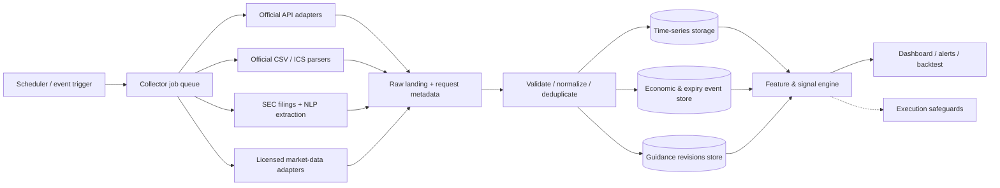

# Auto-Axe 외부 지표 수집기 설계

> 기준 2026-11-22 KST. 본 문서는 **구현 가이드**이며 실제 파이프라인 배포/자동화 또는 각 API의 전수 실호출을 의미하지 않는다. 데이터 공급원·정확한 키는 [Indicator_Data_Sources.md](./Indicator_Data_Sources.md) 참조.

## 1. 설계 목표와 범위

- **수집**: ① 가격·시계열(금, 유가, VIX, 국채, BTC, 정책금리, 공탐) ② 이벤트 일정(CPI/PCE/NFP/FOMC, 파생 만기) ③ 정형화할 기업 가이던스 ④ 참고용 피자지수.
- **가용성**: 공식 소스 장애가 주문·기존 시세 수집 경로에 전파되지 않도록 비동기 배치와 큐 중심의 별도 서브시스템 구성.
- **일관성**: 데이터 시간, 수집 시간, 최초 공개 시간, 수정 시간, 원본 출처, 라이선스·품질을 원자료와 함께 관리.
- **백테스트**: *그 당시 시장에 공개된 데이터*만 알고 있었던 것처럼 재현 가능해야 한다. 월별/일별/실시간 시계열을 하나로 혼합하여 허위 초과수익을 만들지 않는다.

## 2. 권장 아키텍처



**피자지수/CNN 비공식 데이터**는 계약·권리 심사 전 운영 파이프라인과 연결하지 않고 dashboard의 별도 experimental 소스 목록으로만 유지한다. 나무 OpenAPI 주문 기능과 외부 수집기 간 장애·권한 경계를 분리한다.

## 3. 어댑터 인터페이스 및 공급원 설정

공급원별 책임을 다음처럼 통일한다.

```python
from typing import Protocol, Iterable

class Collector(Protocol):
    def fetch(self, start_utc, end_utc) -> Iterable[dict]: ...
    def normalize(self, raw: dict) -> Iterable[dict]: ...
    def healthcheck(self) -> dict: ...
```

- `provider_id`: e.g. `eia`, `fred`, `cboe`, `treasury`, `bls`, `sec`, `ecb`, `boj`, `boe`, `coinbase`.
- `dataset_id`: 공급자 원본 시리즈 식별자 `DGS10`, `PET.RWTC.D` 등.
- `transport`: REST JSON, CSV, ICS, 공식 웹페이지, 라이선스 API.
- `auth`: API key/계약 토큰/무인증 (비밀은 환경변수·secret store, Git 커밋 금지).
- `market_calendar`: NYSE, US federal, UK, Eurozone, JP, 24x7, custom.
- `source_timezone`: America/New_York, Europe/London, Europe/Frankfurt, Asia/Tokyo, UTC.
- `schedule`: source별 cron/TTL/백필 범위. 실제 공개가 완료되지 않은 미래 시점은 `pending`으로 유지.
- `legal_status`: `approved|review_required|display_only|blocked` 및 계약 증빙/갱신기한.

### 1차 우선순위

| 단계 | 데이터 | 기본 폴링 제안 | 검증 |
|---|---|---|---|
| P0 | Treasury/FRED 일별·EIA 현물·Cboe VIX | 미국 거래일 EOD 후 1~3회 지연 재시도 | 장마감/발행기관 게시 후만 확정 |
| P0 | Coinbase/Binance BTC | 1~5분 봉 마감 후 또는 필요 시 1분 | 누락 캔들·거래소 상태 확인 |
| P0 | BLS ICS / FOMC / BEA / ECB 결정 일정 | 매일 1회 + 중요 이벤트 전 재확인 | 일정 변경·취소 탐지 |
| P0 | Fed/BOJ/BoE/ECB 금리 | 일 1회 + 정책 결정일 집중 수집 | 목표치와 실효치 분리 |
| P1 | OCC/Cboe/CME 만기 달력 | 매주, 월초 및 휴장 공지 시 | 계약별 최종거래·결제일 검증 |
| P1 | SEC filing/guidance | 영업일 5~30분(공정이용/지연 고려) | 원문 공시 버전 및 텍스트 추출 |
| P1 | 금 제3자 spot | 상용 약관·허용 빈도에 따라 1~5분 | 합성가격/벤치마크 구분 |
| P2 | 월간 Dubai/Gold Pink Sheet | 월 1회 + 공개 후 재수집 | 빈도·게시 지연·수정 추적 |
| 실험 | CNN / Pizza | 공식 계약 전 자동 수집 보류 | 수집 권리·재현성 심사 |

위 주기는 **Auto-Axe의 제안값**이지 공급자가 보장하는 업데이트 간격이 아니다. API별 실제 `Retry-After`, 사용량 제한 및 갱신 시각 측정 후 조정한다.

## 4. 저장 모델

### 공통 시계열 `market_observations`

```sql
CREATE TABLE market_observations (
    provider TEXT NOT NULL,
    series_id TEXT NOT NULL,
    instrument TEXT NOT NULL,
    observation_at TIMESTAMPTZ NOT NULL,
    published_at TIMESTAMPTZ,
    ingested_at TIMESTAMPTZ NOT NULL DEFAULT now(),
    revision_id TEXT NOT NULL DEFAULT 'initial',
    value NUMERIC(28, 10),
    unit TEXT NOT NULL,
    frequency TEXT NOT NULL,
    price_type TEXT,
    market_timezone TEXT,
    source_url TEXT NOT NULL,
    quality_status TEXT NOT NULL,
    raw_sha256 TEXT NOT NULL,
    PRIMARY KEY (provider, series_id, observation_at, revision_id)
);
```

`published_at` 값이 확인되지 않는 경우 임의로 `observation_at`이나 `ingested_at`을 넣지 말고 NULL과 불명확 플래그를 사용한다. 개장 시각에 아직 공개되지 않은 EOD 시계열을 미리 참조해서는 안 된다. 수정 공표 가능성 있는 거시지표는 `revision_id`/vintage 및 `first_seen_at`을 사용해 버전별 저장한다.

### 이벤트 `calendar_events`

```text
provider, external_uid, event_type, country_or_market, title,
scheduled_at_utc, scheduled_timezone, status(SCHEDULED/RESCHEDULED/CANCELLED/RELEASED),
published_at, last_seen_at, event_version, official_url,
instrument_or_contract, last_trade_at, settlement_at, actual_value,
forecast_value, previous_value, unit, revision_id
```

- 일정 원본의 `UID`가 없으면 `provider+event_type+period+contract`의 안정적인 키 사용.
- 발표일정(예정 데이터)과 통계값(결과 데이터)은 테이블/이벤트 타입으로 분리. 결측 `forecast_value`는 0이 아니다.
- 파생상품은 매 거래소·상품 고유 `last_trade_at`, `expiration_at`, `settlement_at`, `exercise_style`, `AM_PM`, `holiday_override` 기록.

### 가이던스 `corporate_guidance`

```text
ticker, cik, accession_number, filing_type, filed_at, accepted_at,
first_seen_at, source_url, source_excerpt, fiscal_year, fiscal_quarter,
metric(revenue/EPS/margin/capex/etc.), accounting_basis(GAAP/adjusted),
currency, unit, range_low, range_high, point_estimate,
guidance_kind(issued/reaffirmed/raised/lowered/withdrawn),
extractor_version, review_status, supersedes_id
```

- 기업의 가이던스(issuer guidance)와 벤더의 애널리스트 컨센서스(sell-side estimate)는 **물리적 테이블과 라이선스까지 분리**.
- 법인식별코드 CIK 10자리 패딩; 액세션·발표시각·원문 링크로 재현 가능하도록 함.
- 회계연도 시작/마감, FY/Q, diluted EPS/adjusted EPS, 통화, 범위를 정규화하되 원문은 유지.

## 5. UTC 정규화와 데이터 품질

1. **세 가지 시간축**: `observation_at` (값이 가리키는 시각/거래일), `published_at` (시장에 첫 공개된 시각), `ingested_at` (서버가 획득한 시각). `first_seen_at`은 공개시각 불명확 시 보수적 대용.
2. **Timezone**: 내부 저장 UTC TIMESTAMPTZ, 사용자 표시 `Asia/Seoul`; 원래의 `America/New_York` 등 IANA 시간대를 소스에 보존하여 DST 계산. 미국 CPI 08:30 ET를 연중 고정 UTC로 변환하지 않는다.
3. **캘린더**: 미국 주식 휴장·옵션·선물 결제 캘린더, JP/UK/Eurozone 은행 영업일, 가상자산 24×7 별도. 2026-06-19 Juneteenth는 만기 예외 사례.
4. **주기**: 월별 Dubai를 일별 금리/유가와 결합할 때 실제 **공개시점 이후**의 마지막 값만 사용. `event_time`와 `valid_from`을 별도로 사용하고 사전 공표된 것처럼 백필 금지.
5. **단위**: 국채/정책금리는 % (예: 4.50), 금 USD/tr.oz, 유가 USD/bbl, VIX 지수/연율변동성 %, BTC USD/USDT, 각 시리즈에 scale 명시. 수익률 bps 변경과 퍼센트포인트 변경도 구분.
6. **품질 상태**: `provisional`, `verified`, `revised`, `missing`, `stale`, `disputed`. 허용 기간 넘어 업데이트 없는 값은 stale으로 표시.
7. **조회 출처**: raw HTTP status, request URL(토큰 제거), 응답 해시, 수집 버전, 라이선스 레코드 보존. 숫자만 저장하면 데이터 정정 근거가 사라진다.

## 6. 리트라이·백필·계약 안전장치

- `429`, `502/503/504`, timeout: exponential backoff + jitter + 공급자 `Retry-After` 존중. 403 또는 계약상 차단을 프록시·UA 회전으로 우회하지 말 것.
- idempotency key: `provider|series|observation_at|revision_id` 또는 `event_source|uid|version`; 같은 raw 버전 재수집 시 중복 제거.
- 체크포인트: `cursor`, `last_success_at`, `last_published_at`, `etag`, `last_modified`; 이벤트 캘린더는 미래 6~12개월 rolling window 재확인.
- 백필 검증: 공개일·수정일 없는 과거 시계열은 `historical_only` 취급하고 PIT 백테스트 경고.
- 자격증명: EIA/FRED/API keys는 `.env` 또는 클라우드 Secret Manager; 소스 로그, HTTP URL에 키가 그대로 남지 않게 마스킹.
- 사용권: data ingestion, caching, derivative works, commercial redistribution, UI rendering, historical storage를 별개 체크. **Yahoo/CNN/Google Maps의 화면 표시 자체는 수집 권리 보장이 아니다.**
- 신뢰성: 알람은 `last_success`, source lag, 결측률, 429율, 값 이상치, cron drift, 이벤트 변경에 걸고 실패 시 최신 공개일·stale 시점을 UI에 표시.

## 7. 지표별 보강 피처 (권장)

| 원천 | 가공 피처 | 모형 사용시 유의 |
|---|---|---|
| DGS10, DGS2 | 10Y-2Y 커브차, 5거래일 수익률 변화(bp) | 발표일·시차·휴장 처리 |
| DFEDTARL/U, ECB DFR | 정책금리 변경 이벤트와 서프라이즈 | 결정 이전 예상 컨센서스 별도 공급원 |
| EIA Brent/WTI | Brent-WTI spread, 1개월/3개월 변화 | 일별 현물 동일 날짜에만 계산 |
| IMF Dubai | 월간 Dubai-Brent 평균 차이 | 일별/월별 혼합 금지 |
| Cboe VIX | level, 5일 변화, term structure(추가 공급 필요) | VIX 자체와 VX 선물 차이 |
| BTC | 24h 수익률·변동성·거래량 | 주말/주식 휴장 별도 계산 |
| SEC 가이던스 | 상향/하향, 신규/철회, guidance vs estimates | 최초 공개와 실제 거래가능 시간을 보수적으로 |
| 경제 캘린더 | 발표까지 남은 시간, 발표 후 위험 완화 | 실제 발표/지연/취소 확인 |
| 만기일 | DTE, 만기 주간/월말, 상품 결제 위험 | 상품·휴장일·AM/PM 정산 반영 |
| CNN/Pizza | 실험 대시보드 관찰 | 계약/통계 검증 전 자동 매매 입력 배제 |

## 8. 개발 티켓과 검증 단계

### Milestone 1 — 공식 피드 MVP
- EIA `PET.RWTC.D`, `PET.RBRTE.D`; FRED `DGS2/DGS10/DFEDTARL/DFEDTARU/DFF`; Cboe VIX CSV; BTC 공개 거래소 캔들.
- BLS ICS + FOMC 예정 캘린더 및 ECB DFR + BoE IUDBEDR + BOJ 실효 콜금리 데이터.
- 첫 샘플 수집 시 HTTP 응답·원본 필드·발표 시각·빈값 처리·약관 검토 로그 남김.

### Milestone 2 — 이벤트 통합 및 수정 이력
- BEA/Census, OCC/Cboe/CME 만기 및 JP/UK/ECB 정책회의.
- 수집 후 이벤트 스케줄 변경 감지 및 정정 이력, 거래소별 holiday override.
- Gold API spot / World Bank Gold, Dubai 월간 시리즈: 갱신일 측정 후 전개.

### Milestone 3 — 비정형 고급 지표
- SEC EDGAR 8-K 첨부 자료 구문 분석과 인간 검수, issuer guidance PIT 저장.
- 컨센서스·실시간 금/VIX·Dubai 일별 벤더 계약 검토.
- CNN/피자지수는 **데이터 권리·안정성·역사 재현성 승인 이후** 별도 모듈 여부 결정.

### 릴리즈 수용 기준
- 공급자마다 10개 이상 샘플 및 휴장·수정·빈응답·429 회복 테스트.
- 누락·중복 없는 멱등 증분 수집, 운영 로그에 비밀키 비노출.
- 표준 스키마의 시간대와 빈도가 일관되며 **미래값 참조 방지 PIT 쿼리** 통과.
- UI에서 단위/출처/최종 공개시각/지연시간/검증상태 표시.
- 가격 수집기 장애가 주문 동작에 영향을 주지 않는 독립성 검증.

## 9. 공식 문서

- [EIA API](https://www.eia.gov/opendata/documentation.php) · [FRED API](https://fred.stlouisfed.org/docs/api/fred/) · [Treasury yield curve](https://home.treasury.gov/policy-issues/financing-the-government/interest-rate-statistics)
- [Cboe VIX historical](https://www.cboe.com/tradable_products/vix/vix_historical_data) · [SEC EDGAR](https://www.sec.gov/search-filings/edgar-application-programming-interfaces)
- [ECB SDMX](https://data.ecb.europa.eu/help/api/data) · [BOJ API manual](https://www.stat-search.boj.or.jp/info/api_manual_en.pdf) · [BoE database](https://www.bankofengland.co.uk/boeapps/database/Bank-Rate.asp)
- [BLS schedule](https://www.bls.gov/schedule/news_release/) · [FOMC schedules](https://www.federalreserve.gov/monetarypolicy/fomccalendars.htm) · [OCC/OIC expiry](https://www.optionseducation.org/referencelibrary/expiration-calendar)
- [Coinbase Exchange candles](https://docs.cdp.coinbase.com/exchange/reference/exchangerestapi_getproductcandles) · [Binance Spot REST](https://developers.binance.com/en/docs/products/spot/rest-api)
