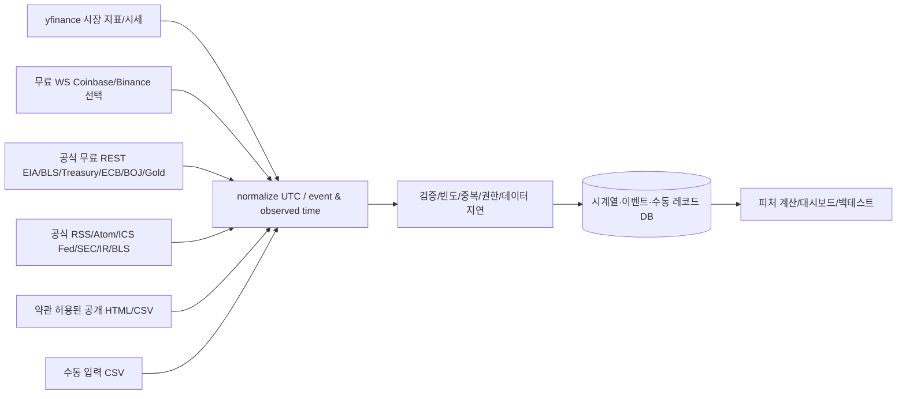

# Auto-Axe 무료 수집기 설계 및 운영 표준

> **시장가격 및 금리지표는 yfinance 우선 → 나머지는 무료 API/WS → 허용된 RSS/HTML → 수동 기록**. 이전의 데이터 구독/거래소 유료 피드 관련 설계·계약·어댑터는 폐기한다. 기준일: 2026-11-22.

## 1. 모듈 구성



- 수집기의 `provider`, `collection_method=API|WEBSOCKET|SCRAPE|MANUAL`, `source_url`, `frequency`, `cost=0`, `terms_check_at`, `quality_status` 고정 기록.
- 무료 공개 브라우저 시세가 해당 서비스에서 **자동 수집·보관 허가**된다는 가정을 하지 않는다. CNN, Google Maps Popular Times, Cboe Quote Dashboard, TradingView/Yahoo 내부 시세 역공학은 승인 소스로 자동 등록하지 않음.
- VIX·3M/5Y/10Y/30Y 금리지표·WTI/Brent/금 선물·BTC/USD 시장 요약 시세는 **yfinance가 기본**. 국채 **2Y**는 무료 Treasury XML 일별; 금 **현물**은 Gold API. EIA 유가 현물과 Cboe VIX EOD 및 Treasury 전체 공식 곡선은 보조 검증용. **정확한 지연과 빈도**를 표시.
- API 장애 → 동일 정의의 허용된 무료 데이터가 있을 때만 fallback → 정책 허용 스크래핑 → **수동**. 같은 자산이라도 선물과 현물처럼 `instrument_type`이 다르면 서로 fallback으로 섞지 않는다.

## 2. 저장 스키마

```sql
CREATE TABLE indicator_observations (
    id BIGINT GENERATED ALWAYS AS IDENTITY PRIMARY KEY,
    provider TEXT NOT NULL,
    series_id TEXT NOT NULL,
    method TEXT NOT NULL CHECK (method IN ('api','websocket','scrape','manual')),
    instrument_type TEXT NOT NULL,
    value NUMERIC(30,12),
    unit TEXT,
    quote_currency TEXT,
    venue TEXT,
    contract_code TEXT,
    period_label TEXT,
    observation_at TIMESTAMPTZ,
    published_at TIMESTAMPTZ,
    first_seen_at TIMESTAMPTZ NOT NULL,
    received_at TIMESTAMPTZ NOT NULL,
    revision_id TEXT,
    reported_delay_minutes INT,
    status TEXT NOT NULL,
    source_url TEXT NOT NULL,
    raw_sha256 TEXT,
    attribution TEXT,
    note TEXT
);
CREATE INDEX indicator_by_series_event
ON indicator_observations(series_id, observation_at, first_seen_at);
```

`observation_at`이 공개되지 않은 경우 NULL. 자동화에 쓸 수 있는 시점은 첫 공개/실제 수집 시점 중 늦은 보수적 기준. `received_at`을 `observation_at`으로 대입해 백테스트 미래값 누출하지 않는다.

공시 가이던스는 별도 `corporate_guidance` 테이블: `cik/ticker`, `accession`, `filing_url`, `fiscal_year/quarter`, `metric`, `gaap_or_adjusted`, `low/high`, `first_seen_at`, `review_status`. 추출기가 문맥을 확정하지 못하면 `manual_review_required`.

발표/만기는 `event_calendar`에 `scheduled_at`, `released_at`, `first_seen_at`, `actual/forecast/previous`, `expiration_at`, `last_trade_at`, `processing_at`, `settlement_at`, `is_holiday_override`, `source_url`를 따로 기록. 명목 만기일과 처리일은 달라도 된다.

## 3. 무료 수집 스케줄 (제안, 게시기관 보장 주기가 아님)

| 어댑터 | 권장 실행 | 변동 시 |
|---|---|---|
| yfinance 시세·지수 | 요청/표시 주기에 맞춰 1~5분(제안) 최신봉 조회 | Yahoo 수신 시점/장시간/지연·약관 확인 |
| Treasury 공식 국채 2년물 + 5종 교차검증 | 게시 후 일 1회 | 파 수익률 공식값과 Yahoo 지수 비교 |
| Coinbase/Binance WS (선택) | 상시 스트리밍 | heartbeat/sequence gap 확인 → 백오프 후 재연결; 허용 REST 백필 |
| Gold API | 30~60초 폴링 | `updatedAt` 변경 시만 저장 |
| SEC 신규 8-K/기업 IR RSS | 평시 60~120초 (정책 허용 범위) | 링크 신규→공시 첨부 파싱·검수 |
| BLS ICS/BEA/Fed 일정 | 일 1~4회, 발표 전 추가 확인 | 변경된 이벤트 UID 버전 저장 |
| BLS/BEA 실제 발표 | 평소 공식 발표 주기에 맞춰; 발표 예정 전후 단기 집중 | 무료 API 호출량 제한·429 준수 |
| Treasury/EIA/Cboe | 게시 완료 후 일별 | 늦은 수정/빈값 탐지 |
| Fed/BOJ/ECB RSS, BoE 결정 | 평시 수분~시간 간격, 발표 시 집중 | headline → 결정문 본문 → 수치/발효일 검증 |
| OCC/CME 만기/휴장 | 주간, 긴급 변경 공지 | 계약별 명목 만기·처리일 변경 검증 |
| CNN/Pizza/권한 미확인 시세 및 2Y 일중 | 자동 수집 불가 시 수동 | Yahoo 지연·권리 문제 또는 공식 2Y 미게시 시 수동 기록 |

구독이 없는 정적 원본을 매초 호출하지 않는다. 공식 무료 API의 권리·요금·호출량과 문서화를 주기적으로 재검토한다.

## 4. 무료 스크래핑 어댑터

1. **공식 기계 판독 링크가 있으면 먼저 사용**: SEC Atom, 회사 IR RSS, 연준/ECB/BOJ RSS, BLS ICS, Treasury XML, Cboe EOD CSV.
2. HTML 외에는 없는 공공발표/회사 IR 페이지에서 사이트 이용약관·robots 등 허용 여부 확인 후 `requests + BeautifulSoup`, `ETag/If-Modified-Since`, 429 backoff, 셀렉터 테스트 적용.
3. 페이지에서 기준시각이 빠진 경우 임의 추정하지 않고 `source_time_unknown`/수동 검수.
4. robots가 허용해도 이용약관·콘텐츠 재사용 권리가 금지하면 수집 중단. CAPTCHA/403 로그인·유료벽을 우회하지 않는다.
5. HTML DOM 변경으로 선택자가 0개를 반환하면 **성공 처리 금지**, `manual_required` 로 남겨 원문을 확인.
6. 원문 링크·시각·해시를 남기고 SEC는 식별 UA·10req/s 이하, BLS 무료 일일 호출량 준수.

## 5. 장애·정정·시간대

- `429`은 Retry-After, `5xx` 지수 백오프. 인증/403 차단은 회피하지 않고 수동 경로로 전환.
- WS 재연결 후 갭 범위 REST 재요청, 거래 시퀀스/타임스탬프 중복 제거.
- `UTC` 저장, `America/New_York` (EST/EDT), `Europe/London`, `Asia/Tokyo`, `Asia/Seoul` 렌더링. 주요 정책 발표시간 고정 UTC 오인 금지.
- first-release 값과 revised 값 분리해 point-in-time 백테스트 수행; 전망치와 결과값, 월평균과 일별, 원상품과 파생상품 가격을 섞지 않는다.
- API에서 값이 비어있거나 지연되면 `missing|stale`로 명시하고 자동 주문에 연결할 때 `stale` 방지 규칙을 먼저 구현.

## 6. 실행 경로

- [무료 지표 전수 명세](./Free_Data_Collection.md)
- [무료 실행 가이드](./Realtime_Quickstart.md)
- [수동 입력 정책·CSV](./Manual_Collection.md)
- [Python 수집기](./examples/realtime_collector.py), [환경변수](./examples/.env.example)


## 미국 국채 만기 구성

| 만기 | 우선 소스 | 보조 공식 일별 |
|---|---|---|
| 3개월 | yfinance `^IRX` | Treasury `BC_3MONTH` |
| 2년 | **Treasury `BC_2YEAR`** | 동일 원본, Yahoo 2년 현물 티커 미검증 |
| 5년 | yfinance `^FVX` | Treasury `BC_5YEAR` |
| 10년 | yfinance `^TNX` | Treasury `BC_10YEAR` |
| 30년 | yfinance `^TYX` | Treasury `BC_30YEAR` |

[최신 기본 수집 명세](./YFinance_First_Collection.md). 국채 금리선물과 현물 수익률을 같은 컬럼에 기록하지 말 것.
