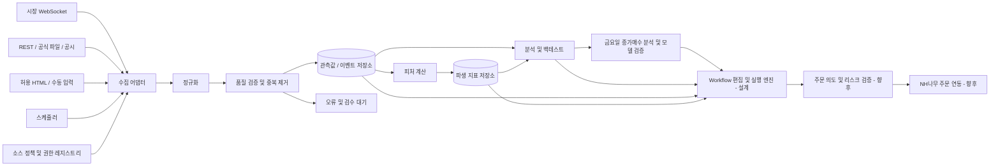
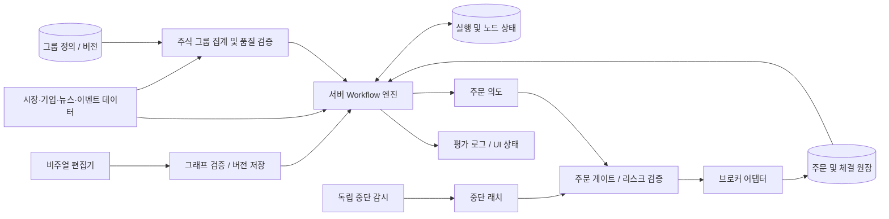
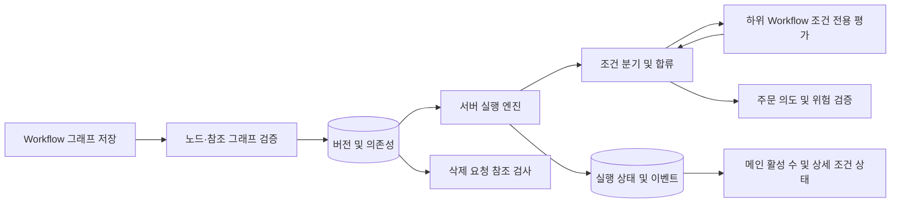
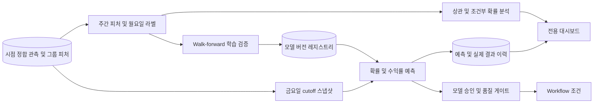

# Auto-Axe 시스템 설계 명세서

> 기준일: 2026-11-24 · 설계 초안. 기존 지표 수집 명세를 통합한 목표 아키텍처이며 운영 시스템 구현 완료를 의미하지 않는다.

## 1. 목적 및 범위

Auto-Axe는 NH나무 OpenAPI 기반 알고리즘·패턴 매매 퀀트 시스템을 목표로 한다. 현재 저장소에서 확인되는 구현 범위는 무료 시장 데이터 수집 및 검증용 Python 예제다. 본 설계는 수집, 정규화, 저장, 피처 산출, 분석 및 향후 매매 연동의 경계를 정의한다. 노드 기반 Workflow의 전체 승인 기능, 사용자 정의 주식 그룹 집계·트리거 및 금요일 종가매수 확률 예측 시스템을 정의한다. 세부 주문 API, 전략 템플릿, 배포 인프라, DB 제품, UI 기술은 아직 확정하지 않는다.

- [기능 명세](../function/specification.md)
- [금요일 종가매수 분석·예측 명세](../function/friday-close-strategy.md)
- [프론트엔드 디자인 명세 (Live3x 레퍼런스)](./frontend.md)
- [무료 데이터 수집 정책](../indicator-collection/Free_Data_Collection.md)
- [수집기 설계 원문](../indicator-collection/Collector_Design.md)

## 2. 논리 아키텍처

| 계층 | 책임 |
|---|---|
| 소스 레지스트리 | provider, series_id, 상품 정의, 수집 방식, 주기, 권한 및 활성화 상태 |
| 수집 어댑터 | WS 구독, REST 조회, 공식 문서 파싱, 승인형 HTML 추출, 수동 입력 |
| 스케줄러 | 스트림 수명 관리, 주기 실행, 발표 예정 시각 기반 실행, 1Hz 로컬 샘플링 |
| 정규화·검증 | 단위·통화·시간대·상품 유형, 필수 필드, 순서·중복·결측·지연 검사 |
| 저장소 | 원본 관측, 이벤트, 정정 이력, 재무 스냅샷, 파생 피처 |
| 피처 엔진 | 이동평균, 고저가, 위칭 플래그·DTE 등 재현 가능한 로컬 계산 |
| 분석 | 시계열 조회, 대시보드 및 point-in-time 백테스트 목표 |
| 그룹 집계 | 주식 그룹 버전·구성·가중치, 동일 as-of 수익률 및 시장폭, coverage 검증 |
| 금요일 예측 | 주간 피처·라벨, 시간순 모델 학습·검증·버전, 확률 및 수익률 예측, 승인 게이트 |
| Workflow 엔진 | 노드 및 참조 그래프 검증, 조건 분기·합류, 하위 Workflow 조건 평가, 상태 보존, 독립 중단 감시, 주문 의도 생성 |
| Workflow 상태·의존성 관리 | 버전 참조 무결성 및 삭제 제약, 활성 최상위 Workflow 집계, 실행/조건 스냅샷 및 상태 이벤트 |
| 매매 연동 | 향후 브로커 어댑터; 데이터 품질·리스크 검증을 통과한 주문 의도만 전달 |

## 3. 수집 파이프라인

1. 소스 레지스트리에서 활성화 여부, 비용 0, 권한, 호출 제한 및 상품 정의를 확인한다.
2. 이벤트 기반 WS 또는 주기 기반 API·공식 파일을 우선 사용한다. 허용된 경우에만 HTML 파싱을 실행한다.
3. 원본 응답의 필드·시간·단위를 정규화한다. 원본 보관은 허용 범위에 한정한다.
4. 스키마 오류, 결측, 역순, 중복, 세션 변경, 지연 및 정정을 검증한다.
5. 유효 관측값과 상태를 적재한다. 오류는 검수 대기 또는 결측 상태로 기록한다.
6. 확정봉·새 발표·새 관측 등 피처별 트리거에 따라 파생 지표를 계산한다.
7. 분석 소비자는 값뿐 아니라 원본 시각, 품질, 권한 상태를 함께 조회한다.

### 3.1 스트림

Binance Spot BTCUSDT 및 TradFi Futures 5종은 독립 상품으로 구독한다. 선물 WS는 현재 검증 문서의 `wss://fstream.binance.com/market/stream?streams=...` 경로를 사용한다. 재연결, ping/pong, 누락 구간 및 중복 처리를 구현 대상으로 둔다.

미국 주식·ETF는 yfinance AsyncWebSocket 수신 캐시와 1Hz 샘플러를 분리한다. 샘플러는 monotonic clock 기반으로 동작하며 새 메시지가 없으면 기존 원본 시각을 유지한다. 누적량 감소·거래일 변경은 리셋 검증 대상으로 처리한다. 공급자의 1초 전송이나 무지연을 보장하지 않는다.

### 3.2 스케줄링

| 작업 | 권장 주기 |
|---|---|
| Binance 시세 | 체결 이벤트 |
| Binance 롱숏·Taker 통계 | 5분 집계, 기본 300초 조회 |
| yfinance VIX·국채 | 1~5분 최신봉 |
| 미국 주식 누적 거래량 | WS 이벤트 + 로컬 1초 |
| PER·PBR | 일별 |
| ROE | 실적 발표 후 |
| SMA·EMA·고저가 | 해당 봉 확정 후 |
| Treasury·EIA·Cboe 일별 | 게시 완료 후 |
| SEC/IR 공시 | 허용 범위 내 60~120초 |
| 경제 발표 일정 | 일 1~4회 및 발표 전 확인 |
| 실제 발표·정책 결정 | 예정 시각 전후 집중, 호출 제한 준수 |
| 만기·위칭 | 주간 및 변경 공지, 해당 주 일별 확인 |
| DRAM 모듈 | 일 1회 점검, 주간 원본 갱신만 적재 |
| SEIBro·CNN·PizzINT·네이버 | 권한에 따른 수동 또는 승인형 수집 |

주기는 프로젝트 제안이며 공급자의 갱신 보장이 아니다. [상세 정책](../indicator-collection/Free_Data_Collection.md).

## 4. 데이터 모델

논리 스키마이며 특정 DB 엔진 확정이 아니다. 기존 SQL 예시는 [Collector_Design.md](../indicator-collection/Collector_Design.md)를 참조한다.

| 엔터티 | 주요 필드 |
|---|---|
| source_registry | provider, series_id, instrument_type, method, source_url, frequency, cost, terms_check_at, permission_status |
| indicator_observations | provider, series_id, symbol/contract_code, value, unit, quote_currency, venue, period_label, observation_at, published_at, first_seen_at, received_at, revision_id, status, source_url |
| stock_volume_samples | symbol, day_volume, source_event_at, last_received_at_utc, sampled_at_utc, source_age_sec, receive_age_sec, data_status, market_hours |
| corporate_guidance | cik/ticker, accession, filing_url, fiscal_year/quarter, metric, gaap_or_adjusted, low/high, first_seen_at, review_status |
| fundamental_snapshots | symbol, metric, value, unit, fetched_at_utc, financial_period_end, published_at_utc, earnings_basis |
| event_calendar | scheduled_at, released_at, first_seen_at, actual/forecast/previous, expiry_date, last_trade_at, processing_at, settlement_at, source_url |
| witching_events | event_type, candidate_date, effective_session_date, family_status, contract_refs, verified_at_utc, revision |
| technical_indicators | symbol, interval, indicator, window, value, close_basis, bar_closed_at_utc, calculated_at_utc, is_final_bar, warmup_complete |
| collection_runs | adapter, started_at, finished_at, result_status, error_type, record_count (제안) |

### 4.1 식별 및 정정

- 원본 상품과 공급자별 시계열을 분리한다. 현물/영구선물/만기선물, USD/USDT, 정규장/시간외를 혼합하지 않는다.
- 관측값은 공급자·시계열·원본 관측시각·계약/종목·집계기간을 고려한 복합 식별자를 사용한다. 정정은 revision으로 보존한다.
- 1Hz 거래량 샘플은 종목과 샘플 시각으로 식별한다. DRAM은 provider + series_id + source_updated_at을 기본 키로 한다.
- 원본 시각 미확인 시 null을 유지한다. 수신 시각으로 대체하지 않는다.

### 4.2 시간 및 백테스트

UTC 저장, 미국 동부시간 DST 및 거래소 세션 달력 적용, DRAM GMT+8 원본 시각 보존. 최초 공개와 실제 수집 시각 중 늦은 보수적 시점 이후에만 피처를 사용할 수 있게 한다. 수정값, 현재 재무 스냅샷, 미확정봉을 과거에 소급 적용하지 않는다.

## 5. 장애 대응 및 보안

- 429는 Retry-After, 5xx는 지수 백오프, 403·CAPTCHA·권한 실패는 우회 없이 중단한다.
- 동일 정의의 허용된 무료 소스만 failover 대상으로 사용한다. 다른 상품은 별도 참고 시계열이다.
- WS 연결 종료는 disconnected, 신규 데이터 없음은 no_update/stale, 최초 미수신은 no_data로 구분한다.
- HTML 구조 변경·필수 필드 누락은 성공 처리하지 않는다. 수동 검수 및 결측으로 전환한다.
- API 키는 환경변수 등 비밀 관리 경로를 사용하고 로그·저장소에 노출하지 않는다.
- 권한 미확인 데이터의 자동 적재·재배포·자동매매 사용은 활성화하지 않는다. 피자지수는 자동 주문 신호로 사용하지 않는다.
- 주문 계층은 오래된 데이터 차단, 중복 주문 방지, 리스크 한도, 비상 정지 및 모의 검증을 확정 기능으로 구현한다. 세부 한도·API 계약은 별도 검증한다. 현재 주문 구현은 확인되지 않는다.

## 6. 매수·매도 Workflow 실행 아키텍처 (설계)

[매수·매도 Workflow 상세 명세](../function/trading-workflow.md). 사용자는 ComfyUI/n8n 스타일 캔버스에서 조건·트리거·논리·주문 노드를 연결한다.

- 순차 실행은 이전 단계의 충족 이력을 기억하고 다음 조건을 활성화한다. AND/OR은 동일 평가 시점의 입력을 결합하며 UNKNOWN을 구별한다.
- 가격 반전 트리거는 기준가·고점/저점·활성화 시각·만료를 영속화한다. 뉴스 감정 피드는 출처·모델·이용권을 별도 확정한다.
- 전체 중단 트리거는 실행 경로와 독립 감시하고 신규 주문 게이트에 우선 적용한다. 미체결 취소·보유량 청산은 별도 정책이다.
- 실행 버전은 불변으로 고정하며 브라우저 종료에 의존하지 않는다. 실행·노드 상태와 주문 의도·체결·평가 로그를 저장한다.
- 실주문 제출은 NH나무 어댑터를 통해서만 수행하도록 설계한다. 주문 종목 매핑, 리스크 검증, 중복 방지, 응답 유실 대사 및 모의 검증을 필수 구현 요구사항으로 둔다.
- [주식 그룹](../function/stock-groups.md)은 그룹 정의/버전/구성종목·가중치, 집계 스냅샷 및 상태형 조건을 영속화한다. 동일 as-of·세션·기준가격의 구성종목 수익률을 집계하고 coverage/신선도 검증 후 Workflow에 전달한다. 그룹 버전은 실행에 고정하며 신호와 주문 종목을 분리한다.
- 승인된 전체 P0~P2 기능(편집기, 제어 노드, 기술·거시·뉴스 트리거, 백테스트, 주문·위험 제어, 다중 전략, 알림·성과)을 개발 범위에 포함한다.
- 모의 실행·백테스트와 실거래 상태·자격증명을 분리한다. 구체 엔진·큐·DB·브로커 API 계약은 추가 확정 대상이다.

### 6.1 조건 분기·재사용·참조 무결성

- 서버는 TRUE/FALSE/UNKNOWN 분기, Switch, 명시적 Fork/Join을 지원한다. 선택 경로와 합류 상태를 실행별로 영속화하고 SKIPPED 경로를 실행하지 않는다. 전체 중단은 모든 분기와 하위 호출에 전파한다.
- WorkflowCondition은 다른 Workflow의 전체 불변 버전을 조건 전용 실행으로 참조한다. 명시적 ConditionResult만 전달하며 주문·취소·청산 부작용은 실행하지 않는다. 부모 실행/노드/활성화/호출 경로별 상태를 격리한다. 독립 실행 상태와 혼용하지 않는다.
- 저장·가져오기·버전 변경·배포에서 Workflow 간 순환 참조를 검사한다. 의존성 레지스트리와 서버 트랜잭션 제약으로 참조 중인 Workflow 삭제를 금지한다. 초안·비활성 저장본·배포본 및 활성 실행 고정 참조를 포함하며, 삭제 전에 참조 관계를 해제해야 한다. 감사 이력은 보존한다.
- 논리 엔터티: workflow_dependencies, workflow_condition_results, workflow_branch_states, workflow_status_snapshots; workflow_runs에 parent/root 실행 및 invocation_mode 필드 추가. 상세 스키마는 [Workflow 명세](../function/trading-workflow.md).

### 6.2 실행 상태 전달

서버의 실제 실행 상태로 메인 활성 Workflow 정의 수를 집계한다. 실행/감시/활성 대기 상태만 포함하고, 중복 실행은 정의 ID로 중복 제거한다. 하위 호출 및 과거 백테스트는 제외하고 LIVE/PAPER/DRY_RUN과 실행 인스턴스 수를 구분한다. 상세 조회는 선택된 run_id 기준으로 조건별 결과·충족 이력·경로·원본 시각·사유를 반환한다. 스냅샷 및 WS/SSE 상태 이벤트를 통해 갱신하고 이벤트 순서, 재접속, stale을 처리한다. 구체 전송 기술은 구현 시 확정한다.

## 7. 금요일 종가매수 분석·예측 아키텍처

[상세 기능 및 모델 명세](../function/friday-close-strategy.md).

- 최근 3년 기본 및 5/10년 비교. 한 주 한 표본, 3종 예측 라벨, 거래소 세션·시간대·휴장·조기 마감 반영.
- 데이터 시점과 라벨 공개 시점을 별도로 보존하며 모델 학습·전처리·선택·튜닝·보정은 미래 검증 구간으로 누수되지 않게 분리한다.
- L2 Logistic Regression 및 KNN을 우선하고 Bayesian Logistic, Random Forest, XGBoost, LightGBM을 기준 모델 대비 검증한다. 예측 수익률·하방 위험은 방향 확률과 별도 산출한다.
- 연구용 확정 일봉과 주문 전 cutoff 기반 실행 모델의 피처·데이터셋·모델·성과를 분리한다. 연구용 모델은 실주문 불가.
- 논리 저장소: friday_feature_sets, friday_weekly_samples, friday_model_versions, friday_validation_runs, friday_predictions, friday_similar_cases, friday_outcomes. 데이터·피처·모델 버전 및 입력 참조와 과거 예측을 보존한다.
- 주간 재학습, 금요일 추론, 월요일 결과 대사는 거래소 캘린더 기반 스케줄링. 검증된 버전만 배포하며 결측·불확실성·stale·미승인 시 주문 조건을 차단한다.
- 별도 화면에서 확률·주간 지표·과거 유사 사례·통계·모델 성과를 표시하고 승인된 실행 모델의 예측만 실주문 Workflow에 연결한다.

## 8. 구현 및 검증 단계

| 단계 | 범위 | 상태 |
|---|---|---|
| 1 | Binance 시세·롱숏, yfinance 일부 분봉, Treasury 수집 예제 | 기존 PoC 및 일부 실측 검증 |
| 2 | 소스 레지스트리, 스케줄러, 저장소, 품질 검증 통합 | 목표 설계 |
| 3 | 주식 1Hz 누적량, 재무·기술지표, Nasdaq 연동, DRAM·SEIBro, 위칭 | 상세 문서화; 운영 구현 및 필요한 실측·권한 확인 미완료 |
| 4 | 비주얼 Workflow 편집기·조건 엔진·모의 실행·분석/백테스트 | 전체 기능 및 그룹 집계 승인·문서화, 구현 미완료 |
| 4a | 금요일 종가매수 데이터셋·통계·모델·검증·전용 UI·Workflow 연동 | 승인 설계, 미구현; 별도 9개 Phase 명세 |
| 5 | NH나무 매매 연동 및 리스크·체결 대사 | 별도 API 검증 및 세부 요구사항 확정 필요 |

단위 테스트는 필드 파싱·정규화·피처 계산, 통합 테스트는 연결 종료·중복·정정·휴장·권한 실패를 포함한다. 실시간 후보는 실제 장중 수신 빈도와 지연을 측정한다. [실행 예제](../examples/realtime_collector.py) · [검증 가이드](../indicator-collection/Realtime_Quickstart.md).
