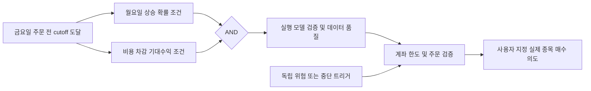

# 금요일 종가매수 (Friday Close Strategy) 기능 및 분석 시스템 명세

> 상태: 사용자 승인 설계 · 2026-11-24. 별도 전략 카테고리, 데이터 분석, 확률 예측, 전용 UI 및 Workflow 연동을 개발 범위로 확정한다. 데이터 수집·모델 학습·백테스트·실주문 구현 및 실측 성과는 아직 없다. 기술 스택·모델별 파라미터·매매 임계값은 검증 후 결정한다.

## 1. 목적과 범위

최근 3년간 월요일~금요일 나스닥 및 관련 시장 지표의 흐름과 다음 주 월요일의 가격 움직임 사이의 통계적 관계를 분석한다. 현재 주간 패턴을 입력으로 다음 월요일 상승 확률, 예상 수익률, 하방 위험, 과거 유사 패턴을 제공한다. 시장 데이터 화면과 독립된 **금요일 종가매수** 카테고리에서 분석하고, 승인된 예측 결과를 기존 매수·매도 Workflow의 조건으로 사용할 수 있게 한다.

- 기본 분석 기간: 최근 3년. 5년·10년 이상 비교 지원(실제 확보 가능 범위 내).
- 주 분석 시장: NASDAQ-100 지수 ^NDX. Nasdaq Composite ^IXIC, QQQ, QLD 및 기타 관련 지표를 보조 분석에 사용한다.
- 실제 거래 대상 ETF/주식의 예측 모델과 지수 방향 모델은 별도로 구분한다. 지수 자체를 주문 종목으로 사용하지 않는다. QLD의 기간 수익률을 QQQ 수익률의 단순 2배로 가정하지 않는다.
- 모든 수집은 기존 무료 데이터 정책 및 이용권을 따른다. 통계적 연관성은 인과관계 또는 수익률 보장이 아니다.
- 예측·연구·모의거래·실거래를 구분하며, 초기에는 연구와 모의 검증을 우선한다.

관련: [전체 기능 명세](./specification.md) · [시스템 설계](../design/specification.md) · [Workflow](./trading-workflow.md) · [주식 그룹](./stock-groups.md) · [무료 수집 정책](../indicator-collection/Free_Data_Collection.md).

## 2. 예측 목표 및 라벨

F는 해당 주의 금요일, M은 다음 달력 주 월요일(미국 거래소 현지 날짜). C_F, O_M, C_M은 동일 상품·통화·가격 조정 정책의 확정 금요일 종가, 월요일 시가, 월요일 종가다.

| target_id | 수익률(%) | 해석 |
|---|---|---|
| MONDAY_CLOSE | 100 × (C_M / C_F − 1) | 주 예측 목표: 금요일 종가 대비 다음 월요일 종가 |
| MONDAY_GAP | 100 × (O_M / C_F − 1) | 주말 갭 |
| MONDAY_INTRADAY | 100 × (C_M / O_M − 1) | 월요일 정규장 장중 등락 |

각 목표별 Y=1 if R>0, else 0으로 정의한다. 정확히 0인 경우 비상승(하락·보합)으로 분류하며, 하락과 보합을 따로 표시할 경우 별도 분류 모델로 관리한다. 세 목표를 독립적으로 학습·평가한다. R은 관측 수익률이며 실제 체결·비용 포함 수익률은 별도로 계산한다. 전체 수익률은 갭과 장중 수익률을 복리로 결합한 값이지 단순합이 아니다.

- 기본 거래일 정책: F와 M 모두 정규 거래 세션이 존재해야 한다. 금요일 또는 월요일 휴장 시 해당 표본을 제외한다. 월~목 중 휴장은 요일 위치 및 session_mask로 기록하고 보수적 초기 모델에서는 완전한 월~금 거래 주만 사용한다. 별도의 단축 주 모델은 충분한 데이터 확보 후 검증한다.
- 다음 거래일 예측은 별도 target_id 및 정책으로 관리한다. 목요일→화요일을 금요일→월요일 표본으로 이름만 바꿔 합치지 않는다.
- 미국 동부시간(America/New_York), DST, 조기 폐장 및 공식 거래소 캘린더를 적용한다.
- 기업행동 조정 정책을 일관되게 적용한다. 과거 시점에 알려지지 않은 수정·배당·분할 정보를 소급 사용하지 않으며 실제 체결 수익률과 배당 포함 총수익률은 구별한다.

## 3. 데이터 및 피처 카탈로그

### 3.1 가격·기술 지표

| 입력 | 후보 출처/계산 | 초기 우선도 |
|---|---|---|
| NASDAQ-100 | yfinance ^NDX | 매우 높음 |
| Nasdaq Composite | yfinance ^IXIC | 높음 |
| QQQ / QLD | yfinance QQQ / QLD | 매우 높음 / 높음 |
| Nasdaq 100 선물 | yfinance NQ=F | 높음, 실제 CME 선물 참고 시계열 |
| 월~금 각각의 수익률 | 일별 종가 / 직전 거래일 종가 − 1 | 매우 높음 |
| 주간 누적 수익률 | 금요일 / 전주 마지막 정규장 종가 − 1 | 매우 높음 |
| 주간 최고·최저가, 범위 | 유효 일봉 High/Low 및 기준가 정규화 | 높음 |
| SMA 5/10/20/60/120/200 | 확정 종가 rolling mean | 높음 |
| 이동평균 이격도 | 100 × (가격 / SMA − 1) | 높음 |
| RSI | OHLCV, 예: Wilder 14 (정의·초기화 버전 고정) | 높음 |
| MACD | EMA 차이 및 signal/histogram, 파라미터 설정 | 보통 |
| ATR | true range 및 smoothing, 예: ATR14/가격 | 높음 |
| 상대 거래량 RVOL | 동일 종목·동일 시간대 거래량 / 과거 기준 거래량 | 높음 |
| 연속 상승/하락일 | 확정 거래일 수익률 부호 및 길이 | 높음 |

지수 자체의 거래량은 제공되지 않거나 ETF 거래량과 의미가 다를 수 있다. RVOL은 실제 거래 종목(예: QQQ)의 유효 거래량으로 산출한다. ^NDX, ^IXIC, QQQ, QLD, NQ=F 및 MEXC NAS100_USDT/Binance QQQUSDT는 별개의 상품이다. 연동 영구선물이나 연속선물의 롤 효과를 실제 ETF 데이터와 혼합하지 않는다.

### 3.2 거시경제·관련 시장

| 입력 | 후보 출처/계산 | 초기 우선도 |
|---|---|---|
| VIX 수준·주간 변화율 | yfinance ^VIX, Cboe 참고 | 매우 높음 |
| 미국 국채 10Y | yfinance ^TNX / Treasury | 매우 높음 |
| 미국 국채 2Y | Treasury 공식 일별 | 높음 |
| 달러 인덱스 | yfinance DX-Y.NYB 후보 | 높음 |
| S&P 500 | yfinance ^GSPC | 높음 |
| 필라델피아 반도체지수 | yfinance ^SOX | 높음 |
| WTI / Brent | yfinance CL=F / BZ=F, 기존 Binance 상품 별도 | 보통 |
| 금 | yfinance GC=F 후보, 기존 XAUUSDT 별도 | 보통 |
| 비트코인 | Binance BTCUSDT 현물 | 보통 |
| 경제지표 일정·실제 발표 | 기존 공식 출처, actual/consensus 차이 | 높음 |
| 트리플·쿼드러플 위칭 | 기존 확정 계약 기반 캘린더 | 높음 |
| 다음 주 주요 경제 발표 예정 | 당시 공개된 경제 캘린더만 사용 | 높음 |

금리 변화는 bp 단위로 정규화한다. 금·원유의 역사적 선물 시세와 Binance USDT 영구선물은 별도 시계열이다. 다음 주 일정 피처에는 금요일 예측 시점까지 알려진 예정 정보만 사용하고 실제 발표값·변경 결과는 입력하지 않는다. 비트코인도 금요일 cutoff 이후 주말 수익률을 금요일 예측에 사용하지 않는다.

### 3.3 Auto-Axe 특화 피처

| 입력 | 활용 |
|---|---|
| 경기방어주·빅테크·반도체·금융주 그룹 수익률 | 업종 흐름 및 위험 선호도 |
| 그룹별 상승/하락/보합 비중, 평균 상승률/하락률, 시장폭 | 상승·하락의 확산과 강도 |
| 경기방어주와 기술주 상대수익률 | 그룹 간 상대 강도 |
| DDR5 UDIMM/RDIMM Session Average 변화 | 반도체 산업 주간 동향 |
| CNN 공포·탐욕 지수 | 시장 심리 |
| 뉴스 감정 | 종목/시장 관련성, 공개·분석 시각 및 신뢰도 |
| Binance 롱숏·Taker 비율 | 파생상품 시장 수급 |

[주식 그룹](./stock-groups.md) · [DRAM 가격](../indicator-collection/DRAMeXchange_Module_Spot_Prices.md) · [롱숏](../indicator-collection/Binance_Metals_LongShort_20261123.md) · [위칭](../indicator-collection/US_Equity_Witching_Calendar.md).

초기 모델은 과거 3년 이상 이력이 실제 확보되는 지표만 사용한다. 역사적 그룹 구성·가중치와 당시 종목 생존 여부를 반영한다. 데이터가 축적되지 않은 DRAM·뉴스·롱숏·심리 등의 피처를 소급 생성하거나 미래 값으로 보간하지 않는다. 권한 미확인 자료는 비활성화하고 PizzINT는 기존 정책대로 자동 주문 신호에서 제외한다. 위 후보의 심볼별 실제 가용성·역사적 범위·가격 단위 및 권한은 개발 시 검증하며 현재 확보 완료로 간주하지 않는다.

### 3.4 초기 피처 선택

3년 기준 주간 표본은 약 156개(휴장·결측 제외 전)뿐이다. 750여 개 일봉을 독립적인 금요일→월요일 라벨로 간주할 수 없다. 월~금의 상승/하락 조합만으로도 32개 패턴이므로 과도한 조합 및 세분화는 피한다. 초기 모델은 핵심 5~8개 피처로 제한한다. 예: 주간 수익률, 금요일 수익률, 주간 VIX 변화, 10Y 금리 변화, SMA20 이격, ATR 정규화, QQQ 상대 거래량 등. 실제 피처 선정 및 파라미터는 학습 구간 내부 검증으로 결정한다. 요일별 전체 피처를 제공하는 탐색 화면과 모델에 실제 투입되는 제한된 피처 세트를 구분한다.

## 4. 데이터셋 생성 및 시점 정합성

한 주당 하나의 표본을 만든다. 월~금 각각의 지표 변화와 주간 요약 피처를 저장하고 다음 월요일의 관측 결과를 학습 라벨로 연결한다.

| week_id | Mon return | Tue return | Wed return | Thu return | Fri return | VIX 주간 변화 | 다음 Mon 종가 수익률 |
|---|---:|---:|---:|---:|---:|---:|---:|
| W1 | +0.5% | −0.3% | +1.2% | −0.8% | +0.7% | −5.2% | +1.15% |
| W2 | −1.2% | −0.5% | +0.3% | +0.1% | −0.7% | +4.1% | −0.32% |
| W3 | +0.2% | +0.8% | +0.1% | +0.4% | +0.5% | −2.1% | +0.47% |

표의 값은 스키마 설명용 가상 데이터다.

- 키: instrument_id + week_end_session + target_id + cutoff_policy + feature_set_version.
- source_event_at, published_at, first_seen_at, received_at, revision, session_mask, missing_mask, quality_status와 입력 참조를 보존한다.
- 당시 실제 이용 가능한 관측만 as-of join. 출시되지 않은 상품·그룹, 미래의 수정치, 현재 재무비율을 과거로 소급하지 않는다.
- 워밍업에 필요한 200일 이상 데이터를 분석 시작일 이전부터 추가 확보한다. 워밍업은 평가 기간과 구분한다.
- 결측은 null/UNKNOWN. 필수 피처가 없으면 예측 보류, 선택 피처는 버전별 정책으로 처리한다. 대체/스케일링/분위수/선택/이상치 처리의 학습은 각 train fold 내부에서만 수행한다.
- 과거 자료의 정확한 공개 시각 또는 해당 시점 데이터 버전을 재구성할 수 없으면 해당 피처를 실거래 검증용 데이터에서 제외한다. 역사 다운로드 시각을 역사 발표 시각으로 가장하지 않는다.

## 5. 연구 모델과 실거래 모델 분리

| 구분 | RESEARCH_EOD | EXECUTION_PRE_CLOSE |
|---|---|---|
| 금요일 입력 | 확정 일봉 및 마감 이후 확인 자료(명시된 연구 cutoff까지) | 주문 제출 전 지정 cutoff까지 실제 이용 가능한 정보 |
| 목적 | 시장 패턴과 다음 월요일 결과의 관계 분석 | 금요일 마감 부근 실제 주문 의도 검증 |
| 목표 | 3종 라벨, 금요일 확정 종가 기준 가상 가격 변화 | 동일 방향 목표와 별도로 실제 가능한 진입가 기준 수익률 |
| 진입가 | 가상 비교 기준. 체결 가능성을 보장하지 않음 | 주문 제출 및 체결 시각·가격, 거래비용·슬리피지 |
| 이력 | 과거 일봉 3/5/10년 | 충분한 동일 cutoff 장중 데이터 필요 |
| 실행 | 실주문 연결 금지 | 검증·승인·리스크·브로커 요건 충족 시에만 가능 |

금요일 확정 종가로 계산한 RSI·SMA·가격을 입력한 뒤 동일 금요일 종가에 매수하는 백테스트는 금지한다. 실제 시장 마감 및 브로커 주문 마감 시각을 확인한 뒤 충분한 여유를 둔 cutoff를 설정한다. 조기 폐장·휴장·DST를 반영하며 특정 MOC/LOC 주문 지원을 가정하지 않는다. yfinance의 장중 이력에는 조회 기간 제한이 있으므로 무료 데이터만으로 3년간 동일 시각 분봉을 확보할 수 있다고 가정하지 않는다. 초기에는 RESEARCH_EOD 구축과 허용된 마감 전 데이터 축적을 병행한다. cutoff 또는 상품·세션이 바뀌면 재검증한다.

참고: [yfinance history API](https://ranaroussi.github.io/yfinance/reference/api/yfinance.Ticker.history.html). 실제 주문은 사용자 승인된 nhplug-sdk 기반 Trading Executor로 연동하며, 주문 조건은 NH나무 API 및 모의 환경 검증에서 확정한다. [NH 연동 명세](../mcp/nhplug-integration.md).

## 6. 통계 분석

| 기능 | 결과 |
|---|---|
| Pearson 상관 | 피처와 연속 월요일 수익률의 선형 관계 |
| Spearman 상관 | 순위 기반 단조 관계 |
| Mutual Information | 비선형 의존성 탐색 |
| 조건부 상승 확률 | 조건 충족 주의 상승 수 / 유효 표본 수 |
| 분위수/구간 분석 | 예: 금요일 수익률 5구간별 월요일 수익률·상승률 |
| Bootstrap | 통계량 및 모델 평가 불확실성; 시간 의존성 고려한 block bootstrap 우선 |
| 피처 간 상관 | 중복/공선성 진단 및 제한된 피처 선정 |

각 결과에 분석기간, 표본 수, 상승 횟수, 기본 상승 빈도, 평균·중앙 수익률, 불확실성 구간을 제공한다. 조건 구간은 사전에 정의하거나 학습 구간에서만 결정한다. 탐색에서 다수 가설을 검정할 경우 다중비교 및 선택 편향을 표시하고 홀드아웃 결과와 분리한다. 작은 표본의 높은 조건부 확률을 유효한 신호로 단정하지 않는다.

## 7. 모델 구성

| 모델 | 역할 및 우선순위 |
|---|---|
| 상수 확률 기준 모델 | train의 상승 비율, 기본 성능 비교 |
| L2 Logistic Regression | 주 방향성 확률 분류 모델 |
| Bayesian Logistic Regression | 추정 불확실성 비교 모델 |
| KNN | 정규화된 피처 기반 과거 유사 패턴 검색 및 보조 확률 |
| Random Forest | 비선형 비교 모델 |
| XGBoost / LightGBM | 복합 상호작용 비교 모델; 복잡도 제한 |
| LSTM / Transformer | 현 표본에는 부적합, 초기 개발에서 제외 |

로지스틱 분류 P(Y=1|X), 연속 수익률 회귀 또는 조건부 경험적 수익률 분포를 별도로 추정한다. 상승 확률로 예상 수익률을 임의 변환하지 않는다. 예측 수익률 평균, 하방 분위수(예: 5% 분위수), 손실 확률, 추정 불확실성을 산출하고 순기대수익은 비용을 반영해 계산한다. KNN 검색은 현재 예측 시점 이전에 결과까지 확인된 표본에 한정하며 train 내 표준화, 거리 정의, k 및 거리 임계값을 명시한다. 유사도 점수의 정의를 기록하고 상승 확률과 혼용하지 않는다.

모델별 학습 기간(3/5/10년), 피처 세트, 타깃, cutoff, 하이퍼파라미터, seed, 데이터 버전, 전처리, 모델 해시를 저장한다. 주 1회 재학습을 기본으로 하되 다음 월요일 결과가 아직 공개되지 않은 최근 표본은 학습하지 않는다. 성능 및 데이터 품질을 확인한 버전만 배포한다. 예측 확률을 검증 데이터로 보정하는 경우 train 내부 시간순 보정 분할을 사용하며 표본 부족 시 보정하지 않은 확률임을 표시한다.

## 8. Walk-forward 검증 및 전략 평가

```text
Fold 1: [과거 학습] [미래 검증]
Fold 2: [---- 확장/이동 학습 ----] [미래 검증]
Fold 3: [--------- 학습 ---------] [미래 검증]
                                      ...
마지막 미사용 구간: 최종 홀드아웃 평가
```

- 무작위 train/test split 금지. rolling 또는 expanding window로 시간 순서 유지. 필요 시 TimeSeriesSplit 또는 직접 달력/라벨 시각을 반영한 분할 사용.
- 각 검증 cutoff 전 라벨이 실제로 확정된 주만 train에 포함한다. 경계에서 라벨 기간이 겹치면 purge/gap을 적용한다.
- 전처리, 피처 선택, 모델 튜닝 및 보정은 훈련 데이터의 내부 시간순 검증으로만 수행한다. 최종 홀드아웃은 모델 선택에 반복 사용하지 않는다.
- 최근 3년 모델, 5년·10년 모델을 각각 같은 평가 기간/대상으로 비교한다. 더 긴 기간이 항상 더 좋은 결과를 보장하지 않는다.
- 방향 평가: 정확도, 균형 정확도, 기본 상승 빈도 대비 개선, Brier Score, Log Loss, reliability/calibration plot, 예측 구간별 표본 수 및 실제 상승 빈도.
- 회귀/분포 평가: MAE, 수익률 오차, 하방 분위수 검증, 실제 손실 빈도.
- 거래 평가: 비용 차감 수익률·기대수익, 평균 이익/손실 및 손익비, MDD, Sharpe Ratio(주간 수익률·무위험수익률·연율화 정책 명시), 거래 횟수, 거래/비거래 기간, 슬리피지·부분체결·주말 갭 위험. 실제 주문 검증은 EXECUTION_PRE_CLOSE로만 수행한다.
- 비교 전략: 항상 상승으로 분류하는 기준, 훈련 상승비율의 확률 예측, 동일 실행 조건의 매주 매수·월요일 매도 및 무거래 기준. 연구용 가상 수익률과 실행 가능 수익률을 명확히 구분한다.
- 최소 표본·검증 성능·보정 품질·예측 데이터 커버리지 기준은 검증 결과로 확정한다. 충족하지 못하면 LOW_CONFIDENCE 또는 ABSTAIN. 확률 숫자 하나만으로 실주문 허용하지 않는다.

참고: [scikit-learn TimeSeriesSplit](https://scikit-learn.org/stable/modules/generated/sklearn.model_selection.TimeSeriesSplit.html). 주별 간격/휴장/라벨 공개 시각은 별도 검증한다.

## 9. 시스템 파이프라인 및 데이터 모델


| 엔터티 | 핵심 필드 |
|---|---|
| friday_feature_sets | feature_set_id, version, definitions, source_policy, cutoff_policy |
| friday_weekly_samples | instrument_id, week_end_session, target_id, feature_set_version, cutoff_at, features, input_refs, quality_status, label, label_available_at |
| friday_model_versions | model_id, version, instrument_id, target_id, mode, train_start/end, feature_set_id, data_version, params, artifact_hash, validation_status, approved_at |
| friday_validation_runs | model_id/version, fold, train/test dates, OOS predictions, metrics, calibration, cost_model, report_ref |
| friday_predictions | prediction_id, instrument_id, target_id, model_version, forecast_at, feature_asof, target_session, p_up, expected_return, downside_risk, confidence_status, interval, coverage, status, input_refs |
| friday_similar_cases | prediction_id, historical_week_id, distance, similarity_definition, known_outcome |
| friday_outcomes | prediction_id, realized_return, direction, outcome_available_at, evaluation_status |

스케줄러는 금요일 세션 cutoff, 주간 학습 및 월요일 라벨 확정·성과 반영을 거래소 달력에 따라 실행한다. 결과의 정정·모델 재학습 시 기존 예측을 덮어쓰지 않는다. 실제 시장 결과와 그 당시 발행된 예측을 고정하여 감사 및 성과 추적에 사용한다. 연구/실행 모델 및 모의/실계좌 실행 경계를 보존한다.

## 10. 전용 프론트엔드

기존 Live3x 기반 디자인 토큰을 사용한다. 상위 메뉴에 **금요일 종가매수**를 추가하고 시장 지표·주식 그룹·Workflow와 분리한다.

```text
[시장 지표] [주식 그룹] [Workflow] [금요일 종가매수]
[분석 종목: NDX / QQQ / QLD] [3년 / 5년 / 10년]
[RESEARCH_EOD / EXECUTION_PRE_CLOSE] [기준 시각] [모델 버전]

[월요일 종가 상승 확률: 반원 게이지 + 100% 비율 막대]
[주말 갭 상승 확률] [월요일 장중 상승 확률]
[예상 수익률] [하방 위험] [Walk-forward 성능]
[주간 시장 상황: 월~금 등락률 및 주요 지표 변화]
[주요 예측 기여 요인: 양/음 기여 막대]
[과거 유사 패턴: 주차 / 거리·유사도 / 실제 월요일 수익률]
[통계 분석: 상관관계 / 구간별 조건부 확률 / 표본 수·구간]
[모델 검증: calibration / fold별 성능 / 가상·실행 수익률 및 MDD]
[Workflow 조건으로 추가] [예측/모델 이력]
```

- 대표 확률 게이지와 수치, 상승/비상승(하락·보합) 비율을 함께 표시한다. 빨강/파랑은 기존 등락 관례를 사용한다. 확률과 신뢰 수준은 별개다.
- 기간, 종목, 주 예측 목표 및 모델 선택; 원본/피처 기준시각, 대상 월요일 날짜, 실제 표본 수, 모델 검증 상태, 데이터 coverage 및 불확실성 표시.
- 주요 피처 기여는 logistic 계수와 실제 입력의 기여(로그오즈 등 단위 명시), 비교 모델은 SHAP 등의 설명값을 사용하며 인과 효과로 표시하지 않는다.
- 유사 사례 표는 실제 모델 거리·유사도 정의와 과거 확정 결과를 표시한다. 미래 결과/가상의 역사 주차를 실제 사례로 표시하지 않는다.
- RESEARCH_EOD는 연구 전용임을 명시하고 실주문 연결을 비활성화한다. LOW_CONFIDENCE / ABSTAIN / STALE / NOT_AVAILABLE 등은 확률 대신 보류 사유를 표시한다.
- 모바일은 카드 세로 배치, 주간 데이터 및 유사 사례 테이블의 수평 스크롤, 축/툴팁·키보드 접근성을 지원한다. 원본 날짜, 예측 버전, 단위와 신뢰 상태를 생략하지 않는다.

## 11. Workflow 트리거 연동

| 신규 트리거 ID | 데이터 의미 |
|---|---|
| MONDAY_UP_PROBABILITY | 금요일 종가 대비 월요일 종가 상승 확률 |
| MONDAY_GAP_UP_PROBABILITY | 월요일 시가 갭 상승 확률 |
| MONDAY_INTRADAY_UP_PROBABILITY | 월요일 장중 상승 확률 |
| MONDAY_EXPECTED_RETURN | 모델 추정 수익률 (%) |
| MONDAY_DOWNSIDE_RISK | 정의된 하방 분위수/손실 확률 등 (metric·단위 지정) |
| PREDICTION_CONFIDENCE | 별도의 불확실성/신뢰 상태, 예측 확률과 구별 |
| HISTORICAL_PATTERN_SIMILARITY | 정의된 과거 유사 패턴 점수 |
| MODEL_VALIDATION_STATUS | 검증·배포 승인 상태 |

노드 설정: instrument_id, target_id, model_version 또는 승인된 버전 정책, mode, forecast_at/target_session, 비교 연산, 임계값, 최대 허용 age, 최소 데이터 coverage, 검증 상태 및 품질 요구조건. 예측 버전과 cutoff를 실행 로그에 고정한다. 연구 전용 모델·미검증·지연·보류 상태는 실주문 조건에서 UNKNOWN 또는 차단한다. 월요일 결과가 확정된 과거 예측은 신규 주문 신호로 재사용하지 않는다.



예시 임계값 65% 이상 및 비용 차감 기대수익 양수는 UI/논리 예시이며 검증된 기준이 아니다. 매수와 월요일 청산 조건은 Workflow에서 별도로 설정한다. 전체 중단, 중복 방지, 체결 대사, 모의 검증 등 기존 [Workflow 안전 요구사항](./trading-workflow.md)을 동일하게 적용한다.

## 12. 추천 기술 스택

| 계층 | 후보 |
|---|---|
| 수집 | yfinance, 기존 Auto-Axe 수집기 및 공식 자료 |
| 전처리 | pandas, NumPy |
| 통계 | SciPy, statsmodels |
| 기술지표 | pandas-ta 또는 자체 검증된 산식 |
| 머신러닝 | scikit-learn (Logistic Regression, KNN, Random Forest 등) |
| 비교 모델 | XGBoost, LightGBM |
| 베이지안 | PyMC |
| 설명 | Logistic 계수/입력 기여, SHAP |
| 백테스트 | VectorBT 또는 자체 이벤트 기반 엔진 (체결 정책 검증) |
| 모델 관리 | MLflow |
| 프론트엔드 | 기존 Auto-Axe 디자인 시스템 |

무료·오픈소스 사용 가능 범위 및 라이선스를 검토한다. 특정 패키지 버전, 인프라 및 모델 운영 제품은 구현 단계에서 확정한다.

## 13. 구현 로드맵

| Phase | 개발 범위 | 검증 조건 |
|---|---|---|
| 1 | 3/5/10년 데이터 확보·정제 | 가용 기간·세션·시점·권한 확인 |
| 2 | 요일 패턴 및 상관관계 분석 | 조건부 확률, 표본 수·불확실성 표시 |
| 3 | Logistic Regression + KNN 및 기준 모델 | 주 단위 데이터와 확률·유사 사례 출력 |
| 4 | Walk-forward 백테스트 및 확률 평가 | 시간순 분할·누수 방지·기준 모델 비교 |
| 5 | Bayesian Logistic, Random Forest, XGBoost, LightGBM 비교 | 동일 검증 구간에서 복잡도·성과 비교 |
| 6 | 전용 프론트엔드 | 확률·주간 상황·기여 요인·유사 사례·검증 시각화 |
| 7 | 주식 그룹 및 기존 지표 확장 | 시점 정합성·coverage·권한 |
| 8 | Workflow 트리거 및 모의매매 | 승인/보류·중단·중복 방지·체결 모델 |
| 9 | 실거래 가능성 검증 | 마감 전 과거 자료, 실제 주문 지원 및 비용·위험 검증 후 별도 승인 |

Phase 1부터 권한이 확인된 마감 전 가격과 피처를 지속 축적한다. 모든 단계는 승인된 개발 범위이나 마지막 실거래 활성화는 검증 결과 및 별도 명시적 승인에 종속된다.

## 14. 수용 테스트

- 3종 라벨 산식, 휴장·조기 폐장·DST·월/금 날짜 정렬, 단축 주 정책.
- 한 주 한 표본, 최소 워밍업, 3/5/10년 분석창, 종목 및 가격 조정 일관성.
- cutoff 이후 데이터·주말 데이터·미확정 월요일 라벨·정정치 및 그룹 미래 구성 접근 차단.
- 시간순 학습/검증, train 내부 전처리·선택·튜닝·보정, 최종 홀드아웃 격리, 재현 가능한 버전.
- 상관·조건부 확률 표본 수·구간, 기준 모델 비교 및 calibration, 유사 사례가 모두 과거 확정 자료인지 검증.
- 예상 수익률·하방 위험·실행 비용 모델, 불확실성 및 예측 보류 처리.
- 연구용 종가 모델의 동일 종가 체결 주장 및 실주문 연결 금지. 실행 모델 미검증 시 차단.
- UI 실제/예시 데이터 구분, 3종 확률·단위·표본·기준시각·모델 버전·검증 상태 확인.
- 8개 Workflow 트리거·버전 고정, 품질·리스크 게이트, 중복·중단 및 주문 대사.

현재 상태: 명세 등록. 3년 데이터 수집, 실제 통계 분석, 학습, 예측, 백테스트, UI 및 주문 연동은 미구현이며 실측 확률·수익률은 제공하지 않는다.
