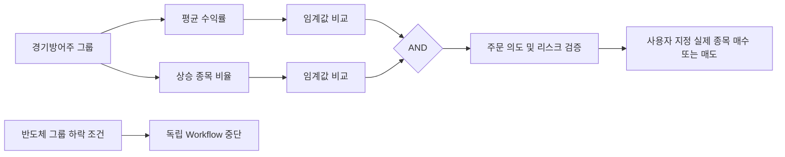

# 주식 그룹(Stock Group) 및 집계 트리거 기능 명세

> 2026-11-24 사용자 승인 요구사항. 주식 그룹의 생성·편집·집계 및 Workflow 연결은 확정 기능이며, 아래 계산 기본값과 데이터 모델은 구현 기준안이다. 실제 수집·UI·엔진은 미구현.

## 1. 기능 및 범위

사용자가 여러 주식 종목을 하나의 이름 있는 그룹으로 묶고 그룹 전체 또는 구성종목의 움직임을 수치화한다. 그룹은 Watchlist(조회/다중 종목 실행 대상)와 별개로 **하나의 집계 신호**를 출력하는 Workflow 데이터 노드로 사용한다. 동일 종목을 여러 그룹에 등록할 수 있다. 그룹 자체는 실제 매매 가능한 증권이나 ETF가 아니며 매수/매도 노드는 별도로 지정한 실제 거래 종목을 대상으로 한다.

예시 그룹(사용자가 자유롭게 편집):
- 경기방어주: PG, KO, PEP, WMT, JNJ 등.
- 반도체주: NVDA, AMD, AVGO, MU, INTC 등.
- 빅테크주, 금융주, 에너지주, 사용자 정의 관심 종목.
위 종목은 분류 예시이며 추천 매수 목록이나 공식 지수 구성종목이 아니다. 자동 섹터 구성/시가총액 자료의 출처·이용권은 별도 검증한다.

## 2. 그룹 관리

- 그룹 생성, 이름·설명·태그, 종목 추가/제거/검색, 순서 변경, 복제, 삭제, 저장, 버전 관리 및 JSON 가져오기/내보내기.
- 종목은 거래소·상품 유형·통화·공급자 심볼을 포함한 정규화 instrument_id로 식별하고 동일 그룹 내 중복을 허용하지 않는다. 빈 그룹 또는 양수 가중치 합이 없는 그룹은 활성화할 수 없다.
- 동일가중 기본; 사용자 지정 고정 가중치 및 시가총액 가중 옵션을 제공한다. 시가총액은 해당 시점에 확인 가능한 적법 데이터가 필요하며 미확보 시 비활성화한다. 음수 가중치는 지원하지 않는다. 가중치 정규화 및 변경 이력을 보존한다.
- 활성 실행은 그룹 구성과 가중치 버전을 고정한다. 편집은 새 버전으로 저장되고 기존 실행에 자동 반영하지 않는다. 그룹 변경 후 재실행/재무장 시 기준가 및 극값을 재설정한다. 삭제는 참조 중인 버전을 보존한다.
- 그룹은 기본적으로 동일 거래소 세션 기준의 미국 주식으로 구성한다. 서로 다른 시장·통화 혼합은 기준시각·세션 정렬 및 환율 정책을 명시하고 검증한 경우만 지원한다. 실제 주식과 추종 영구선물을 동일 종목으로 대체하지 않는다.

## 3. 집계 지표 및 산식

각 구성종목 i에 대해 공통 평가시각 t와 공통 기준기간/기준시각의 유효 가격 P_i(t), B_i>0를 사용한다. r_i = 100 × (P_i(t)/B_i − 1) [%]. 기본 기준은 전일 정규장 종가, 다른 옵션은 장 시작가·Workflow 시작가·최근 N분/시간/거래일 시작가. 동일한 가격 조정 정책 및 세션을 적용한다. 기간마다 각 종목의 r_i를 먼저 계산한 다음 집계한다. 서로 다른 가격대의 주가 자체를 평균하지 않는다.

M=전체 구성종목 수, V=유효 관측 종목 집합, n=|V|. U/D/F는 r_i가 각각 +epsilon 초과, −epsilon 미만, 나머지인 유효 종목 집합. 기본 epsilon=0, 사용자 지정 보합 허용폭은 %p 단위로 기록한다. 가중치 w_i는 유효 집합에서 정규화한다(부분 허용 정책에서만). 평균 수익률과 상승/하락 종목 비율은 다른 값이다.

| 지표 ID | 의미 및 산식 |
|---|---|
| GROUP_AVG_RETURN | 전체 유효 구성종목의 부호 있는 평균 수익률 sum(r_i)/n |
| GROUP_WEIGHTED_RETURN | sum(w_i × r_i)/sum(w_i), 동일/사용자/시가총액 가중 |
| GROUP_MEDIAN_RETURN | median(r_i), 이상치 영향 비교 |
| GROUP_UP_COUNT / GROUP_DOWN_COUNT / GROUP_FLAT_COUNT | 상승/하락/보합 종목 수 |
| GROUP_UP_PCT / GROUP_DOWN_PCT / GROUP_FLAT_PCT | 100×|U 또는 D 또는 F|/n; 상승률이라는 이름으로 평균 수익률과 혼용 금지 |
| GROUP_AVG_UP_RETURN | 상승 종목만의 평균 sum(r_i for U)/|U|; 상승 종목 없으면 null |
| GROUP_AVG_DOWN_RETURN | 하락 종목만의 평균 sum(r_i for D)/|D| (음수 유지), 하락폭 표시 시 abs를 별도 사용; 없으면 null |
| GROUP_UP_DOWN_RATIO | 상승 종목 수 / 하락 종목 수; 분모 0이면 null 및 사유 표시 |
| GROUP_NET_BREADTH | 100×(|U|−|D|)/n [%p], 시장 폭 |
| GROUP_MAX_RETURN / GROUP_MIN_RETURN | 최대/최소 구성종목 수익률 |
| GROUP_RETURN_DISPERSION | 구성종목 수익률의 모집단 표준편차 [%p] |
| GROUP_THRESHOLD_COUNT / GROUP_THRESHOLD_PCT | 사용자 임계값 이상/이하 등 충족 종목 수 및 유효 종목 대비 비율 |
| GROUP_RETURN_SPEED | 동일 그룹/버전/기준 정의의 평균 수익률 변화량 / 실제 경과 분 [%p/min] |
| GROUP_RELATIVE_RETURN | 동일 기간 그룹 평균 또는 가중 수익률 − 비교 벤치마크 수익률 [%p] |
| GROUP_COVERAGE | 100×n/M [%], missing_count 및 stale_count 별도 |

부가 상승/하락 강도는 평균 수익률·조건부 평균 상승/하락률·상승/하락 종목 비율·순시장폭·변화 속도를 구분하여 선택한다. 그룹 평균이 양수인데 하락 종목이 더 많을 수 있으므로 평균과 breadth를 결합할 수 있다. 상대수익률의 비교 대상(예: QQQ 실제 ETF)은 별도 데이터 정의로 지정한다.

## 4. 데이터 정합성 및 계산 주기

- 원본 가격 소스는 허용된 기존 주식 시계열을 사용한다. yfinance 조회/WS의 실제 종목별 가격 전달 빈도와 지연·사용권 검증을 거쳐 사용한다. 1초 로컬 평가 설정은 원본 1Hz 갱신 보장이 아니다.
- 그룹 스냅샷은 동일 as-of 시각 이전에 수신한 각 종목의 최신 유효 가격을 사용하고, 기준 가격과 데이터의 신선도, 최대 종목 간 관측시각 편차를 검사한다. 장마감·정규장·시간외, 거래 정지, 휴장·DST, 기업행동 및 분할/배당 조정을 혼용하지 않는다.
- 기본 엄격 모드: 전체 구성종목의 유효한 관측과 기준가격이 확보되어야 집계 및 트리거 평가 가능. 일부 누락/지연/권한 미확인 시 UNKNOWN. 0% 수익률로 대체하지 않는다.
- 선택적 부분 집계 모드: 사용자 지정 최소 유효 종목 수·coverage·가중치 coverage·허용 시각 편차를 통과할 때만 계산하며, 유효 n/M 및 제외 종목과 가중치 재정규화를 표시한다. 구성 유효 집합 변경에 따른 인위적인 돌파는 재기준화하거나 평가 보류한다. LIVE에 사용하려면 명시적인 허용 및 품질 검증 필요.
- 계산 주기 선택: 데이터 이벤트, 1초 로컬 스냅샷, 1/5/15분 등 확정봉, 일봉. 재평가로 동일 관측을 새 신호로 취급하지 않는다. 백테스트는 당시 그룹 구성/가중치와 당시 공개된 가격만 사용하며 생존편향·미래정보 누수를 방지한다.
- 빈 유효 집합이나 분모 0은 null/UNKNOWN. 그룹 지표 자체가 거래 가능한 지수나 포트폴리오 실현 수익률은 아니다. 기간별 단순 평균을 이어 붙여 실제 지수 수익률로 해석하지 않는다. 상태형 반전에는 고정 기준 가격의 그룹 수익률 또는 명시적으로 정의·검증된 동일 구성의 정규화 지수 레벨을 사용한다.

## 5. 그룹 Workflow 노드

| 노드 | 역할 |
|---|---|
| StockGroup | group_id/version을 선택해 구성 및 유효 입력을 제공 |
| GroupMetric | 지표 ID, 기준가/기간, 가중치, 세션, 평가 주기, 품질 조건 선택; 숫자+상태 출력 |
| GroupCondition | >=, <=, >, <, ==, 범위, 상향/하향 돌파, 지속시간, 변화량 및 상태형 반전 |
| GroupMemberCondition | 동일 조건을 각 구성종목에 평가하고 ALL/ANY/N-of-M/비율로 결합; UNKNOWN을 보존 |
| GroupComparison | 두 그룹 또는 그룹과 벤치마크의 수익률 차이/순시장폭 비교 |
| GroupInterrupt | 그룹 조건을 독립 Interrupt 경로에 연결 |

GroupMemberCondition은 단순 평균과 독립적이다. 예를 들어 10개 중 최소 7개 상승은 각 종목 TRUE의 개수로 판정한다. UNKNOWN이 결과를 바꿀 수 있으면 UNKNOWN이며, 엄격 품질 게이트가 별도로 적용된다. 그룹 평균 수익률 −2%→+1% 등의 순차 조건을 구성할 수 있고, 그룹 평균/시장폭 변화를 %p로 명시한다. 그룹 수익률 자체를 분모로 퍼센트 변화 계산하지 않는다.

예시(임의 수치, 전략 권고 아님):
- 경기방어주 평균 수익률 >= 1% AND 상승 종목 비율 >= 70% → 지정 종목 매수/매도 노드.
- 반도체 그룹 평균 수익률 <= −2% OR 하락 종목 비율 >= 80% → Workflow 전체 중단.
- 경기방어주 평균 수익률 > 빅테크 평균 수익률 + 1%p → 후속 조건 활성화.
- 반도체 10종목 중 7개 이상 SMA20 상향 돌파 → 알림/후속 조건.
- 그룹의 평균 수익률이 기준 대비 상승한 후 고점에서 설정한 %p만큼 하락 → 상태형 반전 조건.

그룹 신호는 어느 실제 종목을 주문할지 자동 결정하지 않는다. 다중 종목 실행은 별도 Watchlist 기능과 명시적 매수/매도 매핑·종목별 한도·계좌 리스크 게이트를 사용한다.

## 6. UI 및 데이터 모델

기존 [프론트엔드 디자인](../design/frontend.md)과 통일한다. 그룹 관리 화면에는 그룹 카드(이름, 전체/유효 종목 수, 평균 수익률, 상승/하락/보합 100% 막대, 평균 상승·하락률, 원본 시각)를 표시한다. 상세는 구성종목 가격·수익률·가중치·신선도와 집계 추이 차트, 기간/가중치 선택, 제외 사유를 제공한다. Workflow 라이브러리에 그룹 노드 카테고리를 추가한다. 우측 설정 패널에서 그룹/버전/지표/기준가/비교값/최소 coverage를 선택하고 숫자 출력 포트 및 조건 결과 포트를 연결한다. 실행 로그는 실제 구성 버전 및 입력값을 보여준다.

| 엔터티 | 주요 필드 |
|---|---|
| stock_groups | group_id, owner_ref, name, description, tags, created_at, status |
| stock_group_versions | group_id, version, weighting_method, effective_at, created_at, checksum |
| stock_group_members | group_id, version, instrument_id, weight, source_ref |
| group_metric_snapshots | group_id, version, metric_id, period, reference_policy, session, weighting_method, asof_at, received_at, value, unit, valid_count, total_count, coverage, weight_coverage, quality_status, input_refs |
| group_trigger_states | run_id, node_id, group_id, version, activation_id, metric_id, reference_value, extrema, last_event_id |

가중치 및 가격·집계 방식의 버전은 재현 가능하게 보존한다. 그룹 지표는 기존 피처 엔진에서 계산하고, Workflow 평가 엔진은 정규화된 결과와 품질 상태를 사용한다.

## 7. 수용 테스트

- 가상 수익률 +2%, +1%, −3%, 0%, +5%인 5개 종목: 평균 +1%, 상승 60%, 하락 20%, 보합 20%, 평균 상승 8/3%, 평균 하락 −3%, 순시장폭 +40%p, 중앙값 +1%.
- 동일가중/사용자 가중 비교, 가중치 0·중복·빈 그룹·분모 0 검증.
- stale·결측·부분 커버리지·장 정지·휴장·분할·종목 간 시각 편차·멤버 변경에서 오발동 금지.
- 버전 고정, 그룹 간 비교·ALL/ANY/N-of-M 및 그룹 기반 독립 Interrupt, 중복 실행 방지 검증.
- UI의 집계 수치·막대 합계·원본 시각 및 유효/전체 수 일치; 미지원 그룹 상태 명시.
- 백테스트에서 당시 구성 및 당시 공개 데이터만 접근.

관련: [Workflow 상세 명세](./trading-workflow.md) · [전체 기능](./specification.md) · [시스템 설계](../design/specification.md) · [프론트엔드](../design/frontend.md).
