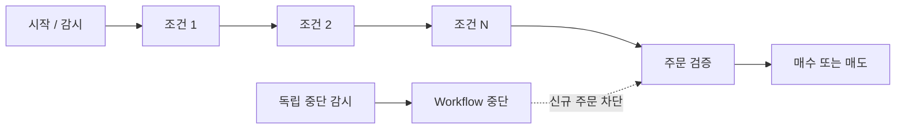
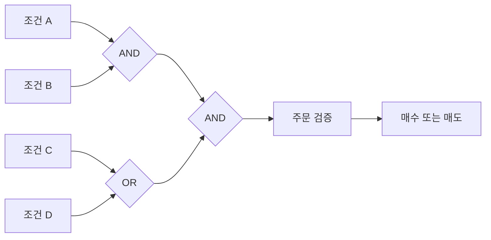
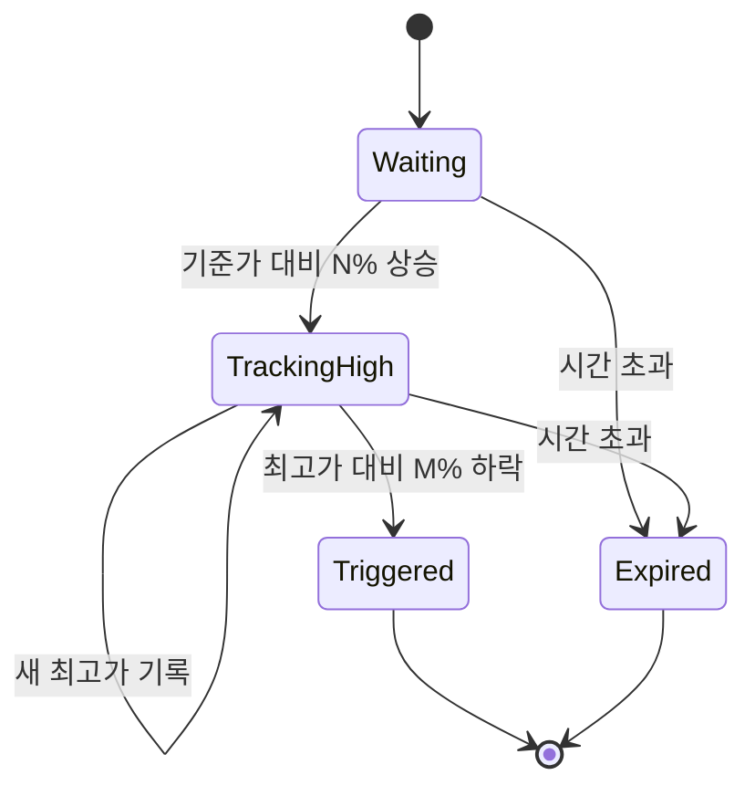
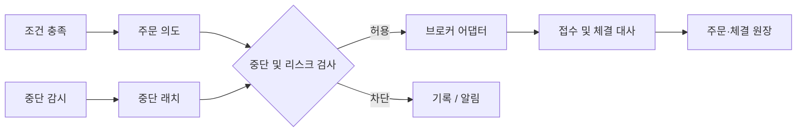

# 매수·매도 Workflow 기능 및 실행 설계

> 기준일: 2026-11-24. 사용자 확정 요구사항과 구현을 위한 제안 사양을 구분한다. 문서 설계 단계이며 주문 연동 및 Workflow 엔진은 미구현.

## 1. 확정 요구사항

Auto-Axe의 매수·매도 전략은 ComfyUI, n8n과 유사한 노드 기반 비주얼 Workflow로 구성한다. 사용자가 블록을 드래그하여 캔버스에 배치하고 입력·출력 포트를 연결한다. 조건과 실행 노드를 자유롭게 조합한다.

- 순차 조건: 조건 1 → 조건 2 → 조건 N → 매수/매도.
- AND: 조건 1 && 조건 2 → 매수/매도.
- OR: 조건 1 || 조건 2 → 매수/매도.
- 전체 중단: 별도 트리거 충족 시 실행 중인 해당 Workflow 전체를 중단.
- 초기 트리거: 목표가 도달, N% 상승/하락, 상승 후 하락 또는 하락 후 상승, 상승/하락 강도, 뉴스 긍정/부정 감정.
- 조건 블록의 중첩과 분기, 복수 조건 연결을 지원하는 방향으로 설계한다.

이하 실행 규칙·노드 종류·화면·안전장치·추가 트리거는 위 요구사항을 구현하기 위한 권장 상세 사양이다. 예시 수치는 UI 및 논리 검증용이며 권장 매매 전략이나 수익률 보장이 아니다.

## 2. Workflow 구조와 조건 의미

### 2.1 평가 규칙

| 유형 | 권장 실행 의미 |
|---|---|
| Sequence | 이전 조건이 충족되어 다음 노드가 활성화된다. 이전 단계의 성공 시각·기준값을 보존한다. 기본적으로 이전 조건을 계속 참으로 유지할 필요는 없으며 필요 시 AND/유지 조건을 명시한다. |
| AND | 지정된 동일 평가 시점(as-of)에서 모든 입력 조건 TRUE. 소스별 유효 시각·허용 지연을 함께 검사한다. |
| OR | 하나 이상 TRUE이면 충족. 여러 입력이 동시에 충족되어도 동일 실행의 합류 지점과 주문 노드는 한 번만 활성화한다. |
| NOT | 정상적으로 확인된 FALSE를 TRUE로 반전. UNKNOWN은 UNKNOWN 유지. 추가 논리 노드 제안. |
| N-of-M | M개 중 N개 이상 충족. UNKNOWN 때문에 판정 불가능하면 UNKNOWN. 추가 제안. |
| IF / ELSE | TRUE와 FALSE의 분기. UNKNOWN은 별도 대기/오류 경로이며 FALSE로 취급하지 않는다. |
| Interrupt | 정상 경로와 독립적으로 감시하며, 충족 시 해당 실행 범위의 모든 신규 주문과 후속 노드 진행을 차단한다. |

TRUE/FALSE/UNKNOWN의 3값 논리를 사용한다. AND는 하나라도 FALSE면 FALSE, 모두 TRUE면 TRUE, 나머지는 UNKNOWN. OR은 하나라도 TRUE면 TRUE, 모두 FALSE면 FALSE, 나머지는 UNKNOWN. 단, 주문 실행 전 필수 주문·리스크 데이터와 해당 신호의 품질 조건은 독립적으로 검사하므로 UNKNOWN을 통해 우회할 수 없다.

순차 조건은 활성화 이후 관측되는 이벤트를 대상으로 한다. 이미 충족 중인 조건을 즉시 인정하는 LEVEL 방식과 경계 통과를 기다리는 EDGE 방식을 노드에서 명시한다. 상승률→하락률 같은 상태형 조건은 기준점, 극값, 활성화 시각, 만료 시간, 재설정 조건을 저장한다. 새 이벤트가 없는 상태에서 반복 평가해도 동일 신호를 중복 발생시키지 않는다.

### 2.2 실행 시작·종료

실행 방식 제안: 수동 시작, 예약 시작, 시장 데이터 변경 시 감시, 거래 세션 시작, 경제 이벤트 발생. 실행 종료 정책은 1회 완료(기본 제안), 조건 재설정 후 재감시, 최대 N회 또는 기간 내 반복을 명시적으로 선택한다. 자동 반복은 쿨다운·일별 주문 제한을 요구한다. 무제한 순환 그래프는 초기 버전에서 금지하고 반복은 제어된 재실행/루프 노드로만 지원한다.

## 3. 노드 카탈로그

| 노드 분류 | 예시 | 역할 |
|---|---|---|
| 시작/이벤트 | 수동, 시간, 세션, 데이터 갱신 | 실행 시작 또는 평가 요청 |
| 데이터 | 가격, 거래량, 지표, 뉴스 감정, 계좌/포지션 | 종목·시장·소스·시계열·기준시각 바인딩 |
| 조건 | 비교, 목표가, 퍼센트 변화, 돌파, 범위 | 조건의 TRUE/FALSE/UNKNOWN 산출 |
| 상태형 조건 | 상승 후 하락, 하락 후 상승, 지속시간, 최고/최저 추적 | 여러 관측에 걸친 상태 보존 |
| 논리 | AND, OR, NOT, N-of-M | 복수 조건 결합 |
| 제어 | Sequence, IF/ELSE, Wait, Timeout, Cooldown, Interrupt | 실행 흐름 및 시간 제약 |
| 주문 | BUY, SELL | 주문 의도 생성; 브로커 API 직접 호출 금지 |
| 위험 관리 | 데이터 유효성, 한도, 손실 제한, 주문 검증 | 실행 허용 여부 결정 |
| 알림/기록 | 알림, 로그, 결과 저장 | 실행 관측·검수 |

초기에는 사용자 지정 임의 Python/JavaScript 코드 실행 노드를 제공하지 않는다. 검증 가능한 선언형 노드와 타입화된 포트로 구성한다.

## 4. 사용자 지정 초기 트리거

모든 가격 트리거는 종목·거래소/상품 종류·통화·가격 종류(실제 체결가/종가 등)·거래 세션·평가 방식·유효 시간 및 데이터 신선도를 지정한다. 주식 실매매 종목과 Binance/MEXC 연동 파생상품 가격은 별개이며, 교차시장 신호 사용 여부를 명시적으로 설정한다.

| ID | 트리거 | 필수 설정 및 판정 |
|---|---|---|
| TR-001 | 목표가 도달 | 목표 가격 P, 상향/하향, LEVEL(현재 >= 또는 <=) 또는 EDGE(이전→현재 경계 통과), 1회/재무장 |
| TR-002 | N% 상승 | 기준가 B>0, 상승률 N>0. 100×(P/B−1) >= N |
| TR-003 | N% 하락 | 기준가 B>0, 하락률 N>0. 100×(P/B−1) <= −N |
| TR-004 | N% 상승 후 M% 하락 | B 대비 N% 상승 시 활성화, 이후 최고가 H 추적, 100×(P/H−1) <= −M |
| TR-005 | N% 하락 후 M% 상승 | B 대비 N% 하락 시 활성화, 이후 최저가 L 추적, 100×(P/L−1) >= M |
| TR-006 | 상승/하락 강도 | 산식·기간·단위·기준 임계값 선택. 기본 후보는 일정 시간 수익률, 수익률 변화 속도, 상승/하락봉 비율 |
| TR-007 | 뉴스 감정 | 종목/기업, 허용 뉴스 출처, 긍정/중립/부정 또는 점수, 최소 신뢰도, 유효 시간, 중복 제거, 관련성 검증 |

기준가 B는 사용자 고정 가격, 이전 정규장 종가, 장 시작가, Workflow 시작 시 가격, 지정 기간 시작가, 매수 평균 체결가 등에서 명시적으로 선택한다. 평균 체결가는 실제 계좌 체결 기록에서만 가져온다. 가격 차이가 분할·배당 조정 정책 변경에서 발생한 경우 잘못된 트리거를 차단한다.

상승/하락 강도는 단일 표준 금융 지표가 아니므로 공식과 관측 창을 저장한다. 예: 5분 수익률 100×(P_t/P_(t−5m)−1), 분당 수익률 변화 속도, 최근 N개 확정봉 상승 비율. 거래량 또는 Taker 매수·매도 비중은 별도 조건으로 결합한다. Yahoo 누적 거래량 갱신 간 차분은 정확한 초당 체결량이나 매수/매도 체결 방향이 아니다.

### 4.1 상태형 예시

가상 예시: B=100, N=5, M=3이면 105 이상 도달 시 활성화. 이후 최고가가 110이면 3% 하락 기준은 106.7이다. 105 도달 순간의 값이나 원래 100을 하락률 분모로 재사용하지 않는다. 반대 패턴은 최저가를 추적한다. 동일 평가에서 활성화와 후속 반전이 동시에 처리되지 않도록 실제 관측 순서를 검증한다. OHLC 한 봉만으로 고점과 저점의 발생 순서를 알 수 없는 백테스트는 보수적으로 처리하거나 더 세밀한 데이터가 확보될 때만 판정한다.

### 4.2 뉴스 감정 분석

뉴스 감정은 사용자 요구 트리거이나 데이터 수집원·모델·무료 이용권은 미확정이다. 운영 활성화 전 허용된 무료 뉴스/공시 원문 또는 RSS, 종목 매칭, 언어, 분석 방식, 품질 검증을 확정한다. SEC/기업 IR은 기존 가이던스의 출처로 참고할 수 있으나 종합 뉴스 피드와 동일하지 않다.

권장 필드: article_id, canonical_url, source, symbol, published_at, first_seen_at, analyzed_at, polarity, score, confidence, model_version, duplicate_group, evidence. 동일 기사의 재배포·갱신을 중복 신호로 사용하지 않고 오래된 기사나 종목 무관 기사는 제외한다. 감정 점수는 사실 검증이나 미래 수익률을 보장하지 않으며 저신뢰/분석 실패는 UNKNOWN. 단독 실주문 자동 실행보다는 다른 검증 조건과 조합하고, 출처 권한 및 모의 검증을 통과해야 한다.

## 5. 추가 추천 트리거 (채택 전 검토)

기존 수집 명세로 확보 가능한 항목과 신규 데이터가 필요한 항목을 구분한다. 문서에 존재한다고 운영 수집이 이미 구현된 것은 아니다.

| 분류 | 추가 트리거 | 데이터 및 조건 예시 |
|---|---|---|
| 추세 | 이동평균선 돌파/골든·데드크로스 | 종가가 SMA20 상향 통과, SMA5와 SMA20 교차. 기존 SMA/EMA |
| 범위 | 최근 5/10/20거래일 고가·저가 돌파 | 직전 N개 확정봉 기준; 당일 진행봉을 기준에 섞지 않음 |
| 가격 패턴 | 갭 상승/하락, 지지·저항 재돌파 | 전일 확정 종가 대비 시가, 사용자 가격대; OHLC 및 세션 필요 |
| 거래량 | 거래량 급증/감소, 상대 거래량(RVOL) | 동일 장중 시간대 또는 동일 봉 주기의 과거 기준과 비교; 데이터 갭·세션 리셋 검증 |
| 모멘텀 | RSI, MACD, ROC | OHLCV 기반 로컬 계산 후보; 공식·기간·워밍업 추가 정의 필요 |
| 변동성 | ATR, Bollinger Band, 실현 변동성 | OHLCV 기반 계산 후보; 급변 시 주문 보류/변동성 조건 |
| 시장 심리 | VIX 임계값, VIX 변화율, CNN 공포·탐욕 | 실제 갱신 주기와 stale 확인; CNN 자동화 권한 미확인 |
| 수급 | Binance 계정/포지션 비중, Taker 비중 변화 | 5분 이상 공식 집계; 연동 상품을 실제 주식 수급으로 표시하지 않음 |
| 금리 | 미국 국채 수익률 변화(bp), 금리차 | Treasury/yfinance 등; 동일 기준시각·수익률 정의 확인 |
| 일정 | 경제 발표·실적 발표·위칭 DTE | 발표 전후 거래 제한/감시; 일정 변경과 ET DST 반영 |
| 발표 충격 | 실제값−컨센서스, 가이던스 변경 | 실제·예상·수정·단위 분리, 미확인 컨센서스는 UNKNOWN |
| 산업 | DDR5 모듈 가격 전주 대비 변화 | 주간 Session Average, 권한 확인 후; 초단위 신호로 오인 금지 |
| 교차자산 | BTC/원자재/Nasdaq 연동 가격 변화 | 시계열·통화·상품 정의 및 신선도 검증 |
| 포지션 | 평균 체결가 대비 수익률·손절·익절·트레일링 | 실제 체결 수량·원가·수수료; 주문 브로커 연동 필요 |
| 위험 | 일일 손실, 최대 주문액, 포지션 한도, 스프레드 | 계좌/호가 데이터 및 리스크 엔진 추가 필요 |
| 시간 | 정규장 전후, 요일, 기간 만료 | 거래소 달력 및 시간대 |
| 데이터 이상 | 피드 단절, 가격 stale, API 오류 | 주문 차단/Workflow 중단; 위험 관리 기본 후보 |

PizzINT는 기존 수집 정책상 자동 주문 신호에서 제외한다. 기타 수동·허가 미확인 지표는 실주문 조건으로 활성화하지 않는다.

## 6. 매수·매도 액션 및 중단 안전장치 (권장 상세)

### 6.1 주문 노드

입력은 계좌 참조, 실제 주문 가능 종목/시장, 방향 BUY/SELL, 수량 산정 방식(고정 주수/고정 금액/가용 자산 비율 등), 주문 유형, 가격, 유효 기간, 최대 허용 수량/금액이다. 증권사 지원 여부가 확인되지 않은 주문 유형(시장가·지정가·조건부 주문 등)은 활성화하지 않는다. 매도는 기본적으로 보유 수량 이내이며 공매도/레버리지 실행은 별도 명세·권한 확인 전 제외한다.

조건의 충족은 주문 의도 생성과 같으며, 주문 접수 및 실제 체결과 다르다. 주문 전 계좌·잔고·가용 수량/현금·거래 세션·호가 및 가격 유효성·허용 한도·중단 상태를 확인한다. 신호 소스와 브로커 주문 종목을 별도 필드로 관리하고 교차자산 신호는 명시적 매핑만 허용한다. NH나무 API 인증·실제 지원 시장/종목/주문 유형·모의 환경·호출 제한 및 이용권은 별도 검증 후 확정한다.

권장 상태: INTENT → VALIDATED → SUBMITTING → ACKNOWLEDGED → PARTIALLY_FILLED → FILLED 또는 REJECTED/CANCELED/UNKNOWN. 응답 유실은 UNKNOWN으로 처리하고 브로커 조회·체결 대사 전 무조건 재전송하지 않는다. run_id + node_id + activation_id 등으로 주문 의도 고유 키를 유지한다. 브로커가 같은 키를 지원하지 않더라도 내부 원장 및 조회를 통해 중복 제출을 막는다.

### 6.2 전체 중단 트리거

- Interrupt는 순차 조건의 다음 활성 노드와 무관하게 실행 시작부터 감시한다. 일반 조건과 같은 평가 주기에 충족되면 중단을 우선한다.
- 중단 범위는 기본적으로 해당 Workflow 실행의 모든 분기. 전체 계좌/전체 Workflow 비상 정지는 별도의 상위 권한 기능으로 제안한다.
- 중단 상태를 영속화하고 모든 신규 주문 의도 및 대기 실행을 차단한다. 주문 게이트에서 제출 직전 재확인하며 이미 전송 중인 요청은 안전하게 대사한다.
- 중단 자체가 기존 보유 주식의 시장가 매도 또는 모든 주문 취소를 의미하지 않는다. 이미 접수된 미체결 주문은 별도의 명시적 취소 정책(취소 요청 후 결과 확인), 기존 보유분은 별도의 청산 정책 및 권한으로 처리한다. 부분체결 및 취소 실패를 표시한다.
- 중단된 실행은 자동 재시작하지 않는 것을 기본으로 제안한다. 운영자가 원인·계좌 상태를 확인하고 새 실행 또는 명시적 재무장을 선택한다.

## 7. 비주얼 Workflow 편집기 (권장 상세)

ComfyUI/n8n 스타일의 드래그 가능한 블록과 방향성 연결선. 기존 [프론트엔드 디자인](../design/frontend.md)의 다크/라이트 토큰을 사용한다.

- 좌측: 노드 라이브러리(검색 및 분류), 가운데: 점/격자 배경 캔버스, 우측: 선택 노드의 파라미터와 유효성 검사, 하단/접이식: 실행 로그·현재 상태.
- 상단: 이름·버전·저장/복제·검증·모의 실행·실행/일시정지/중단. LIVE 전환은 별도 권한과 사용자 확인; 편집만으로 실주문 활성화 금지.
- 노드 추가/이동/삭제, 연결/분리, 확대·축소·팬, 미니맵, 정렬·스냅, 다중 선택, 복사/붙여넣기, Undo/Redo 제안.
- 포트 타입(이벤트, boolean/UNKNOWN, number, 시계열, 제어 흐름, 주문 의도)을 명시하고 호환되지 않는 연결은 거부한다. 실행 제어 연결과 데이터 연결을 구별한다.
- 노드 상태: 미실행, 조건 감시, 충족, 미충족, UNKNOWN, 실행 중, 완료, 오류, 중단. 색상과 아이콘/문자 동시 표기. 실행 흐름의 실제 경로 및 조건 충족 시각을 강조한다.
- 노드 설정에는 지표·심볼·소스·집계주기·비교연산·임계값·기준가·시간창·평가 모드·TTL·재무장 등을 표시한다.
- 저장 가능한 그래프(JSON 제안): workflow_id, version, nodes[{id,type,config,position}], edges[{from_node,from_port,to_node,to_port}], interrupt_rules, execution_policy, risk_profile_ref. 비밀정보/토큰은 그래프에 저장하지 않는다. 배포된 버전은 불변으로 보존한다.
- 편집과 실행을 분리한다. 실행 중인 그래프는 저장 당시 버전에 고정되고 편집본 변경은 다음 실행에 반영한다.

## 8. 실행 엔진·저장 구조 (제안)

UI는 그래프 작성 및 상태 조회, 서버는 이벤트 평가·상태 영속화·주문 의도 실행을 담당한다. 브라우저 종료와 무관하게 활성 실행을 관리한다. 데이터 수집 피드와 주문 브로커를 분리한다.

| 논리 엔터티 | 핵심 필드 |
|---|---|
| workflow_definitions / versions | workflow_id, version, graph, owner_ref, checksum, created_at, validation_status |
| workflow_runs | run_id, version, mode, started_at, status, stopped_at, stop_reason |
| node_states | run_id, node_id, activation_id, status, activated_at, reference_value, extrema, last_event_id, expires_at |
| evaluation_events | event_id, run_id, node_id, evaluated_at, inputs_asof, result, source_refs, reason |
| order_intents | intent_id, run_id, node_id, broker_symbol, side, quantity, price, risk_decision, status |
| broker_orders / fills | broker_order_id, intent_id, status, fill_id, fill_qty, fill_price, fees, event_at |
| risk_events | scope, run_id/account_ref, policy, status, decision_at, reason |

서버 재시작 후 상태·중단 래치·미확인 주문을 복구하고 대사 전 실주문을 재개하지 않는다. 한 실행 안의 평가와 중단 판정은 일관된 순서로 처리하며 이벤트 중복·역순·데이터 재전송을 구별한다. 실주문과 모의/백테스트 저장 네임스페이스 및 자격증명을 분리한다. 구체적인 DB·큐·노드 편집 라이브러리는 미확정.

## 9. 추가 상세 기능 추천 및 우선순위

| 우선순위 | 기능 | 이유 |
|---|---|---|
| P0 | 모의 실행 / Dry-run | 주문 없이 어떤 조건이 충족되어 어떤 의도가 생성되는지 검증 |
| P0 | 상태형 순차 평가, Timeout, Reset | 상승 후 하락 등 복수 시점 패턴을 정확하게 판정 |
| P0 | 일회 실행 / Cooldown / 중복 주문 방지 | TRUE가 지속되어 초당 반복 주문하는 오류 방지 |
| P0 | 전체 중단, 데이터 품질 게이트, 계좌 리스크 한도 | stale·권한·손실 한도·피드 단절 등에 대한 독립 차단 |
| P0 | 주문/체결 대사 및 감사 로그 | 주문 성공과 체결 구분, 응답 유실·재시작 안전 |
| P1 | 역사 데이터 백테스트 및 이벤트 재생 | 당시 사용 가능한 자료만으로 동일 엔진을 검증, 수수료·슬리피지·거래시간·부분체결 모델 명시 |
| P1 | 실시간 Workflow 경로 시각화 및 디버깅 | 노드별 현재값·조건 결과·기준가·극값·최근 충족 시각 표시 |
| P1 | 저장·복제·버전 관리·템플릿·JSON 가져오기/내보내기 | 전략 재사용 및 변경 비교 |
| P1 | 분할 매수/매도, 익절·손절, 트레일링, OCO | 체결 기준 상태 관리; 브로커 지원 검증 및 안전한 주문 조정 필요 |
| P1 | 거래시간·경제 이벤트 거래 금지 구간 | 예정된 발표와 비정상 장세에서 실행을 제어 |
| P2 | 다중 종목 Watchlist 및 변수/서브워크플로 | 종목마다 상태 격리, 재사용 및 복수 전략 관리 |
| P2 | 전략 충돌 방지 및 계좌 수준 조정 | 여러 Workflow가 동일 종목/계좌에 충돌하는 주문을 만들지 않게 함 |
| P2 | 알림·승인 노드, 배포 승인 및 권한 관리 | 실주문 전 사람 승인 선택, 실행 결과/오류 통지 |
| P2 | 전략 성과 리포트 | 수익률뿐 아니라 낙폭·거래비용·체결 품질·비활성 시간 평가 |

우선순위는 제안이다. 실주문 단계는 모의 검증 및 필수 안전장치가 완료되고 사용자 권한·브로커 계약이 확인된 이후에만 진행한다.

## 10. 수용 테스트 (제안)

- 순차: B가 A보다 먼저 발생해도 순차 충족으로 잘못 인정하지 않으며, 설정한 LEVEL/EDGE 의미를 준수한다.
- AND/OR: 3값 논리 및 동시 조건, 중첩 그래프, 합류 시 한 번만 실행.
- 상승 후 하락/하락 후 상승: 기준가·극값·만료·재설정·순서 검증, 재시작 후 상태 복구.
- 목표가: 갭으로 경계 통과, 경계값, 최초 관측, 지속 TRUE, 쿨다운, 세션 변경.
- Interrupt: 일반 조건과 동시 충족, 대기/분기/주문 제출 경계, 부분체결, 취소 실패, 중단 후 재시작을 검증.
- 주문: 수량 한도, 보유량, 중복 이벤트, ACK 유실, 브로커 조회, 데이터 stale 및 거래시간 제한.
- 뉴스: 오래된/중복/무관 기사, 낮은 신뢰도, 모델 오류 및 권한 미확인 시 차단.
- 백테스트: 공개 시각 이전 데이터 접근 금지, OHLC 경로 불확실성, 비용/슬리피지 반영.
- 편집기: 노드 드래그·연결·저장/복원, 타입 오류, 순환 연결 거부, 검증 실패 시 배포 금지.

## 11. 관련 문서

- [전체 기능 명세](./specification.md)
- [시스템 설계](../design/specification.md)
- [프론트엔드 디자인](../design/frontend.md)
- [무료 데이터 수집 명세](../indicator-collection/Free_Data_Collection.md)
- [재무 및 기술지표](../indicator-collection/YFinance_Valuation_and_Moving_Averages.md)
- [1초 누적 거래량](../indicator-collection/YFinance_1s_Stock_Cumulative_Volume.md)

현재 상태: 확정 요구사항 및 추천 상세 기능 문서화. 엔진, 편집기, 뉴스 분석, 주문·체결 연동 모두 미구현.
