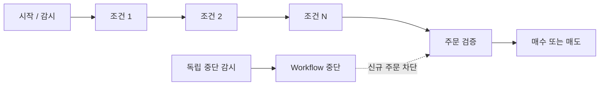
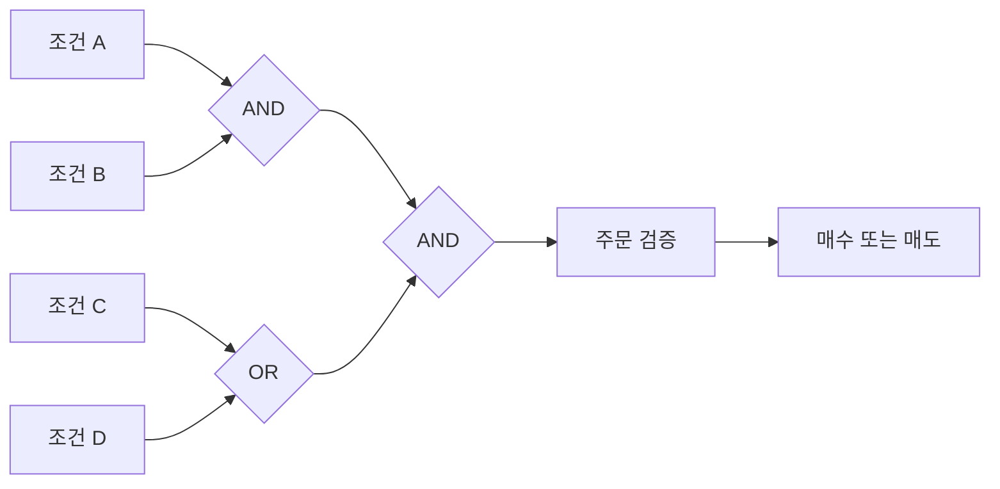
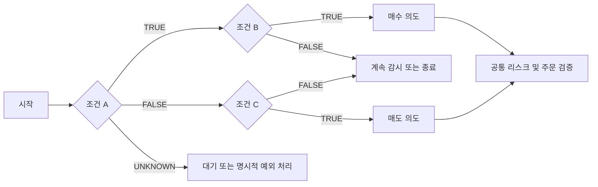
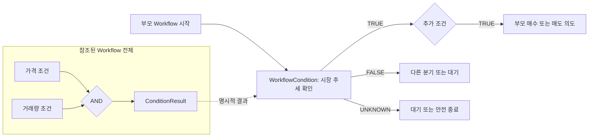
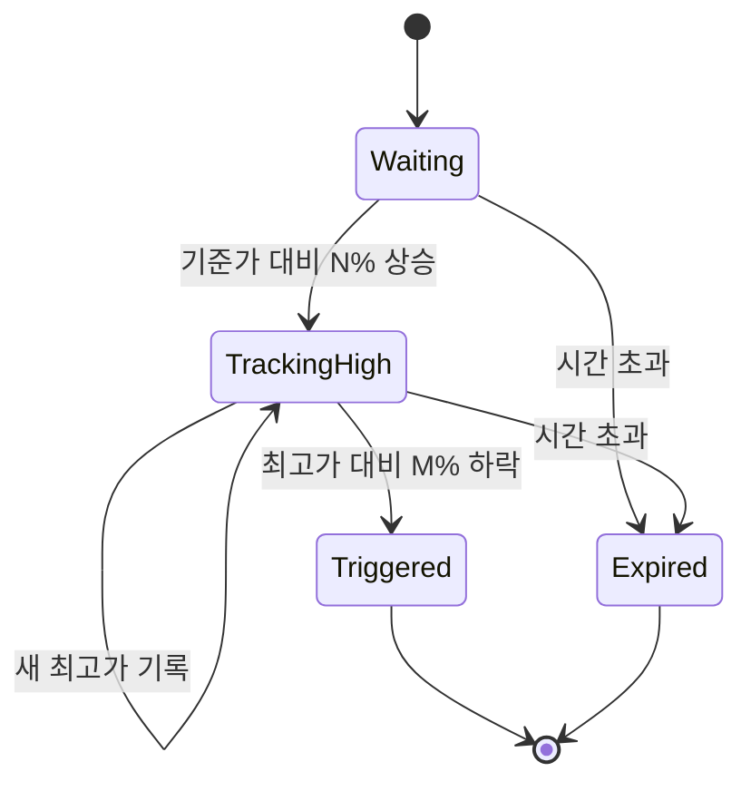
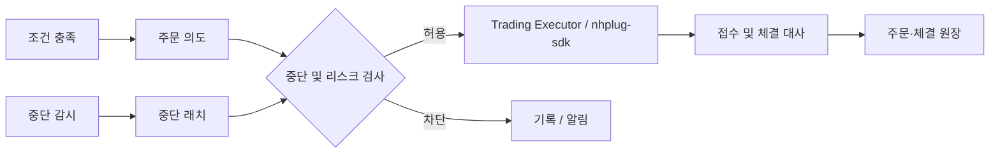

# 매수·매도 Workflow 기능 및 실행 설계

> 기본 Workflow, 편집기 UI, 전체 트리거 및 P0~P2 상세 기능을 구현 범위로 한다. 기술 스택은 [Workflow 엔진 명세](../tech-stack/workflow-engine.md)를 따르며 외부 API·파라미터·공급자 권한은 검증한다. 주문 연동 및 엔진은 미구현이다.

## 1. 확정 요구사항

Auto-Axe의 매수·매도 전략은 ComfyUI, n8n과 유사한 노드 기반 비주얼 Workflow로 구성한다. 사용자가 블록을 드래그하여 캔버스에 배치하고 입력·출력 포트를 연결한다. 조건과 실행 노드를 자유롭게 조합한다.

- 순차 조건: 조건 1 → 조건 2 → 조건 N → 매수/매도.
- AND: 조건 1 && 조건 2 → 매수/매도.
- OR: 조건 1 || 조건 2 → 매수/매도.
- 전체 중단: 별도 트리거 충족 시 실행 중인 해당 Workflow 전체를 중단.
- 초기 트리거: 목표가 도달, N% 상승/하락, 상승 후 하락 또는 하락 후 상승, 상승/하락 강도, 뉴스 긍정/부정 감정.
- 조건 블록의 중첩과 분기, 복수 조건 연결을 지원한다. 한 Workflow 안에서 조건 결과에 따라 서로 다른 실행 경로를 선택할 수 있다.
- 저장된 다른 Workflow 전체를 하나의 재사용 가능한 조건 블록(WorkflowCondition)으로 불러오고, 명시된 조건 결과를 일반 조건과 동일하게 연결한다.
- 다른 Workflow에서 참조 중인 Workflow는 삭제할 수 없다. 참조 관계를 표시하고 모든 사용 중인 참조를 해제한 후 삭제할 수 있다.
- 메인 대시보드에 활성 Workflow 개수를 표시하고, Workflow 목록 및 상세 화면에서는 각 Workflow의 조건 충족 상태와 실행 경로를 실시간으로 표시한다.
- §5의 전체 추가 트리거, §7의 편집기 UI 및 §9의 전체 상세 기능을 확정 개발 범위에 포함한다.
- 사용자 정의 주식 그룹을 생성하여 그룹 평균 수익률, 상승/하락 종목 비율, 조건부 평균 상승/하락률, 강도 및 그룹 간 비교를 조건·중단 노드에 연결한다. [주식 그룹 상세](./stock-groups.md).

실행 규칙·노드 종류·화면·안전장치·트리거는 구현 명세다. 공급자 권한 및 브로커 지원, 모델·알고리즘 파라미터 등 미확정 기술은 별도 검증한다. 예시 수치는 UI 및 논리 검증용이며 권장 매매 전략이나 수익률 보장이 아니다.

## 2. Workflow 구조와 조건 의미

### 2.1 평가 규칙

| 유형 | 실행 의미 |
|---|---|
| Sequence | 이전 조건이 충족되어 다음 노드가 활성화된다. 이전 단계의 성공 시각·기준값을 보존한다. 기본적으로 이전 조건을 계속 참으로 유지할 필요는 없으며 필요 시 AND/유지 조건을 명시한다. |
| AND | 지정된 동일 평가 시점(as-of)에서 모든 입력 조건 TRUE. 소스별 유효 시각·허용 지연을 함께 검사한다. |
| OR | 하나 이상 TRUE이면 충족. 여러 입력이 동시에 충족되어도 동일 실행의 합류 지점과 주문 노드는 한 번만 활성화한다. |
| NOT | 정상적으로 확인된 FALSE를 TRUE로 반전. UNKNOWN은 UNKNOWN 유지. |
| N-of-M | M개 중 N개 이상 충족. UNKNOWN 때문에 판정 불가능하면 UNKNOWN. |
| IF / ELSE | TRUE와 FALSE의 분기. UNKNOWN은 별도 대기/오류 경로이며 FALSE로 취급하지 않는다. |
| Interrupt | 정상 경로와 독립적으로 감시하며, 충족 시 해당 실행 범위의 모든 신규 주문과 후속 노드 진행을 차단한다. |

TRUE/FALSE/UNKNOWN의 3값 논리를 사용한다. AND는 하나라도 FALSE면 FALSE, 모두 TRUE면 TRUE, 나머지는 UNKNOWN. OR은 하나라도 TRUE면 TRUE, 모두 FALSE면 FALSE, 나머지는 UNKNOWN. 단, 주문 실행 전 필수 주문·리스크 데이터와 해당 신호의 품질 조건은 독립적으로 검사하므로 UNKNOWN을 통해 우회할 수 없다.

순차 조건은 활성화 이후 관측되는 이벤트를 대상으로 한다. 이미 충족 중인 조건을 즉시 인정하는 LEVEL 방식과 경계 통과를 기다리는 EDGE 방식을 노드에서 명시한다. 상승률→하락률 같은 상태형 조건은 기준점, 극값, 활성화 시각, 만료 시간, 재설정 조건을 저장한다. 새 이벤트가 없는 상태에서 반복 평가해도 동일 신호를 중복 발생시키지 않는다.

### 2.2 실행 시작·종료

실행 방식: 수동 시작, 예약 시작, 시장 데이터 변경 시 감시, 거래 세션 시작, 경제 이벤트 발생. 실행 종료 정책은 1회 완료(기본), 조건 재설정 후 재감시, 최대 N회 또는 기간 내 반복을 명시적으로 선택한다. 자동 반복은 쿨다운·일별 주문 제한을 요구한다. 무제한 순환 그래프는 초기 버전에서 금지하고 반복은 제어된 재실행/루프 노드로만 지원한다.

### 2.3 조건에 따른 분기 및 합류

단순 직렬 경로뿐 아니라 하나의 조건에서 복수의 경로로 나누고 이후 다시 합류할 수 있는 방향성 그래프를 지원한다.

- 조건 노드 또는 IF/ELSE 분기 노드는 TRUE / FALSE / UNKNOWN 출력 포트를 지원한다. TRUE와 FALSE 경로는 해당 평가에서 상호 배타적이다. FALSE를 연결하지 않으면 기본적으로 후속 주문 없이 감시/종료 정책을 따른다. UNKNOWN은 기본 대기 또는 안전 종료이며 FALSE로 치환하지 않는다.
- 다중 분기(Switch)는 조건별 CASE 및 DEFAULT를 제공한다. 기본은 우선순위가 가장 높은 첫 일치 분기 실행이며, 복수 경로 동시 실행은 명시적인 병렬/Fork 노드로 구분한다. CASE 판정에 필요한 값이 UNKNOWN이면 DEFAULT로 자동 실행하지 않는다.
- 분기 안에 순차 조건, AND/OR/NOT/N-of-M, 다른 분기, 재사용 Workflow 조건, 대기, 중단, 매수/매도 노드를 중첩할 수 있다. 선택되지 않은 경로는 SKIPPED로 기록하고 해당 경로의 주문 노드를 실행하지 않는다.
- 병렬 경로의 합류는 Join(ALL/ANY 등 명시적 정책)으로 정의한다. 논리 AND/OR의 입력 평가와 실행 경로 합류를 구별한다. 상호 배타 분기의 합류는 선택된 경로만 대상으로 하며 실행되지 않은 분기를 영구 대기하지 않는다. 동일 실행/활성화의 합류 및 주문 의도는 한 번만 생성한다. 상충하는 주문은 기존 계좌 수준 전략 충돌·위험 게이트에서 검증한다.
- 분기 결과, 선택 경로, 평가 시각, 분기/합류 식별자 및 미선택 사유를 기록한다. 상태형 조건은 해당 분기 활성화부터 평가하며 과거 충족 여부를 잘못 상속하지 않는다.
- 독립 Interrupt는 분기 위치와 무관하게 감시한다. 중단 시 해당 실행의 모든 활성 분기 및 하위 조건 호출을 중지하고 신규 주문을 차단한다. 이미 전송된 주문은 기존 대사 정책을 적용한다.

### 2.4 다른 Workflow 전체를 조건 블록으로 재사용

저장된 Workflow를 편집기에서 하나의 조건 박스 `WorkflowCondition`으로 추가할 수 있다. 단순 복사/붙여넣기나 일부 노드 복제가 아니라 원본 Workflow ID 및 버전을 참조하는 Sub-workflow 방식이다. 원본 내부 그래프의 조건·분기·순차 상태 및 종료 결과를 하나의 조건 출력으로 캡슐화한다.

| 설정 | 구현 기준 |
|---|---|
| 참조 대상 | workflow_id + 불변 version, 이름·버전 표시; 저장된 접근 권한이 있는 Workflow 선택 |
| 입력 | 부모의 종목·시간·변수 및 명시적 매핑, 모드/권한·시점 제약 상속 |
| 결과 | 명시적인 ConditionResult 노드 또는 선언된 조건 결과 포트의 TRUE/FALSE/UNKNOWN |
| 실행 | 부모 조건 활성화 시 전체 참조 그래프를 격리된 하위 조건 실행으로 평가; 별도 독립 활성화 불필요 |
| 상태 | 하위 실행의 상태형 조건·타이머·분기·결과를 parent run/node/activation 및 호출 경로별로 격리 |
| 중단/시간 초과 | 부모 중단은 해당 하위 호출에 전파; 하위 오류·만료·중단은 기본 UNKNOWN 및 사유, 부모의 명시적 오류/중단 처리 정책 적용 |
| 버전 | 저장/배포 시 대상 버전을 고정. 원본 수정은 새 버전이며 부모의 기존 실행을 변경하지 않음; 버전 변경은 명시적 선택 및 재검증 |
| 안전 | 조건 모드에서는 주문·취소·청산 등 외부 부작용 액션을 실행하지 않음 |

기본 설계: **Workflow의 조건 충족 결과와 실행 성공/실제 주문 체결을 구분한다.** 모든 노드가 TRUE라는 뜻으로 임의 판정하지 않고 원본이 선언한 ConditionResult의 결과를 사용한다. 여러 종료 경로가 있으면 각 경로 결과를 명시하고, 여러 결과가 도달할 수 있는 경우 합류 정책을 정의한다. 아직 평가 중인 경우 UNKNOWN/WAITING으로 표현하고, 확정 FALSE만 FALSE로 전달한다. 결과의 관측 시각 및 유효기간을 보존한다.

원본이 매수·매도 노드를 포함하더라도 조건 전용 호출에서는 주문 등 외부 부작용을 절대 발생시키지 않는다. 조건 결과를 순수 평가 경로에서 확정할 수 있도록 편집기에서 결과 포트를 지정한다. 결과가 실제 주문/체결 또는 부작용 실행에 의존하는 Workflow는 조건 블록으로 사용할 수 없으며 검증 오류로 표시한다. 해당 Workflow의 독립 실행은 기존 주문 정책을 따른다. 기존 독립 실행 결과를 무조건 재사용하지 않으며, 독립 실행 및 서로 다른 부모의 호출 상태는 격리한다.

#### 참조 무결성 및 삭제 제한

- 직접 자기 참조(A→A) 및 간접 순환(A→B→C→A)을 금지한다. 노드 연결 검증과 별개로 Workflow 간 버전 의존성 그래프를 저장·가져오기·버전 변경·배포 시 서버에서 검증한다.
- 저장된 참조 블록이 존재하면 부모가 활성/비활성/초안 상태인지와 관계없이 대상 Workflow 삭제를 거부한다. 현재 참조하는 저장본 및 배포 버전, 활성 실행이 고정한 참조를 검사한다. 삭제 시 참조하는 Workflow 이름, 버전 및 노드, 사용 건수를 표시한다.
- 삭제하려면 모든 사용 중인 참조를 제거하거나 다른 대상으로 교체하여 저장하고, 관련 활성 실행 및 버전 의존성을 안전하게 종료/해제한 후 다시 요청한다. 자동 연쇄 삭제, 참조의 강제 제거, 실행 중인 그래프의 묵시적 수정은 금지한다.
- UI 삭제 비활성화뿐 아니라 서버 트랜잭션/제약에서 참조 생성과 삭제의 경쟁 조건을 차단한다. 권한 확인 후 삭제를 허용하며 과거 실행 감사 및 재현에 필요한 불변 버전은 별도로 보존한다. 과거 감사 기록 자체는 살아 있는 사용 참조와 구별한다.
- 직접/간접 참조 목록과 영향 범위를 조회할 수 있다. 참조 대상이 누락되거나 권한/버전이 유효하지 않으면 저장·배포/실행 검증에서 차단하고 임의 TRUE/FALSE로 대체하지 않는다.

### 2.5 조건별 충족 유지 정책 및 달성 횟수

각 조건 블록은 기존 LEVEL/EDGE 평가 방식과 별도로 충족 유지 정책(satisfaction_policy)을 설정한다. 원본 조건의 현재 평가값(raw_result)과 Workflow에서 사용하는 유효 충족값(effective_result)을 구분한다.

| 정책 | 설정 | 동작 |
|---|---|---|
| LATCHED (달성 후 충족 유지) | required_hits: 양의 정수 1~N, hold_until: 리셋까지 또는 별도 유효 기한 | 유효 달성 사건이 required_hits에 도달하면 TRUE를 래치한다. 이후 원본 조건이 FALSE가 되어도 유효 기한과 현재 리셋 주기 내에서는 TRUE 유지 |
| CONTINUOUS (실시간 충족 유지) | 현재 조건의 평가 방식 및 데이터 신선도 | 현재 조건이 TRUE인 동안만 TRUE. FALSE로 변하면 즉시 FALSE, 판정 불가 시 UNKNOWN. 누적 횟수나 과거 래치로 충족을 유지하지 않음 |

기존 조건의 기본값은 CONTINUOUS로 한다. 순차 단계의 기존 충족 이력은 별도 보존하므로 과거 통과 기록을 삭제하지 않는다. LATCHED의 기본 required_hits=1, 기본 hold_until=다음 Workflow 리셋. 별도 유효 기한은 N분/시간/영업일 또는 명시적 만료 시각으로 설정하고, 래치 성립 시점부터 계산하는 상대 기간과 절대 시각을 구분한다. 유효 종료는 조건별 만료와 Workflow 주기 종료 중 먼저 도달하는 시각이다.

- LEVEL은 활성화 시 신선한 TRUE를 최초 1회 인정할 수 있다. 이후에는 유효 FALSE→TRUE 전이(재무장)를 별도 달성으로 센다. EDGE는 실제 경계 통과 사건을 센다. 뉴스/공시/예측 등 독립 이벤트형 조건은 유일한 원본 이벤트 ID마다 최대 1회 센다. 동일 TRUE 지속, 동일 이벤트 재전송, 로컬 폴링, 서버 재시작, UNKNOWN→TRUE만으로 달성 횟수를 늘리지 않는다.
- N회는 기본적으로 동일 리셋 주기 내 누적 달성 횟수이며 연속 N틱이 아니다. N번째 사건에서 래치를 성립시키고 횟수는 목표치에서 포화 처리한다. 별도 만료 시에는 해당 래치·횟수를 초기화하고 새 유효 달성 사건부터 재집계한다. 직전 TRUE를 반복해서 새 달성으로 인정하지 않는다.
- LATCHED에서 아직 목표 횟수에 미달한 상태는 미충족(유효하게 판정할 수 있는 경우) 또는 UNKNOWN(평가 불가)으로 표시한다. 래치 성립 후 원본 데이터가 stale/UNKNOWN이더라도 과거 달성 이력 자체는 만료 전까지 보존하고 UI에 현재 데이터 품질을 별도 표시한다. 실제 주문에 필요한 품질·리스크·중단 게이트는 언제나 독립 검사하며 래치로 우회하지 않는다.
- 기존 AND/OR 및 분기는 effective_result를 사용한다. 순차 조건은 기존 활성화/통과 이력을 유지하되, CONTINUOUS로 설정한 선행 조건이 현재 실행 경로에서 계속 요구되는 경우 후속 진행 및 주문 직전에 다시 검사하여 미충족/UNKNOWN이면 대기 또는 설정된 예외 경로로 처리한다. 이미 실행한 분기·주문·체결을 소급 취소하지 않는다.
- 하위 Workflow의 참조 조건도 부모 블록에서 정책을 선택할 수 있다. 자식 실행 내부의 횟수와 래치는 호출별로 격리하며 원본의 독립 실행과 공유하지 않는다.
- 독립 위험 관리·Kill Switch·주문 안전 게이트는 과거 달성 상태로 허용하지 않는다. 자동 리셋이 중단 래치를 해제하거나 미체결 주문을 취소/재주문하지 않는다.

예: required_hits=2인 LATCHED 조건이 월요일 1회, 화요일 1회 달성하면 화요일부터 리셋/만료까지 충족이다. 수요일 현재값이 FALSE가 되어도 유지한다. CONTINUOUS 조건은 수요일 FALSE일 때 미충족이다.

### 2.6 Workflow 영업일 기준 자동 리셋

Workflow 설정에서 reset_policy를 선택한다. 기존 1회 실행/반복 실행, Cooldown, Timeout과 독립된 조건 상태의 수명 정책이다.

| 프리셋 | reset_business_days |
|---|---:|
| 당일 | 1 |
| 일주일 | 5 |
| 한 달 | 20 |
| 직접 입력 | 사용자 지정 양의 정수 N |

기본 프리셋은 1영업일이며, 5/20영업일은 달력 주/월이 아닌 실제 거래 세션 개수다. 사용자 설정으로 리셋 주기를 변경할 수 있다. calendar_id(기준 거래소), calendar_version, timezone을 명시한다. 미국 주식 Workflow는 해당 미국 거래소 달력을 기본으로 하고, 교차시장/24시간 시장 신호를 포함해도 지정한 기준 달력으로 계산한다. 달력 정보 미확인 시 임의 평일 계산으로 대체하지 않는다.

- 기본 주기는 활성화된 첫 유효 거래 세션을 1일차로 포함하여 N번째 세션의 공식 정규장 마감에 종료한다. 장중 시작한 세션도 1일차이며, 장외 시작 시 다음 유효 세션부터 집계한다. 주말·휴장 제외, 조기 폐장은 1영업일, DST/시간대 반영. 기본 집계는 유효 세션 안의 사건에 한정하며 별도 시간외 평가 정책을 설정한 경우에도 주기 경계·사건 귀속을 명시한다.
- 마감 시각에 해당 주기의 유효 종료를 원자적으로 처리하고 다음 주기는 다음 거래 세션 개장부터 시작한다. 경계 시각에 동시에 도착하는 이벤트는 종료된 주기를 재활성화하지 않는다. 다음 영업일에 새 횟수 집계/감시를 시작한다.
- 리셋 대상: 조건 달성 횟수, 충족 래치·만료, 현재 유효 조건 결과(새 평가 전 미평가), 순차 단계 및 분기/합류 진행, 추적 기준값·고저점·조건 타이머, 하위 조건 호출의 주기별 상태. 완료된 실행 이력, 평가 로그, 주문 의도·접수·체결 원장, 보유량, 미체결 주문, 계좌 위험 한도, 중복 주문 방지 키, 중단 래치는 보존한다.
- 정상적으로 감시 중인 반복 실행은 리셋 후 새 주기에서 처음부터 감시한다. 1회 실행 종료·일시정지·중단·오류 상태를 자동 시작시키지 않는다. 리셋 자체는 매수/매도 신호가 아니며 기존 승인·위험·주문 제한을 초기화하지 않는다.
- 서버 스케줄러가 주기 ID(reset_epoch), 시작/종료 시각, 다음 리셋 시각을 관리하고 상태를 영속화한다. 중복 스케줄/재시작/누락 리셋은 동일 epoch 기준 멱등 처리한다. 마감 이후 도착한 이전 주기의 이벤트는 감사 기록으로 남기되 현재 횟수·래치를 변경하지 않는다. 처리 지연 중에는 새 주문을 보류한다.
- 실행 중 설정 변경은 새 Workflow 버전으로 저장하고 기존 실행에 소급 적용하지 않는다. 백테스트·모의 실행·LIVE는 동일 달력/정책을 사용하며 백테스트에서는 재생 시각으로 리셋을 평가한다.

## 3. 노드 카탈로그

| 노드 분류 | 예시 | 역할 |
|---|---|---|
| 시작/이벤트 | 수동, 시간, 세션, 데이터 갱신 | 실행 시작 또는 평가 요청 |
| 그룹 | StockGroup, GroupMetric, GroupCondition, GroupMemberCondition, GroupComparison, GroupInterrupt | 사용자 정의 그룹 집계와 조건 연결 ([상세](./stock-groups.md)) |
| 데이터 | 가격, 거래량, 지표, 뉴스 감정, 계좌/포지션 | 종목·시장·소스·시계열·기준시각 바인딩 |
| 조건 | 비교, 목표가, 퍼센트 변화, 돌파, 범위 | 조건의 TRUE/FALSE/UNKNOWN 산출 |
| 상태형 조건 | 상승 후 하락, 하락 후 상승, 지속시간, 최고/최저 추적 | 여러 관측에 걸친 상태 보존 |
| 논리 | AND, OR, NOT, N-of-M | 복수 조건 결합 |
| 제어 | Sequence, IF/ELSE, Switch, Fork, Join, Wait, Timeout, Cooldown, Interrupt | 조건 분기·합류·실행 흐름 및 시간 제약 |
| Workflow 재사용 | WorkflowCondition, ConditionResult | 다른 저장된 Workflow 전체를 하나의 조건 블록으로 참조하고 명시적 조건 결과 반환 |
| 주문 | BUY, SELL | 주문 의도 생성; 브로커 API 직접 호출 금지 |
| 위험 관리 | 데이터 유효성, 한도, 손실 제한, 주문 검증 | 실행 허용 여부 결정 |
| 알림/기록 | 알림, 로그, 결과 저장 | 실행 관측·검수 |

초기에는 사용자 지정 임의 Python/JavaScript 코드 실행 노드를 제공하지 않는다. 검증 가능한 선언형 노드와 타입화된 포트로 구성한다.

## 4. 기본 트리거

모든 가격 트리거는 종목·거래소/상품 종류·통화·가격 종류(실제 체결가/종가 등)·거래 세션·평가 방식·유효 시간 및 데이터 신선도를 지정한다. 주식 실매매 종목과 Binance/MEXC 연동 파생상품 가격은 별개이며, 교차시장 신호 사용 여부를 명시적으로 설정한다.

| ID | 트리거 | 필수 설정 및 판정 |
|---|---|---|
| TR-001 | 목표가 도달 | 목표 가격 P, 상향/하향, LEVEL(현재 >= 또는 <=) 또는 EDGE(이전→현재 경계 통과), 1회/재무장 |
| TR-002 | N% 상승 | 기준가 B>0, 상승률 N>0. 100×(P/B−1) >= N |
| TR-003 | N% 하락 | 기준가 B>0, 하락률 N>0. 100×(P/B−1) <= −N |
| TR-004 | N% 상승 후 M% 하락 | B 대비 N% 상승 시 활성화, 이후 최고가 H 추적, 100×(P/H−1) <= −M |
| TR-005 | N% 하락 후 M% 상승 | B 대비 N% 하락 시 활성화, 이후 최저가 L 추적, 100×(P/L−1) >= M |
| TR-006 | 상승/하락 강도 | 산식·기간·단위·기준 임계값 선택. 기본 후보는 일정 시간 수익률, 수익률 변화 속도, 상승/하락봉 비율 |
| TR-007 | 뉴스 감정 | 종목/기업, 허용 뉴스 출처, 긍정/중립/부정 또는 점수, 최소 신뢰도, 유효 시간, 중복 제거, 관련성 검증 |

기준가 B는 사용자 고정 가격, 이전 정규장 종가, 장 시작가, Workflow 시작 시 가격, 지정 기간 시작가, 매수 평균 체결가 등에서 명시적으로 선택한다. 평균 체결가는 실제 계좌 체결 기록에서만 가져온다. 가격 차이가 분할·배당 조정 정책 변경에서 발생한 경우 잘못된 트리거를 차단한다.

상승/하락 강도는 단일 표준 금융 지표가 아니므로 공식과 관측 창을 저장한다. 예: 5분 수익률 100×(P_t/P_(t−5m)−1), 분당 수익률 변화 속도, 최근 N개 확정봉 상승 비율. 거래량 또는 Taker 매수·매도 비중은 별도 조건으로 결합한다. Yahoo 누적 거래량 갱신 간 차분은 정확한 초당 체결량이나 매수/매도 체결 방향이 아니다.

### 4.1 상태형 예시

가상 예시: B=100, N=5, M=3이면 105 이상 도달 시 활성화. 이후 최고가가 110이면 3% 하락 기준은 106.7이다. 105 도달 순간의 값이나 원래 100을 하락률 분모로 재사용하지 않는다. 반대 패턴은 최저가를 추적한다. 동일 평가에서 활성화와 후속 반전이 동시에 처리되지 않도록 실제 관측 순서를 검증한다. OHLC 한 봉만으로 고점과 저점의 발생 순서를 알 수 없는 백테스트는 보수적으로 처리하거나 더 세밀한 데이터가 확보될 때만 판정한다.

### 4.2 뉴스 감정 분석

뉴스 감정은 사용자 요구 트리거이나 데이터 수집원·모델·무료 이용권은 미확정이다. 운영 활성화 전 허용된 무료 뉴스/공시 원문 또는 RSS, 종목 매칭, 언어, 분석 방식, 품질 검증을 확정한다. SEC/기업 IR은 기존 가이던스의 출처로 참고할 수 있으나 종합 뉴스 피드와 동일하지 않다.

권장 필드: article_id, canonical_url, source, symbol, published_at, first_seen_at, analyzed_at, polarity, score, confidence, model_version, duplicate_group, evidence. 동일 기사의 재배포·갱신을 중복 신호로 사용하지 않고 오래된 기사나 종목 무관 기사는 제외한다. 감정 점수는 사실 검증이나 미래 수익률을 보장하지 않으며 저신뢰/분석 실패는 UNKNOWN. 단독 실주문 자동 실행보다는 다른 검증 조건과 조합하고, 출처 권한 및 모의 검증을 통과해야 한다.

## 5. 확장 트리거

기존 수집 명세로 확보 가능한 항목과 신규 데이터가 필요한 항목을 구분한다. 문서에 존재한다고 운영 수집이 이미 구현된 것은 아니다.

| 분류 | 추가 트리거 | 데이터 및 조건 예시 |
|---|---|---|
| 추세 | 이동평균선 돌파/골든·데드크로스 | 종가가 SMA20 상향 통과, SMA5와 SMA20 교차. 기존 SMA/EMA |
| 범위 | 최근 5/10/20거래일 고가·저가 돌파 | 직전 N개 확정봉 기준; 당일 진행봉을 기준에 섞지 않음 |
| 가격 패턴 | 갭 상승/하락, 지지·저항 재돌파 | 전일 확정 종가 대비 시가, 사용자 가격대; OHLC 및 세션 필요 |
| 거래량 | 거래량 급증/감소, 상대 거래량(RVOL) | 동일 장중 시간대 또는 동일 봉 주기의 과거 기준과 비교; 데이터 갭·세션 리셋 검증 |
| 모멘텀 | RSI, MACD, ROC | OHLCV 기반 로컬 계산; 공식·기간·워밍업 추가 정의 필요 |
| 변동성 | ATR, Bollinger Band, 실현 변동성 | OHLCV 기반 계산; 급변 시 주문 보류/변동성 조건 |
| 시장 심리 | VIX 임계값, VIX 변화율, CNN 공포·탐욕 | 실제 갱신 주기와 stale 확인; CNN 자동화 권한 미확인 |
| 수급 | Binance 계정/포지션 비중, Taker 비중 변화 | 5분 이상 공식 집계; 연동 상품을 실제 주식 수급으로 표시하지 않음 |
| 금리 | 미국 국채 수익률 변화(bp), 금리차 | Treasury/yfinance 등; 동일 기준시각·수익률 정의 확인 |
| 일정 | 경제 발표·실적 발표·위칭 DTE | 발표 전후 거래 제한/감시; 일정 변경과 ET DST 반영 |
| 발표 충격 | 실제값−컨센서스, 가이던스 변경 | 실제·예상·수정·단위 분리, 미확인 컨센서스는 UNKNOWN |
| 산업 | DDR5 모듈 가격 전주 대비 변화 | 주간 Session Average, 권한 확인 후; 초단위 신호로 오인 금지 |
| 교차자산 | BTC/원자재/Nasdaq 연동 가격 변화 | 시계열·통화·상품 정의 및 신선도 검증 |
| 포지션 | 평균 체결가 대비 수익률·손절·익절·트레일링 | 실제 체결 수량·원가·수수료; 주문 브로커 연동 필요 |
| 위험 | 일일 손실, 최대 주문액, 포지션 한도, 스프레드 | 계좌/호가 데이터 및 리스크 엔진 추가 필요 |
| 시간 | 정규장 전후, 요일, 기간 만료 | 거래소 달력 및 시간대 |
| 데이터 이상 | 피드 단절, 가격 stale, API 오류 | 주문 차단/Workflow 중단; 위험 관리 기본 기능 |

PizzINT는 기존 수집 정책상 자동 주문 신호에서 제외한다. 기타 수동·허가 미확인 지표는 실주문 조건으로 활성화하지 않는다.

### 5.1 사용자 정의 주식 그룹 트리거

[주식 그룹 상세 명세](./stock-groups.md)의 전체 집계 지표 및 그룹 관리 기능을 지원한다. 그룹 평균 수익률, 상승·하락·보합 종목 비율, 평균 상승률·하락률, 시장폭, 강도, 상대수익률과 개별 구성종목 조건의 ALL/ANY/N-of-M 결합을 사용한다. 그룹 버전·평가 시각·기준 기간·유효 종목 비율을 검증하고, 그룹 신호와 실제 주문 종목을 분리한다. 그룹 조건도 순차·AND·OR·Interrupt에 연결할 수 있다.

### 5.2 금요일 종가매수 예측 트리거

[금요일 종가매수 상세 명세](./friday-close-strategy.md)에 따라 다음 8종 예측 출력을 Workflow 조건으로 연결한다.

- MONDAY_UP_PROBABILITY, MONDAY_GAP_UP_PROBABILITY, MONDAY_INTRADAY_UP_PROBABILITY.
- MONDAY_EXPECTED_RETURN, MONDAY_DOWNSIDE_RISK, PREDICTION_CONFIDENCE.
- HISTORICAL_PATTERN_SIMILARITY, MODEL_VALIDATION_STATUS.

노드는 분석 대상·타깃·모델 버전·cutoff·대상 월요일·단위·검증 상태·최대 데이터 age·최소 coverage를 설정한다. 연구 모델과 실행 모델을 구분하며 RESEARCH_EOD, 미검증/미승인, stale 또는 예측 보류를 실주문 조건에서 차단한다. 확률과 예상 수익률은 별도 출력이다. 금요일 지정 시각 → 상승 확률 및 비용 차감 기대수익 AND 조건 → 품질·위험 검증 → 사용자 지정 실제 종목 주문 의도를 구성할 수 있다. 임계값은 검증 후 사용자 설정하며 자동 청산·실주문 권한을 부여하지 않는다.

## 6. 매수·매도 액션 및 중단 안전장치

### 6.1 주문 노드

입력은 계좌 참조, 실제 주문 가능 종목/시장, 방향 BUY/SELL, 수량 산정 방식(고정 주수/고정 금액/가용 자산 비율 등), 주문 유형, 가격, 유효 기간, 최대 허용 수량/금액이다. 증권사 지원 여부가 확인되지 않은 주문 유형(시장가·지정가·조건부 주문 등)은 활성화하지 않는다. 매도는 기본적으로 보유 수량 이내이며 공매도/레버리지 실행은 별도 명세·권한 확인 전 제외한다.

조건의 충족은 주문 의도 생성과 같으며, 주문 접수 및 실제 체결과 다르다. 주문 전 계좌·잔고·가용 수량/현금·거래 세션·호가 및 가격 유효성·허용 한도·중단 상태를 확인한다. 신호 소스와 브로커 주문 종목을 별도 필드로 관리하고 교차자산 신호는 명시적 매핑만 허용한다. NH 관련 외부 MCP로 [nhplug-mcp](https://github.com/PLUG-OpenAPI/nhplug-mcp)를 채택한다. nhplug-mcp는 조회 전용으로 유지하며 실제 주문은 사용자 승인된 공식 [nhplug-sdk](https://github.com/PLUG-OpenAPI/nhplug-sdk) 기반 독립 Trading Executor로 수행한다. NH나무 API 인증·지원 시장/종목/주문 유형·모의 환경·호출 제한·이용권은 검증 후 확정한다. 구현·모의 검증 및 별도 LIVE 활성화 승인 전까지 실제 주문 제출은 차단한다. [NH 연동 상세](../mcp/nhplug-integration.md).

상태: INTENT → VALIDATED → SUBMITTING → ACKNOWLEDGED → PARTIALLY_FILLED → FILLED 또는 REJECTED/CANCELED/UNKNOWN. 응답 유실은 UNKNOWN으로 처리하고 브로커 조회·체결 대사 전 무조건 재전송하지 않는다. run_id + node_id + activation_id 등으로 주문 의도 고유 키를 유지한다. 브로커가 같은 키를 지원하지 않더라도 내부 원장 및 조회를 통해 중복 제출을 막는다.

### 6.2 전체 중단 트리거

- Interrupt는 순차 조건의 다음 활성 노드와 무관하게 실행 시작부터 감시한다. 일반 조건과 같은 평가 주기에 충족되면 중단을 우선한다.
- 중단 범위는 기본적으로 해당 Workflow 실행의 모든 분기. 전체 계좌/전체 Workflow 비상 정지는 별도의 상위 권한 기능으로 지원한다.
- 중단 상태를 영속화하고 모든 신규 주문 의도 및 대기 실행을 차단한다. 주문 게이트에서 제출 직전 재확인하며 이미 전송 중인 요청은 안전하게 대사한다.
- 중단 자체가 기존 보유 주식의 시장가 매도 또는 모든 주문 취소를 의미하지 않는다. 이미 접수된 미체결 주문은 별도의 명시적 취소 정책(취소 요청 후 결과 확인), 기존 보유분은 별도의 청산 정책 및 권한으로 처리한다. 부분체결 및 취소 실패를 표시한다.
- 중단된 실행은 자동 재시작하지 않는 것을 기본으로 한다. 운영자가 원인·계좌 상태를 확인하고 새 실행 또는 명시적 재무장을 선택한다.

## 7. 비주얼 Workflow 편집기 (확정 디자인)

ComfyUI/n8n 스타일의 드래그 가능한 블록과 방향성 연결선. 기존 [프론트엔드 디자인](../design/frontend.md)의 다크/라이트 토큰을 사용한다.

- 좌측: 노드 라이브러리(검색 및 분류), 가운데: 점/격자 배경 캔버스, 우측: 선택 노드의 파라미터와 유효성 검사, 하단/접이식: 실행 로그·현재 상태.
- 상단: 이름·버전·저장/복제·검증·모의 실행·실행/일시정지/중단. LIVE 전환은 별도 권한과 사용자 확인; 편집만으로 실주문 활성화 금지.
- 노드 추가/이동/삭제, 연결/분리, 확대·축소·팬, 미니맵, 정렬·스냅, 다중 선택, 복사/붙여넣기, Undo/Redo 지원.
- 그룹 관리 및 StockGroup/GroupMetric/GroupCondition 노드를 지원한다. 그룹·지표·기간·가중치·coverage를 설정하고 구성종목 및 평가 근거를 조회한다.
- 포트 타입(이벤트, boolean/UNKNOWN, number, 시계열, 제어 흐름, 주문 의도)을 명시하고 호환되지 않는 연결은 거부한다. 실행 제어 연결과 데이터 연결을 구별한다.
- 노드 상태: 미실행, 조건 감시, 충족, 미충족, UNKNOWN, 실행 중, 완료, 오류, 중단. 색상과 아이콘/문자 동시 표기. 실행 흐름의 실제 경로 및 조건 충족 시각을 강조한다.
- 노드 설정에는 지표·심볼·소스·집계주기·비교연산·임계값·기준가·시간창·평가 모드·TTL·재무장 및 충족 유지 방식(LATCHED/CONTINUOUS), 필요 달성 횟수, 유효 기한을 표시한다. Workflow 전역 설정에는 1/5/20/직접 입력 영업일 리셋과 기준 거래소 달력을 표시한다.
- 저장 가능한 그래프(JSON 제안): workflow_id, version, nodes[{id,type,config,position}], edges[{from_node,from_port,to_node,to_port}], interrupt_rules, execution_policy, reset_policy, risk_profile_ref. 각 조건 config에는 satisfaction_policy를 포함한다. 비밀정보/토큰은 그래프에 저장하지 않는다. 배포된 버전은 불변으로 보존한다.
- 편집과 실행을 분리한다. 실행 중인 그래프는 저장 당시 버전에 고정되고 편집본 변경은 다음 실행에 반영한다.

### 7.1 분기 및 재사용 블록 편집

- 조건 노드에 TRUE/FALSE/UNKNOWN 포트 및 연결선을 표시한다. 분기 라벨을 선에 표기하고 선택된 실행 경로를 강조한다. 미선택 경로는 흐리게 표시하되 상태 텍스트를 제공한다. 병렬 Fork/Join은 IF/ELSE와 시각적으로 구분한다.
- 라이브러리의 기존 Workflow 검색/선택에서 저장된 Workflow 전체를 캔버스에 드래그한다. 하나의 WorkflowCondition 카드에 이름·고정 버전·현재 결과·하위 충족 조건 수를 표시한다. 세부 그래프는 펼치기/상세 이동으로 조회한다.
- Workflow 상세/목록에는 '사용 중인 Workflow' 및 '이 Workflow를 사용하는 Workflow' 목록을 제공한다. 참조가 존재하면 삭제 버튼을 비활성화하고 이유와 영향 대상을 표시한다. 서버 거절도 동일한 사유로 노출한다.

### 7.2 메인 화면 활성 Workflow 수 및 상세 조건 상태

메인 대시보드 상단에 **활성 Workflow N개**를 표시하고 클릭하면 활성 Workflow 목록으로 이동한다. 활성은 서버에서 실제로 시작되어 실행/감시 중인 최상위 Workflow 정의를 뜻한다. 단순 저장·검증·예약 대기·일시정지·완료·중단·오류는 제외한다. 활성 실행 상태는 RUNNING, MONITORING, WAITING(실행 중인 조건/타이머/승인 대기)으로 정규화한다. 동일 Workflow의 복수 종목/복수 실행은 정의 ID 기준 한 번만 센다. 하위 Workflow 조건 호출은 별도 표시하되 최상위 활성 개수에 중복 가산하지 않는다. 독립적으로 시작된 참조 대상은 자체 최상위 실행이 있을 때만 별도로 센다. LIVE/PAPER/DRY_RUN별 수와 실행 인스턴스 수를 구분하며 과거 BACKTEST 재생은 실시간 활성 수에서 제외한다.

Workflow 목록에는 이름, 버전, 실행 모드, 실행 상태, 현재 경로, 충족 조건 수/전체 조건 수, 마지막 평가 및 최근 충족 시각을 표시한다. 복수 실행이 있으면 선택한 run_id 기준의 상태를 표시하고 서로 다른 실행의 충족 조건을 합산하지 않는다. 활성 실행이 없으면 미실행 또는 종료된 최신 이력임을 표시한다.

| 조건 표시 | 의미 |
|---|---|
| TRUE / 충족 | 현재 평가 결과 참 또는 해당 순차 단계 충족 이력(두 의미는 분리 표기) |
| FALSE / 미충족 | 유효 데이터로 평가한 결과 거짓 |
| UNKNOWN / 확인 불가 | 데이터 부족·지연·하위 호출 평가 중 등; 사유 표시 |
| WAITING / 감시 중 | 실행 경로에서 활성화되어 다음 평가/조건을 기다림 |
| NOT_STARTED / 미평가 | 아직 활성화되지 않은 노드 |
| SKIPPED / 미선택 | 분기 결과상 현재 실행에서 지나가지 않는 경로 |
| ERROR / STOPPED | 평가 오류 또는 중단으로 후속 진행 차단 |

- 상세 화면에는 각 노드의 상태, 현재값, 비교 기준, 조건 충족 시각, 마지막 평가 시각, 데이터 원본 시각, 품질/실패 사유 및 실제 선택된 연결선을 표시한다. 상태형 순차 노드는 과거 충족 래치와 현재 조건값을 구분한다.
- 대시보드 진행 요약은 기존 Workflow 그래프에서 AND/OR로 연결된 조건식의 결과를 한 항목으로 표시한다. AND는 모든 유효 입력 TRUE, OR는 하나 이상 TRUE일 때 충족이며 중첩식은 최종 판정 포트 기준이다. 독립 조건은 별도 항목, 하위 Workflow는 부모에서 1개 조건으로 표시한다. 내부 입력은 펼쳐 조회하고 중복 집계하지 않는다. 별도 그룹 엔터티나 관리 기능은 추가하지 않는다. 미평가/미선택/UNKNOWN과 순차 통과 이력을 구분하고 충족 수를 주문 가능성으로 해석하지 않는다.
- 조건별 원본 현재값(raw_result)과 유효 충족값(effective_result), 유지 방식, 달성 횟수/필요 횟수, 래치 성립 시각, 만료 시각, 현재 주기 및 다음 리셋을 표시한다. LATCHED가 현재 FALSE이나 유효 TRUE인 경우 '달성 후 유지'로 설명하고 CONTINUOUS는 현재 결과를 즉시 반영한다. AND/OR 요약에는 유효 충족값을 사용한다.
- 상태는 서버의 실행 이벤트와 스냅샷을 구독하여 변경 시 갱신한다(SSE, 재접속 시 전체 스냅샷 및 이벤트 순서 대사). 브라우저 자체 추정이나 이전 값으로 활성/충족 상태를 위장하지 않는다. 연결 지연 시 마지막 상태 및 시각, 연결 끊김을 표시한다.

## 8. 실행 엔진·저장 구조 (논리 설계)

UI는 그래프 작성 및 상태 조회, 서버는 이벤트 평가·상태 영속화·주문 의도 실행을 담당한다. 브라우저 종료와 무관하게 활성 실행을 관리한다. 데이터 수집 피드와 주문 브로커를 분리한다.

| 논리 엔터티 | 핵심 필드 |
|---|---|
| workflow_definitions / versions | workflow_id, version, graph, owner_ref, checksum, created_at, validation_status |
| workflow_runs | run_id, workflow_id, version, mode, started_at, status, stopped_at, stop_reason, parent_run_id?, parent_node_id?, parent_activation_id?, root_run_id, invocation_mode |
| workflow_dependencies | parent_workflow_id/version, reference_node_id, target_workflow_id/version, reference_kind, live_reference_status; 역방향 조회 및 삭제 제약 |
| workflow_condition_results | run_id, node_id, activation_id, child_run_id?, result, evaluated_at, valid_until, quality_status, reason |
| workflow_branch_states | run_id, activation_id, branch_node_id, selected_ports, skipped_paths, join_policy, join_state, event_id |
| workflow_status_snapshots | workflow_id, run_id, mode, state, condition_counts, expression_results, reset_epoch, next_reset_at, active_path, last_evaluated_at, event_sequence |
| node_states | run_id, node_id, activation_id, status, activated_at, reference_value, extrema, last_event_id, expires_at, reset_epoch, raw_result, effective_result, satisfaction_policy, required_hits, hit_count, latched_at, last_hit_at, rearmed, last_hit_event_id |
| workflow_reset_cycles | run_id, reset_epoch, calendar_id/version, timezone, reset_business_days, first_session, last_session, started_at, ends_at, next_reset_at, reset_status, reset_event_id |
| evaluation_events | event_id, run_id, node_id, evaluated_at, inputs_asof, result, source_refs, reason |
| order_intents | intent_id, run_id, node_id, broker_symbol, side, quantity, price, risk_decision, status |
| broker_orders / fills | broker_order_id, intent_id, status, fill_id, fill_qty, fill_price, fees, event_at |
| risk_events | scope, run_id/account_ref, policy, status, decision_at, reason |
| stock_groups / versions / members | 그룹 정의·구성·가중치 버전 및 유효시각 |
| group_metric_snapshots / group_trigger_states | 그룹 집계, 입력 참조, coverage 및 상태형 평가 상태 ([상세](./stock-groups.md)) |

서버 재시작 후 상태·중단 래치·미확인 주문을 복구하고 대사 전 실주문을 재개하지 않는다. 한 실행 안의 평가와 중단 판정은 일관된 순서로 처리하며 이벤트 중복·역순·데이터 재전송을 구별한다. 실주문과 모의/백테스트 저장 네임스페이스 및 자격증명을 분리한다. Python 상태 머신·PostgreSQL durable job/outbox 및 React Flow를 [기술 명세](../tech-stack/workflow-engine.md)에 따라 적용한다.

## 9. 전체 상세 기능 및 구현 우선순위

| 우선순위 | 기능 | 이유 |
|---|---|---|
| P0 | 모의 실행 / Dry-run | 주문 없이 어떤 조건이 충족되어 어떤 의도가 생성되는지 검증 |
| P0 | 상태형 순차 평가, Timeout, Reset | 상승 후 하락 등 복수 시점 패턴을 정확하게 판정 |
| P0 | 일회 실행 / Cooldown / 중복 주문 방지 | TRUE가 지속되어 초당 반복 주문하는 오류 방지 |
| P0 | 전체 중단, 데이터 품질 게이트, 계좌 리스크 한도 | stale·권한·손실 한도·피드 단절 등에 대한 독립 차단 |
| P0 | 주문/체결 대사 및 감사 로그 | 주문 성공과 체결 구분, 응답 유실·재시작 안전 |
| P1 | 역사 데이터 백테스트 및 이벤트 재생 | 당시 사용 가능한 자료만으로 동일 엔진을 검증, 수수료·슬리피지·거래시간·부분체결 모델 명시 |
| P1 | 실시간 Workflow 경로 시각화 및 디버깅 | 노드별 현재값·조건 결과·기준가·극값·최근 충족 시각 표시 |
| P1 | 저장·복제·버전 관리·템플릿·JSON 가져오기/내보내기 | 전략 재사용 및 변경 비교 |
| P1 | 분할 매수/매도, 익절·손절, 트레일링, OCO | 체결 기준 상태 관리; 브로커 지원 검증 및 안전한 주문 조정 필요 |
| P1 | 거래시간·경제 이벤트 거래 금지 구간 | 예정된 발표와 비정상 장세에서 실행을 제어 |
| P2 | 다중 종목 Watchlist 및 변수/서브워크플로 | 종목마다 상태 격리, 재사용 및 복수 전략 관리 |
| P2 | 전략 충돌 방지 및 계좌 수준 조정 | 여러 Workflow가 동일 종목/계좌에 충돌하는 주문을 만들지 않게 함 |
| P2 | 알림·승인 노드, 배포 승인 및 권한 관리 | 실주문 전 사람 승인 선택, 실행 결과/오류 통지 |
| P2 | 전략 성과 리포트 | 수익률뿐 아니라 낙폭·거래비용·체결 품질·비활성 시간 평가 |

P0~P2는 개발 순서이며 모든 항목은 승인된 필수 개발 범위다. 실주문 단계는 모의 검증 및 필수 안전장치가 완료되고 사용자 권한·브로커 계약이 확인된 이후에만 진행한다.

## 10. 수용 테스트

- 순차: B가 A보다 먼저 발생해도 순차 충족으로 잘못 인정하지 않으며, 설정한 LEVEL/EDGE 의미를 준수한다.
- AND/OR: 3값 논리 및 동시 조건, 중첩 그래프, 합류 시 한 번만 실행.
- 상승 후 하락/하락 후 상승: 기준가·극값·만료·재설정·순서 검증, 재시작 후 상태 복구.
- 목표가: 갭으로 경계 통과, 경계값, 최초 관측, 지속 TRUE, 쿨다운, 세션 변경.
- 충족 유지: 1회/N회 달성, 지속 TRUE·중복 이벤트·UNKNOWN 전이 중복 방지, 래치 후 FALSE 유지, CONTINUOUS FALSE 즉시 해제, 만료와 리셋의 우선순위, 중첩 AND/OR 유효 결과 및 현재 품질 구분.
- 영업일 리셋: 1/5/20/직접 N, 장중 시작·휴장·조기 폐장·DST, 경계 이벤트·재시작·중복 리셋·지연 관측, 하위 호출 격리, 주문 원장/위험 한도/중단 보존 및 백테스트 재현.
- Interrupt: 일반 조건과 동시 충족, 대기/분기/주문 제출 경계, 부분체결, 취소 실패, 중단 후 재시작을 검증.
- 주문: 수량 한도, 보유량, 중복 이벤트, ACK 유실, 브로커 조회, 데이터 stale 및 거래시간 제한.
- 뉴스: 오래된/중복/무관 기사, 낮은 신뢰도, 모델 오류 및 권한 미확인 시 차단.
- 백테스트: 공개 시각 이전 데이터 접근 금지, OHLC 경로 불확실성, 비용/슬리피지 반영.
- 주식 그룹: 그룹 버전 고정, 평균·시장폭·가중 수익률, 결측/coverage, 그룹 비교 및 중단, 구성 변경에 따른 오발동 방지.
- 분기: TRUE/FALSE/UNKNOWN, 중첩 및 Switch 우선순위, 병렬 합류, 미선택 경로 주문 방지, 동일 합류 중복 및 분기 전체 중단 검증.
- 재사용: A가 B를 조건으로 평가, 중첩 참조, 명시적 결과 반환, 상태/변수 격리, 버전 고정, 조건 호출의 주문·외부 부작용 차단, 부모 중단/하위 UNKNOWN 전달.
- 삭제: 활성/비활성/초안·고정 실행 참조가 있는 경우 UI와 API 모두 거부, 참조 해제 후 허용, 자기/간접 순환 및 동시 참조 등록·삭제 경쟁 테스트.
- 상태 UI: 활성 정의 중복 제거, LIVE/PAPER/DRY_RUN 구분 및 자식 호출 제외, 상태 변경·재접속·지연 표시, 선택 실행의 조건 카운트와 선택/미선택 경로 정확성.
- 추가 기능: 승인된 P0~P2 기능 각각의 수용 테스트를 구현한다.
- 편집기: 노드 드래그·연결·저장/복원, 타입 오류, 순환 연결 거부, 검증 실패 시 배포 금지.

## 11. 관련 문서

- [통합 MCP 및 Workflow Tool 명세](../mcp/tools.md)

- [전체 기능 명세](./specification.md)
- [주식 그룹 및 집계 트리거](./stock-groups.md)
- [금요일 종가매수 및 월요일 예측 트리거](./friday-close-strategy.md)
- [시스템 설계](../design/specification.md)
- [프론트엔드 디자인](../design/frontend.md)
- [무료 데이터 수집 명세](../indicator-collection/Free_Data_Collection.md)
- [재무 및 기술지표](../indicator-collection/YFinance_Valuation_and_Moving_Averages.md)
- [1초 누적 거래량](../indicator-collection/YFinance_1s_Stock_Cumulative_Volume.md)

현재 상태: 기본 요구사항·전체 추가 트리거·전체 상세 기능·편집기 UI·주식 그룹 및 조건 분기·Workflow 재사용·참조 삭제 제한·실행 상태 모니터링 승인 명세 완료. 엔진, 편집기, 뉴스 분석, 주문·체결 연동 모두 미구현.
