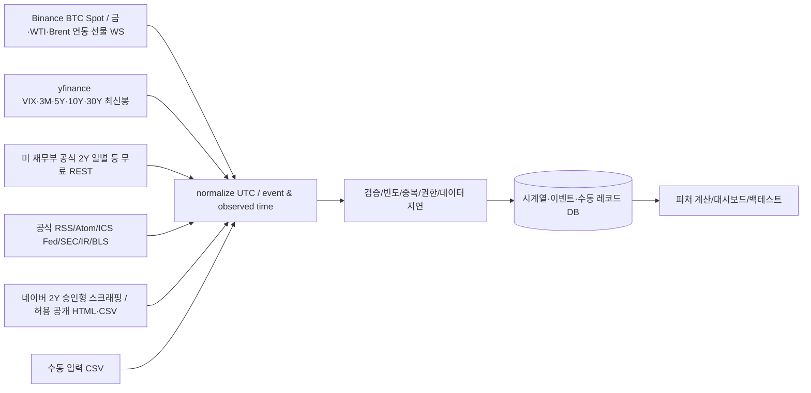

# Auto-Axe 무료 수집기 설계 및 운영 표준

> **2026-11-23 현재:** Binance 무료 실시간 시세는 BTC 현물·금/WTI/Brent 연동 영구선물 기본, yfinance는 VIX·국채 3M/5Y/10Y/30Y만 담당. 2년 국채는 네이버 승인형 데이터 수집 목표이며 허가 전 Treasury 공식 일별값을 사용한다. [최신 소스 정책](./Market_Source_Policy_20261123.md).

## yfinance 기업 재무지표 조회와 이동평균선 산출 (추가 설계)

- **PER 후행·예상, PBR, ROE**는 개별 기업 종목의 `Ticker.info`에서 조회해 값·조회시각·재무기준시점·후행/예상 여부를 보존한다. 필드가 누락되면 결측 처리하고 **QLD 같은 ETF의 기업 ROE**를 강제로 생성하지 않는다.
- **최저가·최고가 6종:** yfinance 일봉 `Low`/`High`의 최근 5·10·20개 확정 거래 세션 rolling min/max를 로컬 계산. 실제 거래 세션만 세고 주말·휴장을 포함한 달력상 일수는 사용하지 않는다. 마감 후 산출과 장중 비교(직전 N개 완성봉)를 분리하여 룩어헤드·진행봉 오염을 막는다.
- **SMA·EMA**는 yfinance `Ticker.history`의 조정 여부가 명시된 OHLCV로 로컬 계산한다. 일봉 SMA 5·20·60·120·200, EMA 12·26 등을 지원하며, 일봉/분봉, 확정/진행 봉을 구분한다.
- 기업 재무지표는 일별 조회·실적 발표 후 갱신을 기본으로, 기술적 지표는 봉 확정 후 계산한다. 과거 백테스트에 현재 `Ticker.info`를 소급 적용하면 미래정보 누수가 발생한다.
- [필드·계산식·Python 예제](./YFinance_Valuation_and_Moving_Averages.md). 현재 운영 수집기에는 미구현.

## 미국 주식·ETF 누적 거래량 1초 스냅샷 (추가 설계)

- NVDA·QLD 등 미국 주식/ETF는 **yfinance WebSocket `day_volume` 이벤트 수신**을 별도 피드로 운영한다.
- 1초 기록은 **로컬 샘플러**가 담당한다. 새로운 WebSocket 업데이트가 없으면 원본 누적값과 원본 타임스탬프를 유지하고 `no_update/stale`로 표기한다. **Yahoo 1Hz 데이터 전송이나 무지연 시세를 보장하지 않는다.**
- `[symbol, source_event_at, received_at, sampled_at, day_volume, status]`를 보존하며 거래량 리셋·역순 메시지·휴장·재연결을 별도 검증한다.
- [yfinance 주식·ETF 누적 거래량 1Hz 수집 명세](./YFinance_1s_Stock_Cumulative_Volume.md). **현재 운영 코드 미구현**.

## DRAM 모듈 가격 수집 (추가 설계)

- DRAMeXchange 홈페이지 `Module Spot Price` 표의 지정 UDIMM 16GB/RDIMM 32GB 두 행 `Session Average`를 승인 후 스크래핑한다. 상품별 별도 `series_id`, 원본 Last Update(GMT+8), 수집 시각·단위·정정 이력을 보존한다.
- 일 1회 점검하되 주간 원본 갱신만 새 발표로 적재한다. DOM 구조·중복/누락 및 수집 권한 검증 실패 시 비활성 또는 결측 처리. [상세 명세](./DRAMeXchange_Module_Spot_Prices.md).

## 1. 모듈 구성



- 수집기의 `provider`, `collection_method=API|WEBSOCKET|SCRAPE|MANUAL`, `source_url`, `frequency`, `cost=0`, `terms_check_at`, `quality_status` 고정 기록.
- 무료 공개 브라우저 시세가 해당 서비스에서 **자동 수집·보관 허가**된다는 가정을 하지 않는다. CNN, Google Maps Popular Times, Cboe Quote Dashboard, TradingView/Yahoo 내부 시세 역공학은 승인 소스로 자동 등록하지 않음.
- **Binance 실시간:** `BTCUSDT` Spot과 `XAUUSDT`·`CLUSDT`·`BZUSDT` 영구선물은 별도 `series_id`, 시장 종류, USDT 호가통화, 원본 시각을 보존한다. VIX·국채 3M/5Y/10Y/30Y만 yfinance(지연 가능). **2Y 국채:** 지정 네이버 `US2YT=RR`는 승인받은 경우에만 자동수집, 권한 없으면 공식 Treasury `BC_2YEAR` 일별 fallback. `Gold API`는 별도의 현물 참고 값이다.
- API 장애 → 동일 정의의 허용된 무료 데이터가 있을 때만 fallback → 정책 허용 스크래핑 → **수동**. 같은 자산이라도 선물과 현물처럼 `instrument_type`이 다르면 서로 fallback으로 섞지 않는다.

## 2. 저장 스키마

```sql
CREATE TABLE indicator_observations (
    id BIGINT GENERATED ALWAYS AS IDENTITY PRIMARY KEY,
    provider TEXT NOT NULL,
    series_id TEXT NOT NULL,
    method TEXT NOT NULL CHECK (method IN ('api','websocket','scrape','manual')),
    instrument_type TEXT NOT NULL,
    value NUMERIC(30,12),
    unit TEXT,
    quote_currency TEXT,
    venue TEXT,
    contract_code TEXT,
    period_label TEXT,
    observation_at TIMESTAMPTZ,
    published_at TIMESTAMPTZ,
    first_seen_at TIMESTAMPTZ NOT NULL,
    received_at TIMESTAMPTZ NOT NULL,
    revision_id TEXT,
    reported_delay_minutes INT,
    status TEXT NOT NULL,
    source_url TEXT NOT NULL,
    raw_sha256 TEXT,
    attribution TEXT,
    note TEXT
);
CREATE INDEX indicator_by_series_event
ON indicator_observations(series_id, observation_at, first_seen_at);
```

`observation_at`이 공개되지 않은 경우 NULL. 자동화에 쓸 수 있는 시점은 첫 공개/실제 수집 시점 중 늦은 보수적 기준. `received_at`을 `observation_at`으로 대입해 백테스트 미래값 누출하지 않는다.

공시 가이던스는 별도 `corporate_guidance` 테이블: `cik/ticker`, `accession`, `filing_url`, `fiscal_year/quarter`, `metric`, `gaap_or_adjusted`, `low/high`, `first_seen_at`, `review_status`. 추출기가 문맥을 확정하지 못하면 `manual_review_required`.

발표/만기는 `event_calendar`에 `scheduled_at`, `released_at`, `first_seen_at`, `actual/forecast/previous`, `expiration_at`, `last_trade_at`, `processing_at`, `settlement_at`, `is_holiday_override`, `source_url`를 따로 기록. 명목 만기일과 처리일은 달라도 된다.

미국 분기 동시 만기는 계약별 원자료를 기반으로 `TRIPLE_WITCHING` / `QUADRUPLE_WITCHING` / `PENDING_VERIFICATION`을 파생한다. 4개 상품군의 실제 동시 만기 여부를 확인하고, ET 세션 날짜·계약 참조·출처·검증시각·개정 이력을 보존한다. `IS_TRIPLE_WITCHING_DAY`, `IS_QUADRUPLE_WITCHING_DAY`, 유형별 DTE를 별도로 계산하며 쿼드러플을 트리플로 중복 집계하지 않는다. [분류·필드·예제](./US_Equity_Witching_Calendar.md).

## 3. 무료 수집 스케줄 (제안, 게시기관 보장 주기가 아님)

| 어댑터 | 권장 실행 | 변동 시 |
|---|---|---|
| Binance Spot·TradFi Futures WS (기본 시장가격) | 거래 발생 시 이벤트 기반 | 체결시각/연결 상태/휴장·유동성 확인, 백오프·누락 보완 | 
| yfinance VIX·3M/5Y/10Y/30Y | 1~5분(제안) 최신봉 조회 | Yahoo 지연·장시간 및 라이선스 확인 |
| 네이버 2Y (자동 수집 허가 시에만) | 승인된 수집 주기 | `US2YT=RR` 원본 시각·지연·권한 검증 |
| Treasury 공식 국채 2년물 + 5종 교차검증 | 게시 후 일 1회 | 네이버 무허가 기본 2Y 일별값, 공식 5종 별도 검증 |
| Coinbase BTC/USD WS (보조) | 필요할 때 스트리밍 | USD와 USDT 혼합 금지, 누락·재연결 관리 |
| Gold API 현물 참고 | 필요할 때만 폴링 | Binance 금 연동 선물과 별도 저장 |
| SEC 신규 8-K/기업 IR RSS | 평시 60~120초 (정책 허용 범위) | 링크 신규→공시 첨부 파싱·검수 |
| BLS ICS/BEA/Fed 일정 | 일 1~4회, 발표 전 추가 확인 | 변경된 이벤트 UID 버전 저장 |
| BLS/BEA 실제 발표 | 평소 공식 발표 주기에 맞춰; 발표 예정 전후 단기 집중 | 무료 API 호출량 제한·429 준수 |
| Treasury/EIA/Cboe | 게시 완료 후 일별 | 늦은 수정/빈값 탐지 |
| Fed/BOJ/ECB RSS, BoE 결정 | 평시 수분~시간 간격, 발표 시 집중 | headline → 결정문 본문 → 수치/발효일 검증 |
| OCC/CME 만기/휴장 | 주간, 긴급 변경 공지 | 계약별 명목 만기·처리일 변경 검증 |
| CNN/Pizza/권한 미확인 2Y 장중 | 자동 수집 불가 시 수동 | Naver robots/이용권 검증 전 불활성화 |

구독이 없는 정적 원본을 매초 호출하지 않는다. 공식 무료 API의 권리·요금·호출량과 문서화를 주기적으로 재검토한다.

## 4. 무료 스크래핑 어댑터

1. **공식 기계 판독 링크가 있으면 먼저 사용**: SEC Atom, 회사 IR RSS, 연준/ECB/BOJ RSS, BLS ICS, Treasury XML, Cboe EOD CSV.
2. HTML 외에는 없는 공공발표/회사 IR 페이지에서 사이트 이용약관·robots 등 허용 여부 확인 후 `requests + BeautifulSoup`, `ETag/If-Modified-Since`, 429 backoff, 셀렉터 테스트 적용.
3. 페이지에서 기준시각이 빠진 경우 임의 추정하지 않고 `source_time_unknown`/수동 검수.
4. robots가 허용해도 이용약관·콘텐츠 재사용 권리가 금지하면 수집 중단. CAPTCHA/403 로그인·유료벽을 우회하지 않는다.
5. HTML DOM 변경으로 선택자가 0개를 반환하면 **성공 처리 금지**, `manual_required` 로 남겨 원문을 확인.
6. 원문 링크·시각·해시를 남기고 SEC는 식별 UA·10req/s 이하, BLS 무료 일일 호출량 준수.

## 5. 장애·정정·시간대

- `429`은 Retry-After, `5xx` 지수 백오프. 인증/403 차단은 회피하지 않고 수동 경로로 전환.
- WS 재연결 후 갭 범위 REST 재요청, 거래 시퀀스/타임스탬프 중복 제거.
- `UTC` 저장, `America/New_York` (EST/EDT), `Europe/London`, `Asia/Tokyo`, `Asia/Seoul` 렌더링. 주요 정책 발표시간 고정 UTC 오인 금지.
- first-release 값과 revised 값 분리해 point-in-time 백테스트 수행; 전망치와 결과값, 월평균과 일별, 원상품과 파생상품 가격을 섞지 않는다.
- API에서 값이 비어있거나 지연되면 `missing|stale`로 명시하고 자동 주문에 연결할 때 `stale` 방지 규칙을 먼저 구현.

## 6. 실행 경로

- [무료 지표 전수 명세](./Free_Data_Collection.md)
- [무료 실행 가이드](./Realtime_Quickstart.md)
- [수동 입력 정책·CSV](./Manual_Collection.md)
- [Python 수집기](../examples/realtime_collector.py), [환경변수](../examples/.env.example)


## 미국 국채 만기 구성

| 만기 | 우선 소스 | 보조 공식 일별 |
|---|---|---|
| 3개월 | yfinance `^IRX` | Treasury `BC_3MONTH` |
| 2년 | **네이버 `US2YT=RR` 승인 시** | 무허가 시 Treasury `BC_2YEAR` 일별 |
| 5년 | yfinance `^FVX` | Treasury `BC_5YEAR` |
| 10년 | yfinance `^TNX` | Treasury `BC_10YEAR` |
| 30년 | yfinance `^TYX` | Treasury `BC_30YEAR` |

[최신 기본 수집 명세](./Market_Source_Policy_20261123.md). 국채 금리선물과 현물 수익률을 같은 컬럼에 기록하지 말 것.

## 구리·은 및 Binance 롱숏 비율 추가 (2026-11-23)

- **구리:** Binance Futures `COPPERUSDT`, 내부 `COPPER_BINANCE_PERP`; **은:** `XAGUSDT`, 내부 `SILVER_BINANCE_PERP`. 두 종목 모두 실측 `TRADING / TRADIFI_PERPETUAL`, REST 1분봉 지원. 기존 Binance Futures `@aggTrade` 실시간 스트림의 구독 목록에 추가했다. USDT 표시 영구선물은 원자재 현물 또는 거래소 만기선물과 다르다.
- **공식 롱숏 비율 4종:** 전체 계정, 상위 계정, 상위 포지션, Taker 매수·매도 거래량 비율. Binance `/futures/data/*` 무료 공개 REST의 **최소 5분 집계**로 수집한다. 실시간 WS 틱이 아니며, Taker 매수·매도 비율은 포지션 롱숏 비율과 다르다.
- `python docs/examples/realtime_collector.py binance-live`: BTC Spot + 금·은·구리·WTI·Brent 5개 영구선물.
- `python docs/examples/realtime_collector.py binance-longshort --ratio-period 5m --interval 300`: 6개 Binance 선물 심볼의 롱숏·Taker 통계 5분 간격 조회.
- [상세 응답 검증과 API 구분](./Binance_Metals_LongShort_20261123.md) · [Python 수집기](../examples/realtime_collector.py).
