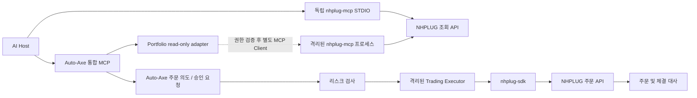

# NH투자증권 nhplug-mcp 및 nhplug-sdk 연동 명세

PAPER_LOCAL은 내부 시뮬레이터, PAPER_BROKER는 공식 NH 모의투자, LIVE는 실전 계좌로 분리한다. 모의 API 미지원 시 자동 LIVE fallback 금지. 독립 Executor의 Order Coordinator와 사전/개별 승인 정책은 [주문 기술 명세](../tech-stack/trading-integration.md)를 따른다.

> 2026-11-25 GitHub 원본 확인. 사용자 지정 외부 MCP는 [PLUG-OpenAPI/nhplug-mcp](https://github.com/PLUG-OpenAPI/nhplug-mcp)이다. 확인한 main commit: c61e38ca37de801911ac6c29a685077802513d44, package/server version 0.1.0. 현재 **조회 전용**이라 실제 주문 실행을 지원하지 않는다. 실제 주문은 공식 nhplug-sdk 기반 독립 실행 서비스로 구현한다. MCP의 조회 제한은 유지한다.

## 1. 확인된 upstream 기능

| 항목 | 실제 확인 |
|---|---|
| 저장소 | NH투자증권 Open API 로컬 MCP sample, MIT |
| 실행 | TypeScript, Node.js >=18, stdio (src/index.ts) |
| 자산군 | 국내주식 krstock, 해외주식 gbstock |
| 목록 규모 | README의 REST 53개·실시간 27채널 표기; MCP의 실제 등록 도구는 아래 6개이며 실시간 WS 구독 Tool 존재를 가정하지 않음 |
| 인증 | 앱키/시크릿 기반 토큰 처리, REST Input_0 봉투 자동 처리 |
| 주문 | 매수·매도·정정·취소 거부, NHPLUG_ENABLE_TRADING 제거 |
| 검증 | README·src/index.ts·src/tools.ts·src/spec.ts·package.json 확인; 실계좌 및 실제 호출 테스트는 미수행 |

| upstream Tool | 역할 |
|---|---|
| list_apis | 자산군/category/keyword 기반 조회 가능한 API 목록, operationId |
| describe_api | operationId 입력 스키마, 주문 API의 형식 설명 가능 |
| call_api | operationId와 input으로 허용 조회 수행, 주문 API 거부 |
| get_stock_price | 국내주식 현재가 |
| get_stock_balance | 국내주식 잔고 |
| list_accounts | 계좌 목록 |

src/tools.ts에서 isTrading인 API를 목록에서 제외하고 call_api에서 거부한다. src/spec.ts에서 주문 경로/태그로 판정한다. 실제 주문을 실행하는 MCP 도구는 없다. README의 주문 테스트 스크립트는 MCP 외부의 사람이 실행하는 테스트이며 Auto-Axe가 우회 호출하지 않는다. operationId와 Python SDK URI 경로를 혼용하지 않는다.

근거: [고정 README](https://github.com/PLUG-OpenAPI/nhplug-mcp/blob/c61e38ca37de801911ac6c29a685077802513d44/README.md) · [등록 도구](https://github.com/PLUG-OpenAPI/nhplug-mcp/blob/c61e38ca37de801911ac6c29a685077802513d44/src/tools.ts) · [주문 분류](https://github.com/PLUG-OpenAPI/nhplug-mcp/blob/c61e38ca37de801911ac6c29a685077802513d44/src/spec.ts) · [진입점](https://github.com/PLUG-OpenAPI/nhplug-mcp/blob/c61e38ca37de801911ac6c29a685077802513d44/src/index.ts).

## 2. 연결 구조

Host는 필요하면 두 MCP 연결을 개별 등록한다. 플랫폼 내부 계좌 조회가 필요하면 Auto-Axe의 격리된 read-only integration worker가 독립 MCP Client로 연결한다. Host 직접 연결과 플랫폼 worker는 별개 프로세스·계정이며 Auto-Axe 서버가 Host에 연결된 MCP를 자동 제어할 수 있다고 가정하지 않는다. 조회 결과는 allowlist 및 계좌 소유권 검사, 마스킹·단위 정규화 후 Application Service로 전달한다. 외부 raw call_api를 일반 Auto-Axe Tool로 무제한 전달하지 않는다. NH 자격증명은 해당 격리 프로세스에만 주입한다.

## 3. 실행 구성

공식 README는 로컬 npx 또는 clone/build 후 node dist/index.js를 안내한다. Auto-Axe 운영은 검증한 commit과 lockfile을 고정하고 재현 가능한 빌드를 사용한다. 부팅마다 최신 main 실행 금지. 실제 앱키를 Git/대화/설정 예제에 넣지 않는다. 로컬 Host의 환경 변수 저장 방식과 운영 Secret Manager는 구분한다.

| 환경 변수 | 의미 |
|---|---|
| NHPLUG_APP_KEY / NHPLUG_APP_SECRET | 격리 프로세스에 전달할 발급 키 |
| NHPLUG_BASE_URL | 나무 운영 https://api.nhplug.com:8443 / 모의 https://moapi.nhplug.com:8443 |
| NHPLUG_AUTH_URL | 운영 인증 https://api.nhplug.com:8443 (모의 호출도 운영 인증) |
| NHPLUG_DEFAULT_ACCOUNT | 필요 시 제한된 계좌 설정; 기본적으로 명시적 계좌 매핑 |
| NHPLUG_ALLOW_HOSTS | 추가 허용 호스트 설정; 운영 기본 미사용 |

N2 사용 시 BASE/AUTH를 N2 공식 도메인으로 함께 맞춘다. 허용 호스트, TLS, 환경·계좌 분리 및 네트워크 정책 적용. 모의/운영 대상 설정을 명시하고 기본 모의 조회부터 검증한다. stdout은 MCP 프로토콜 전용, stderr 로그는 민감 정보 마스킹. 실제 지원 Host·transport는 호환성 시험으로 결정한다.

## 4. 조회 어댑터 및 상태 계약

- list_apis → describe_api → 허용된 operationId call_api. 국내 현재가/잔고 단축 도구 및 계좌 목록 사용 가능. 해외 종목/계좌는 번들 스키마와 실제 응답 검증을 거쳐 매핑한다. 메타 도구에서 시세·계좌 조회만 allowlist하고 미확인 operationId는 거부.
- 계좌 식별자는 내부 account_ref로 매핑하고 응답은 소유권과 최소 공개 범위를 검증한다. NHPLUG가 제공하지 않는 포트폴리오 손익/위험 계산은 별도 Application Service로 수행.
- HTTP/JSON-RPC 성공만으로 업무 성공을 단정하지 않는다. upstream은 rsp_cd/rsp_msg 업무 판정을 그대로 전달하므로 API별 공식 규격에 따라 해석한다. 호출 제한·인증 실패·데이터 없음 및 조회 기준시각을 보존한다.
- 오류 시 BROKER_UNAVAILABLE/STALE_DATA/UNKNOWN 등으로 처리한다. 조회 실패를 주문 성공·잔고 0으로 변환하지 않는다. upstream 변경 시 schema drift, allowlist, 주문 차단, 모의 환경 테스트를 다시 수행한다.

## 5. 실제 주문 실행 — nhplug-sdk

사용자 승인에 따라 실제 매수·매도 주문은 공식 [nhplug-sdk](https://github.com/PLUG-OpenAPI/nhplug-sdk)를 활용한다. nhplug-mcp는 조회 전용으로 유지한다. SDK 채택은 기술 및 개발 범위 확정이며 실거래 활성화 승인이 아니다.

| 항목 | 공식 README 확인 내용 |
|---|---|
| 패키지 | PyPI nhplug (저장소 nhplug-sdk) |
| 호출 | Python REST client call(), URI 경로 기반; MCP operationId와 구분 |
| 인증 | 앱키/시크릿, 토큰 캐시 및 호스트 가드 |
| 국내 주문 | 현금 매수·매도 샘플 |
| 해외 주문 | 매수 및 매수/매도 가능수량 조회 샘플 |
| 조회 | REST 연속조회 및 WebSocket 기능 |
| 응답 | HTTP 200은 업무 성공 보장 아님; rsp_cd/rsp_msg와 기대 출력 확인 |
| 배포 | 버전·의존성 고정; snippets/examples는 PyPI 패키지에 미포함 |

독립 Trading Executor에서만 SDK를 호출한다. Workflow 엔진은 승인된 주문 의도를 전달하고, 통합 MCP는 주문 준비·의도·승인 요청·상태 조회까지만 제공한다. 실제 제출/정정/취소 및 체결 대사는 Executor의 책임이며 구체적인 API 지원 범위는 공식 명세 및 모의 환경으로 검증한다. 임의 URI proxy와 MCP 주문 제한 우회는 금지한다.

- 기존 리스크 게이트, Kill Switch, 주문 의도 고유 키, 승인, 접수·부분체결·체결 대사 및 응답 유실 후 재전송 금지 규칙을 적용한다.
- 모의/운영 자격증명과 계좌 격리. 공식 README의 운영 계좌구분 01/02와 모의 03을 해당 환경에 맞게 확인한다. 모의 환경에서 운영으로 자동 fallback하지 않는다.
- SDK의 토큰 캐시 및 환경변수 탐색이 다른 환경의 키를 읽지 않도록 전용 실행 계정과 명시적 설정을 사용한다. SDK 스로틀 외 플랫폼 공통 호출 제한 적용.
- LIVE 제출은 SDK 연동 구현, 공식 API 계약 및 이용권 확인, 모의 주문·대사 검증, 별도 실제 거래 활성화 승인 전까지 비활성이다.

출처: [SDK README](https://github.com/PLUG-OpenAPI/nhplug-sdk/blob/main/README.md), [AGENTS.md](https://github.com/PLUG-OpenAPI/nhplug-sdk/blob/main/AGENTS.md), [PyPI](https://pypi.org/project/nhplug/), [공식 API 명세](https://www.nhplug.com/llms.txt). 실제 계좌 연결이나 주문 테스트는 수행하지 않았다.

## 6. 검증 단계

1. 고정 버전 build 및 stdio handshake/tools/list, 도구 스키마 저장.
2. 허용 조회 및 mock 환경에서 계좌 매핑·응답/단위·인증·호출 제한 검증.
3. 주문 기능 미노출·차단은 무자격증명 mock/stub 또는 소스/계약 테스트로 검증; 실제 주문 호출 시험 금지.
4. 외부 독립 연결과 Auto-Axe read-only adapter의 격리, 타 계좌 접근 차단, 키 및 로그 마스킹.
5. 조회 장애·schema 변경·재접속 검증.
6. SDK 기반 Executor 구현, 공식 API 지원 확인, 모의 주문·업무 실패·부분체결·취소·대사 및 환경 격리 검증. 별도 LIVE 활성화 승인 전 실주문 차단.

공식 명세: [NHPLUG](https://www.nhplug.com/llms.txt), [NHPLUG SDK](https://github.com/PLUG-OpenAPI/nhplug-sdk). [보안](./security.md) · [Tools](./tools.md) · [Workflow](../function/trading-workflow.md).
