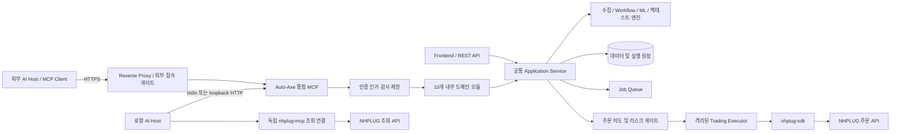

# 통합 MCP 기능 및 시스템 설계 명세

## 1. 목표 및 범위

AI 에이전트가 Auto-Axe의 시장 데이터, 지표, 그룹, 전략, 예측, 백테스트, 계좌 조회, 수집기 및 운영 상태를 표준 Model Context Protocol(MCP)로 접근하도록 한다. 특정 LLM에 종속되지 않으며, 외부 AI Host에서 MCP Client를 통해 연결한다. 기능 전체를 노출 대상으로 하되 실제 사용은 신원·권한·리소스 소유권·데이터 이용권·서비스 구현 상태로 제한한다.

| ID | 요구사항 |
|---|---|
| MCP-001 | 하나의 통합 서버와 endpoint, 내부 도메인 모듈 등록 |
| MCP-002 | Tools / Resources / Prompts 및 capability 협상 |
| MCP-003 | REST/UI와 공통 Application Service 및 도메인 정책 |
| MCP-004 | 시장·지표·그룹·Workflow·예측·백테스트·계좌·수집·시스템·주문 준비 기능 |
| MCP-005 | 원격 인증·세분화 인가·감사·호출 제한 및 사용자 승인 |
| MCP-006 | 장시간 작업 Job 생성/조회/취소, 실행 및 상태 이벤트 |
| MCP-007 | 독립 nhplug-mcp 조회 연동 및 nhplug-sdk 기반 실주문 경계 격리 |
| MCP-008 | 도메인별 계약·오류·스키마 버전 및 호환성 검증 |
| MCP-009 | 프론트엔드 상태/실행 원장과 MCP 결과 일관성, 도메인 제약 유지 |
| MCP-010 | 신규 플랫폼 기능에 대응하는 Tool/Resource 등록 및 테스트, 미구현 기능 미노출 |
| MCP-011 | 로컬 및 외부 원격 MCP 접속을 모두 지원; 인증된 외부 AI Host에서 HTTPS Streamable HTTP endpoint 사용 |
| MCP-012 | 외부 접속 활성화/비활성화, 클라이언트별 권한·승인·폐기, 네트워크 경계·암호화·감사 및 원격 보안 검증 |

## 2. 아키텍처



- Auto-Axe의 공개 MCP 연결은 기본 1개. nhplug-mcp는 외부 독립 서버이며 통합 MCP 내부 도구로 무조건 재등록하지 않는다.
- 인증/인가/감사/스키마 검증은 공통 middleware와 Application Service에서 강제한다. MCP는 비즈니스 로직의 또 다른 어댑터일 뿐이다.
- 플랫폼의 계좌 화면에 필요한 NH 조회 연동은 별도 내부 읽기 전용 MCP Client/adapter가 담당할 수 있다(명시적 권한·운영 검증 이후). 일반 MCP 서버에는 NH 자격증명을 저장하지 않는다.
- 주문 의도와 실제 제출/접수/체결은 별개. nhplug-mcp는 조회 전용으로 유지하고 실제 주문은 사용자 승인된 nhplug-sdk 기반 독립 Trading Executor로 실행한다. 구현·모의 검증·실거래 활성화 승인 전 LIVE 제출은 비활성이다. [연동 명세](./nhplug-integration.md).

## 3. 내부 모듈

| 모듈 | 책임 |
|---|---|
| market | 시세·OHLCV·거래량·롱숏·거래 세션 |
| indicator | 기술·거시·산업·경제 일정·뉴스 감정 |
| stock_group | 그룹 관리·버전·시장폭·비교 |
| workflow | 그래프 편집·참조·검증·상태·모의 실행·중단 |
| prediction | 금요일 종가매수·모델·예측·설명 |
| backtest | 전략 재생·비용 포함 성과·거래 이력 |
| portfolio | 허용 계좌의 잔고·포지션·손익·위험 조회 |
| collector | 수집기·스케줄·권한 상태·품질 |
| system | 서비스 건강·필터 로그·공개 설정·자원 사용량 |
| trading | 주문 준비·의도·검증·승인 요청·내부 원장 조회; 실제 주문 호출 없음 |

[Tool 상세](./tools.md) · [Resources/Prompts](./resources-prompts.md) · [보안](./security.md).

## 4. 통신 및 공통 계약

- 로컬과 외부 원격 접속을 모두 정식 지원한다. 원격 Auto-Axe는 HTTPS Streamable HTTP, 예시 endpoint /mcp. 로컬은 stdio 또는 인증된 loopback HTTP를 지원한다. 정확한 MCP 프로토콜 revision 및 SDK 버전은 대상 Host와 호환성 테스트 후 고정한다. JSON-RPC 및 initialize/capability negotiation은 SDK에 위임한다. 세션 헤더나 실험적 Tasks 기능을 특정 revision에서 당연히 지원한다고 가정하지 않는다.
- Tools 명명: domain_action_object (snake_case). JSON Schema로 입력/출력 검증; 지원 가능한 경우 structuredContent 및 호환용 text content를 제공한다. 도구 설명 및 annotations는 힌트이며 권한 검증을 대체하지 않는다.
- 일반 결과 계약: request_id, status, data, warnings, source_refs, observed_at/as_of, received_at, quality_status, schema_version. 페이지 조회에는 limit/cursor/next_cursor, 데이터가 없으면 null 및 사유. 수치·단위·상품 유형·원본 시각을 보존한다.
- 오류: INVALID_ARGUMENT, NOT_FOUND, FORBIDDEN, CONFLICT, IN_USE, CYCLE_DETECTED, STALE_DATA, PERMISSION_REQUIRED, NOT_IMPLEMENTED, BROKER_UNAVAILABLE, APPROVAL_REQUIRED, RATE_LIMITED, JOB_FAILED. 프로토콜 오류와 도메인 실행 오류를 구별하고 구조화된 사유 및 안전한 재시도 여부를 반환한다.
- 읽기/쓰기/삭제의 의미와 부작용을 도구별 명시. 쓰기에는 expected_version 및 idempotency_key(해당 기능에서 필요)를 검증하고 동일 키/다른 payload는 충돌 처리한다. 임의 SQL, shell, 파일 경로, 외부 URL 실행 도구는 금지.
- 지원되지 않는 도구를 동작하는 것처럼 등록하지 않는다. 고정된 공개 카탈로그가 필요한 프로토콜에서는 호출 단계에서 접근 및 기능 상태를 검사한다. 사용 가능 기능은 system_get_capabilities로 확인할 수 있다.

### 4.1 로컬 및 외부 MCP 접속 (확정 요구사항)

단일 Auto-Axe MCP의 Tool/Resource/Prompt와 Application Service를 공유하며 접속 방식 때문에 도메인 서버를 추가 분리하지 않는다.

| 접속 방식 | 연결 및 사용 범위 |
|---|---|
| 로컬 stdio | 동일 호스트의 MCP Client가 제한된 프로세스로 실행; OS 신원·로컬 권한 적용 |
| 로컬 HTTP | loopback 주소(예: http://127.0.0.1:8000/mcp); HTTP 인증 및 Host/Origin 검사 |
| 외부 원격 HTTP | 인증된 외부 PC·서버·클라우드 AI Host에서 HTTPS Streamable HTTP로 연결; 예시 https://mcp.example.com/mcp |
| 사설 원격 | VPN/사설망을 사용하는 선택적 배포 방식; 해당 네트워크에 연결 가능한 Host에 한함 |

외부 접속은 관리자가 명시적으로 활성화하고 설정한 도메인과 TLS 인증서로 제공한다. 초기값은 외부 비활성이다. 활성화한 경우 외부 네트워크에서 실제 MCP 프로토콜 연결 및 승인 범위 내 Tool/Resource 호출이 가능해야 한다. 클라우드 AI Host를 사용할 경우 해당 Host에서 도달 가능한 인증된 HTTPS endpoint가 필요하다. VPN 전용 주소가 모든 클라우드 Host에서 접근 가능하다고 가정하지 않는다.

- 인터넷 진입점은 Reverse Proxy/API Gateway 등 HTTPS 경계 하나로 제한하고 내부 MCP 프로세스·DB·큐·관리 포트는 직접 공개하지 않는다. 기존 10개 내부 모듈과 별도 nhplug-sdk Trading Executor 구조는 유지한다.
- 로컬 stdio와 원격 프로세스가 공통 서비스 및 저장소를 사용하므로 실행 버전·권한·조건 상태·주문 원장을 이중 관리하지 않는다. 로컬 연결도 무제한 관리자 권한으로 간주하지 않는다.
- 외부 Host는 endpoint 등록 → 프로토콜 초기화/인증 → 사용자 동의 및 scope 부여 → 허용 기능 조회·호출 순으로 사용한다. Host별 OAuth 및 Streamable HTTP 지원 여부는 실제 호환성 검증이 필요하다.
- 접속 설정은 외부 활성 여부, 공개 base URL, 허용 클라이언트, scope, 네트워크 정책, TLS, 제한 및 감사 설정을 관리한다. 토큰·비밀값은 공개 설정에 포함하지 않는다. 상세 요구사항은 [보안 명세](./security.md) §2.1~2.3 참조.
- 원격 접속 지원은 Auto-Axe 통합 MCP에 대한 요구사항이다. 독립 nhplug-mcp의 stdio 포트/자격증명이나 nhplug-sdk 실행 계층을 외부에 직접 공개하지 않는다.

## 5. 비동기 작업 및 운영

모델 훈련, 백테스트, 대규모 통계, 수집 재실행은 Job 방식. 생성 시 job_id/status/created_at, 상태 조회 시 QUEUED/RUNNING/SUCCEEDED/FAILED/CANCEL_REQUESTED/CANCELED, 진행도·결과 참조·오류, 종료 시각을 반환한다. Job 소유자·권한 및 입력 데이터/Workflow 버전 고정. cancel 요청과 실제 종료를 구별한다. MCP 연결이 끊겨도 서버 작업은 정책에 따라 관리하고 명시적 취소가 필요하다. 재시도 시 중복 Job 방지, CPU/메모리·기간·동시 실행 한도, 저장기간, 로그 마스킹. 결과는 Tool 및 Resource 조회로 제공한다.

## 6. AI 사용 흐름

시장 및 지표 조회 → 그룹 분석 → 월요일 예측 조회 → 노드 카탈로그 조회 → Workflow 초안 생성 → 검증 → Dry-run → 백테스트 Job → 성과/위험 보고 → 사용자의 승인 및 모의 실행. 실행 중인 버전은 AI가 수정해도 바뀌지 않는다. 승인된 Workflow의 실행 역시 실제 제출 계층의 별도 지원과 승인 없이는 LIVE 주문을 보낼 수 없다.

## 7. 프로젝트 구조 및 기술 스택

[공통 기술 계약](../tech-stack/contracts.md)의 versioned Workflow JSON Schema, Pydantic DTO/Event Envelope, Decimal/UTC, DB/Role 경계를 공통 사용한다. REST OpenAPI와 MCP JSON-RPC 프로토콜 형식은 구분하되 도메인 계약과 인가는 동일하다.

모드 계약은 BACKTEST/DRY_RUN/PAPER_LOCAL/PAPER_BROKER/LIVE이며 MCP는 직접 LIVE 실행/주문 권한을 가지지 않는다. 독립 사전 승인 Workflow와 MCP 연결 수명은 분리하고 권한 철회·공통 인가 장애를 [보안 명세](./security.md)에 따라 처리한다.

```text
backend/
  api/
  application/
    market/ indicator/ stock_group/ workflow/ prediction/
    backtest/ portfolio/ collector/ system/ trading/
  mcp/
    server.py
    registry.py
    config.py
    middleware/
      authentication.py
      authorization.py
      audit.py
      rate_limit.py
    tools/
      market.py indicator.py stock_group.py workflow.py prediction.py
      backtest.py portfolio.py collector.py system.py trading.py
    resources/
    prompts/
    schemas/
  engines/
  integrations/nhplug_readonly/
  trading_executor/  # nhplug-sdk 기반 격리 실행 서비스, 현재 미구현
frontend/
tests/mcp/
docs/mcp/
```

공식 Python MCP SDK, FastAPI, Pydantic, 공통 Application Service, PostgreSQL durable job queue/transactional outbox, Docker Compose, pytest, MCP Inspector, Prometheus/Grafana를 사용한다. Caddy/Keycloak으로 원격 인증을 적용한다. Valkey는 선택적 캐시/알림으로만 사용한다. 초기 모듈러 모놀리스 및 역할별 프로세스로 구성하고 병목·권한·장애 격리 필요 시 분리한다. 외부 endpoint는 유지하며 독립 주문 실행 계층은 별도 신뢰 경계다. [기술 명세](../tech-stack/mcp-security.md) · [전체 보안](../tech-stack/security.md).

## 8. 구현 단계 및 수용 기준

| 단계 | 범위 | 수용 기준 |
|---|---|---|
| 1 | MCP 공통 기반 및 읽기 도구 | 로컬 stdio/loopback 및 외부 HTTPS handshake, schema, 인증, pagination, 품질/시각 |
| 2 | 그룹·Workflow 초안/검증 | 버전·참조 삭제 제한·순환 검증·AND/OR 상태 일치 |
| 3 | 모의 실행·예측·백테스트·Job | 비동기 상태 및 취소, 시점 정합성, 연구/실행 모델 분리 |
| 4 | 수집/운영 및 원격 접속 보안 | TLS, OAuth, 클라이언트 승인/폐기, 네트워크 격리, 호출 제한, 허가 미확인 소스 차단, 외부 접속·접근 제어 테스트 |
| 5 | nhplug-mcp 독립 조회 연결 | 버전 고정, mock/read-only 검증, 계좌 정보 마스킹 |
| 6 | nhplug-sdk 기반 Trading Executor 구현 및 검증 | API 계약·모의 주문·위험·대사 검증 및 별도 활성화 승인 전 LIVE 차단 |

공식 참조: [MCP 명세](https://modelcontextprotocol.io/specification), [Python SDK](https://github.com/modelcontextprotocol/python-sdk), [MCP Inspector](https://github.com/modelcontextprotocol/inspector). 문서에 명시된 도구·구조는 구현 목표이며 실행 테스트 완료가 아니다.
