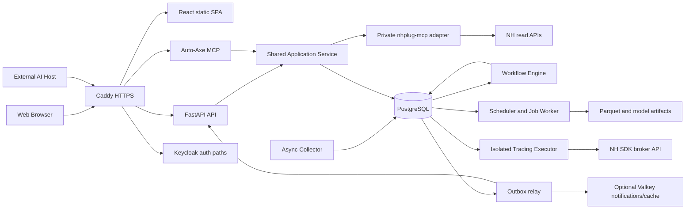

# 시스템 기술 아키텍처

> 기술 설계안 · [전체 시스템 명세](../design/specification.md)

## 1. 배포 단위와 논리 경계



공통 Application Service는 독립 서버를 뜻하지 않는다. API/MCP/worker에 설치되는 공통 Python 패키지다. 모든 변경은 해당 서비스의 정책 및 Repository/UoW를 거친다. API/MCP는 별도 진입 프로세스(동일 코드베이스)이며 MCP는 하나의 논리 endpoint다. Workflow/수집/분석 프로세스는 서로의 HTTP API를 무분별하게 호출하지 않고 명시적 DB 계약과 이벤트로 협력한다. Executor는 제한된 DB role 및 독립 credential을 사용하며 일반 API/MCP의 브로커 주문 권한은 없다.

| 프로세스 | 책임 및 독립성 |
|---|---|
| api | REST, 세션/권한, SSE 스트림, 조회/변경 명령. 수집·학습·매매를 요청 스레드에서 직접 실행하지 않음 |
| mcp | 로컬 stdio 또는 원격 Streamable HTTP, 10개 도메인 등록, 공통 서비스 |
| collector | 장시간 WS, REST 폴링, 허용 파서, 정규화·품질·batch writer |
| scheduler | 거래소 달력 및 발표 일정 기반 durable job 생성, reset 이벤트 예약, 중복 방지 |
| workflow | 활성 run 평가, 상태/체크포인트, 주문 의도 생성 및 중단 처리 |
| worker | 백테스트, 피처, 모델, 수집 재실행 등 CPU/IO job; 동시 실행 제한 |
| outbox relay | 커밋된 이벤트 재전송, UI 알림 및 consumer 전달. 전송 중복 허용·소비자 멱등 |
| nhplug-read | 외부 MCP stdio 프로세스의 전용 adapter; 조회만 수행, private |
| executor | 주문 리스크 재검증·SDK 제출·체결 대사·Kill Switch. 독립 비밀·네트워크·실행 모드 |
| postgres / idp | 원장·이력 및 인증 서버; DB role/스키마 분리 |

초기에는 collector/scheduler/worker/outbox를 역할별 command로 같은 이미지에서 실행 가능하게 한다. 분리 개수는 운영 프로필에 따라 조절하되 executor는 항상 격리한다.

## 2. 저장·통신 결정

- 동기 요청: REST JSON(OpenAPI), MCP JSON-RPC; 조회·검증 및 단건 명령. 쓰기 작업은 DB 트랜잭션과 idempotency key, expected_version을 사용한다.
- 장기 작업: PostgreSQL jobs + lease/heartbeat, FOR UPDATE SKIP LOCKED 기반 claim; 요청 응답은 Job ID. 큐와 결과 원장을 DB로 일원화해 초기 Redis/Celery의 추가 복잡성을 피한다.
- 이벤트: 동일 트랜잭션의 outbox, durable 소비자 checkpoint/inbox. 소비는 at-least-once, 외부 주문은 exactly-once라고 주장하지 않는다. PostgreSQL NOTIFY나 Valkey는 깨우기/캐시용이며 유실돼도 DB polling으로 복구한다.
- 화면 실시간 상태: SSE + snapshot/version/cursor, 브라우저 재접속 시 이력 replay 또는 snapshot 재조회. 시장 소스 WebSocket과 UI 전송을 분리.
- 내부 도메인: Python typed DTO, UTC aware datetime, Decimal 금액/수량, versioned JSON. 외부 소스별 값 정의 및 단위 강제.
- 저장: PostgreSQL 17 transactional truth, Parquet immutable 연구 스냅샷/허용된 원본 아카이브, DuckDB 로컬 분석. Valkey는 선택적 캐시이며 장애 시 주문 조건의 안전성을 훼손하지 않는다.

## 3. 프로젝트 구조 (제안)

```text
auto-axe/
  apps/
    web/                       # React SPA
    backend/
      pyproject.toml
      src/autoaxe/
        entrypoints/           # api, mcp, collector, scheduler, worker, engine, relay
        domain/                # market, indicator, groups, workflow, prediction, portfolio, trading
        application/           # use cases, authorization, UoW, ports
        adapters/              # providers, db, nhplug_read, API DTO
        infrastructure/        # event store, jobs, config, telemetry
      migrations/
      tests/
    executor/                  # 별도 패키지/이미지, SDK credential
  packages/
    contracts/                 # OpenAPI 및 event schemas, generated TS types
  infra/
    compose/
    caddy/
    observability/
  tests/
    e2e/
    fixtures/                  # 합성 또는 이용 허용 자료
  docs/
    tech-stack/
    examples/                  # 기존 PoC 보존
  .github/workflows/
```

의존성 방향은 domain ← application ← adapters/entrypoints. 도메인에서 FastAPI·SQLAlchemy·MCP·브로커 SDK 직접 import 금지. executor에 공유할 것은 versioned order contract와 필수 검증 규칙만, 일반 서비스에 SDK 주문 credential이 들어가지 않게 한다. monorepo CI는 변경 경로 기반 실행.

## 4. 기술 결정 기록

| ADR | 선택 | 이유 / 보류 대안 |
|---|---|---|
| ADR-001 | Python 모듈러 모놀리스 + 별도 실행 프로세스 | 기존 코드와 ML/NH 연동 재사용; 초기 microservices/K8s 오버헤드 배제 |
| ADR-002 | React + Vite + React Flow | 노드 편집기, 클라이언트 중심 대시보드; SSR/Next.js 및 자체 canvas 엔진 불필요 |
| ADR-003 | PostgreSQL 단일 원장 | FK/버전/트랜잭션/파티션/복구; MongoDB·별도 TSDB 초기 제외 |
| ADR-004 | PostgreSQL durable queue/outbox | 상태·명령 원자성, 단순한 운영; Kafka/RabbitMQ/Temporal은 부하 증명 후 |
| ADR-005 | 자체 상태 머신 | 조건 유지·UNKNOWN·참조·영업일 리셋·결정론 replay; n8n/ComfyUI는 UX 참고이지 주문 엔진 아님 |
| ADR-006 | 별도 주문 Executor | 조회 MCP 제한과 실주문 권한 분리, fail closed |
| ADR-007 | 단일 통합 MCP + Keycloak/Caddy | 원격·로컬 지원, 표준 인증, 내부 권한 검증 |
| ADR-008 | CPU 연구 스택 및 Parquet | 작은 주간 표본·재현성 우선, GPU/분산 ML 미채택 |

확장 조건은 [인프라](./infrastructure.md) 및 [검증](./testing-roadmap.md) 참조. 새 ADR은 요구사항, 후보, 선택, 트레이드오프, 실측 근거, 롤백 경로를 기록한다.
