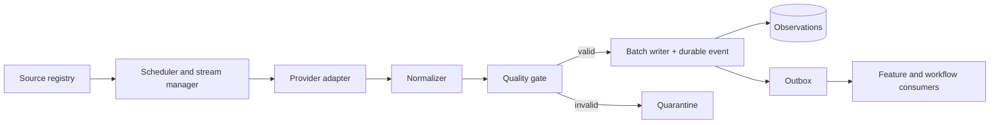

# 데이터 수집 기술 스택

> [무료 수집 정책](../indicator-collection/Free_Data_Collection.md) 및 [최신 소스 정책](../indicator-collection/Market_Source_Policy_20261123.md)을 그대로 따른다. 자동 수집이 허용되는 소스만 활성화. 기존 예제는 PoC로 보존.

## 1. 기술 및 어댑터

| 대상 | 기본 기술/구현 | 검증·제약 |
|---|---|---|
| Binance Spot BTCUSDT | asyncio + websockets, trade, httpx REST 보조 | 체결 이벤트 ID·세션·재연결 |
| Binance XAUUSDT/XAGUSDT/COPPERUSDT/CLUSDT/BZUSDT | Futures aggTrade WS 및 REST | USDT 영구선물 별도 상품, 원자산 대체 금지 |
| Binance 롱숏 | REST 4종(global account/top account/top position/taker), 5m 이상 | 계정·포지션·거래량 기준 분리, 원본 갱신 확인 |
| Nasdaq | MEXC NAS100_USDT Protobuf 어댑터 후보, Binance QQQUSDT 별도, yfinance NQ=F 지연 비교 | MEXC 실제 수신 검증 및 2026-12-01 예정 전환 재확인; NQ 실시간으로 위장 금지 |
| VIX·국채 | yfinance ^VIX/^IRX/^FVX/^TNX/^TYX, Treasury XML | Yahoo 지연·단위 확인; 2Y는 Naver 승인 전 BC_2YEAR 일별 |
| 미국 주식·ETF | yfinance AsyncWebSocket day_volume, 별도 1Hz sampler, Ticker.history | 새 메시지 없음 상태·세션 리셋, 통합 시장 거래량 보장 없음 |
| 기업 재무·기술 | Ticker.info, OHLCV, pandas rolling/EMA | point-in-time 이력, ETF 재무 필드 결측 |
| 공식 경제·정책·가이던스 | httpx, feedparser, icalendar, lxml/XML/JSON | SEC EDGAR, BLS, FRED, EIA, Treasury, 중앙은행/거래소 공식 발표; API 키 무료 등록·권한 |
| CNN F&G, PizzINT, SEIBro, DRAMeXchange, Naver 2Y | 승인 이후 BeautifulSoup/lxml 또는 Playwright UI | 기본 비활성, 허가/수동 이용 범위 확인; 우회 금지 |
| 수동 입력 | Pydantic DTO + 검수 UI/CSV import | 원본 URL·값·시각·입력자·단위·권한·검수, 자동으로 표기 금지 |

SEIBro는 해외주식 TOP50 결제금액(매수/매도/순매수 USD)이며 전체 개인투자자 실시간 거래량이 아님. DRAM은 Module Spot Price의 DDR5 UDIMM 16GB 4800/5600 및 RDIMM 32GB 4800/5600 Session Average 두 시리즈만. 두바이유 전면 제외. 경제 발표 일정과 실제값/수정값/컨센서스는 별개 필드. 위칭은 공식 상품별 만기 일정에서 실제 3/4개 상품군 동시 만기로 판정.

## 2. 파이프라인

ProviderAdapter 인터페이스: capabilities(), fetch(), stream(), normalize(), health(). Source registry에 instrument mapping, source definition, interval, permission_status, allowed_usage(storage/redistribution/trading), rate limit, freshness policy, schema version, session calendar, enabled를 저장한다. 기본 비활성 신규 scrape 소스는 관리 승인 및 증빙 없이는 scheduler가 실행하지 않는다. 환경변수 하나로 권한 확인을 우회하지 않는다.

원본 timestamp, received_at, observed/as_of_at, available_at, ingested_at을 구분. 원본 event ID와 hash로 중복 제거, 수정은 새 revision으로 append, 단위/통화/schema 검사. no_data/stale/disconnected/permission_required 등의 상태 이벤트 발행. 유효 관측값 없음은 null, 0으로 채우지 않는다. DB 적재 및 outbox를 같은 transaction으로 수행. 권한상 저장 불가한 원본은 장기 archive 금지. 허용된 payload만 보존/마스킹.

## 3. 스케줄 및 흐름 제어

- WS는 장시간 asyncio task, ping/pong/heartbeat, exponential backoff+jitter, reconnect 후 가능한 범위 gap backfill. 공급자 rate limit/Retry-After 적용; 인증 실패·권한 제한은 반복 폭주하지 않음.
- REST polling은 중앙 scheduler가 DB에 durable job 생성. 원본 갱신 주기와 조회 주기 구분; provider별 concurrency/token bucket, 공통 timeout, circuit breaker. yfinance 블로킹 호출은 제한 threadpool.
- 1Hz sampler는 monotonic clock 기준 최신 캐시를 읽고 원본 시각·새 event 여부를 보존. 재시작·거래 세션 교체·누적량 감소/정정 검증. 데이터 미수신 초에는 합성 체결량을 만들지 않는다.
- exchange-calendars + 공식 세션/휴장/조기마감 검증·버전 저장. UTC 저장, 거래소 로컬 시간으로 일정 계산. 거시 발표 수정은 idempotent scheduler key와 revision으로 처리.
- asyncio.Queue에 최대 크기/백프레셔, 소스별 공정성, writer batch size/flush interval 측정. 과부하 시 silent drop 금지; gap 기록·복구·Workflow 품질 차단. 브라우저 렌더 coalesce는 별개.
- 스크래퍼는 allowlist/권한 registry, parser fixture·schema 변화 감지, 정상 공개 UI만 사용. robots/약관/저장·활용 권한 확인, CAPTCHA/접근 제어 우회 금지. parser 오류 시 원본/허용된 증빙·검수 상태 보존.

## 4. 실측 검증

장중 BTC/금속/원유 stream, NVDA/QLD day_volume 및 Nasdaq 후보의 실제 메시지·수신률·지연 분포·세션을 측정한다. 공식 endpoint 버전·거래 상태·단위 교차 확인. 가동 전 rate limit, 429/5xx, 끊김, 재연결, 중복, 늦은 이벤트, clock skew, 수정, 권한 위반을 fixture 및 허용 live probe로 테스트. API 키/계좌를 로그로 출력하지 않는다. 소스 미검증은 해당 신호 비활성.

참조: [지표 목록](../indicator-collection/Indicator_Data_Sources.md) · [Collector 설계](../indicator-collection/Collector_Design.md) · [검증 예제](../examples/realtime_collector.py) · [yfinance](https://ranaroussi.github.io/yfinance/) · [websockets](https://websockets.readthedocs.io/) · [Playwright](https://playwright.dev/python/) · [MEXC Protobuf 명세](../indicator-collection/Nasdaq100_Futures_Data_Sources.md)
