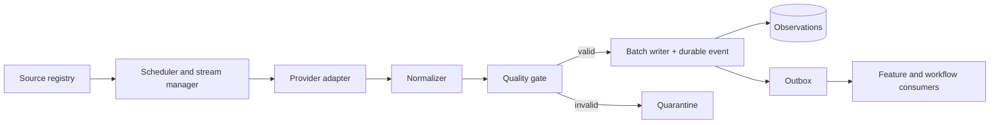

# 데이터 수집 기술 스택

> [무료 수집 정책](../indicator-collection/Free_Data_Collection.md) 및 [시장 데이터 소스 정책](../indicator-collection/Market_Source_Policy_20261123.md)을 그대로 따른다. 자동 수집이 허용되는 소스만 활성화. 기존 예제는 PoC로 보존.

## 1. 기술 및 어댑터

| 대상 | 기본 기술/구현 | 검증·제약 |
|---|---|---|
| Binance Spot BTCUSDT | asyncio + websockets, trade, httpx REST 보조 | 체결 이벤트 ID·세션·재연결 |
| Binance XAUUSDT/XAGUSDT/COPPERUSDT/CLUSDT/BZUSDT | Futures aggTrade WS 및 REST | USDT 영구선물 별도 상품, 원자산 대체 금지 |
| Binance 롱숏 | REST 4종(global account/top account/top position/taker), 5m 이상 | 계정·포지션·거래량 기준 분리, 원본 갱신 확인 |
| Nasdaq | MEXC NAS100_USDT Protobuf 어댑터 후보, Binance QQQUSDT 별도, yfinance NQ=F 지연 비교 | MEXC 실제 수신 검증 및 2026-12-01 예정 전환 재확인; NQ 실시간으로 위장 금지 |
| VIX·국채 | yfinance ^VIX/^IRX/^FVX/^TNX/^TYX, Treasury XML | Yahoo 지연·단위 확인; 2Y는 Toss 최우선, 실패/실행 불가 시에만 BC_2YEAR 임시 일별 fallback |
| 미국 주식·ETF | yfinance AsyncWebSocket day_volume, 별도 1Hz sampler, Ticker.history | 새 메시지 없음 상태·세션 리셋, 통합 시장 거래량 보장 없음 |
| 기업 재무·기술 | Ticker.info, OHLCV, pandas rolling/EMA | point-in-time 이력, ETF 재무 필드 결측 |
| 공식 경제·정책·가이던스 | httpx, feedparser, icalendar, lxml/XML/JSON | SEC EDGAR, BLS, FRED, EIA, Treasury, 중앙은행/거래소 공식 발표; API 키 무료 등록·권한 |
| CNN F&G, SEIBro, DRAMeXchange, Toss 2Y | 승인 이후 Scrapling (Selector/Fetcher 우선, 필요한 정상 렌더링만 별도 검증) | 기본 비활성, 허가/수동 이용 범위 확인; 우회 금지 |
| PizzINT DOUGHCON | 고정 HTTPS JSON GET, `defcon_level`만 정규화 | 1~5 정수, API timestamp 검증, 5분 영속 스케줄, 원본 payload 미보관, HTML/수동 폴백 없음 |
| 수동 입력 | Pydantic DTO + 검수 UI/CSV import | 원본 URL·값·시각·입력자·단위·권한·검수, 자동으로 표기 금지 |

SEIBro는 해외주식 TOP50 결제금액(매수/매도/순매수 USD)이며 전체 개인투자자 실시간 거래량이 아님. Session24부터 미국 15개 scope(5개 기간×매수/매도/순매수)를 일 1회 Scrapling 기반 정상 UI 수집 및 자동 검증으로 처리하며 결제 기준일과 원본 순위 집합을 분리 보존한다. 공급자 권한 확인 전 운영 자동 접근 비활성. DRAM은 Module Spot Price의 DDR5 UDIMM 16GB 4800/5600 및 RDIMM 32GB 4800/5600 Session Average 두 시리즈만. 두바이유 전면 제외. 경제 발표 일정과 실제값/수정값/컨센서스는 별개 필드. 위칭은 공식 상품별 만기 일정에서 실제 3/4개 상품군 동시 만기로 판정.

### 1.1 Scrapling 수집 표준

[공식 저장소](https://github.com/D4Vinci/Scrapling) 및 설치된 릴리스의 공개 API를 확인했다. Session25: 0.5.1은 DynamicSession/DynamicFetcher를 export하지 않으므로 정상 브라우저 수집 API를 제공하는 0.4.15로 고정하고 browser 그룹에 scrapling[fetchers]==0.4.15를 추가한다. Python 3.12/Playwright 1.62.0의 lock을 재생성·설치했다. 신규 수집의 브라우저 실행·세션 수명은 Scrapling이 관리하며, 기존 DOM 조작과 request fence의 Page/Route 타입만 Playwright에 의존한다. 프론트 E2E는 별개다.

| 용도 | 선택 |
|---|---|
| 정적 HTML/응답 파싱 | Scrapling Selector, CSS/XPath, 정확한 Item·열·원본 시각 검증 |
| 일반 HTTP 수집 | DRAM: Scrapling FetcherSession + IP-pinned TLS + Selector; Toss: Fetcher 우선. JSON API는 기존 전송 모듈 유지 |
| JS 렌더링이 꼭 필요한 공개 UI | 별도 승인된 Scrapling 브라우저 fetcher; 정상 렌더링/UI 동작, sandbox와 egress 통제를 실제 검증할 때만 활성화 |
| 여러 페이지 | 등록된 source별 제한된 URL/페이지 범위, scheduler/큐 유지; 자동 광역 크롤링 미사용 |
| DOM 변화 | adaptive/similar-element 매칭은 개발 중 후보 탐색에 한정; 운영 자동 재매핑 금지, 값·행·열·단위·기준시각 검증 실패 시 quarantine |

공식 라이브러리의 내장 MCP/CLI 공개 기능은 Auto-Axe에 노출하거나 사용하지 않는다. 429는 Retry-After 및 제한된 backoff. JS fetcher가 정책에 맞는 정상 모드/네트워크 격리를 제공하지 못하면 해당 어댑터를 비활성화하고 수동 기록을 사용한다.

ScrapeRequest는 사용자 URL 대신 source_id, approved adapter version, 조회 기간/국가 등 정해진 enum/범위만 받는다. job broker를 통해 isolated scraper-worker가 받아 외부 도메인만 접근하고, 크기 제한된 typed ObservationCandidate와 source metadata를 검증 서비스에 반환한다. scraper에는 DB 직접 접근·NH credential·Docker socket·임의 파일 접근·내부망 접근 권한이 없다. 승인 취소는 새 작업 및 결과 반영을 차단한다. redirect, subresource, WebSocket, 다운로드, IPv4/IPv6 및 DNS 재해석을 포함한 egress 보안은 [전체 보안 설계](./security.md) §5를 따른다.

대상별 계획: CNN은 사용자 지정 graphdata JSON 전용(비문서화, 승인 필요), DRAM은 Scrapling FetcherSession(IP 고정 TLS, 정적 DOM, browser fallback 없음), Toss는 Scrapling Fetcher(정상 HTTP) 우선, 정상 페이지의 동적 렌더링 필요 시 DynamicSession, SEIBro WebSquare는 DynamicSession 한 세션·페이지에서 기존 15-scope UI 조회. 두 브라우저 수집기는 첫 navigation 전 context fence를 설치하며 콜백 실패를 별도 보존·검증한다. HTTP 401/403/429 및 기타 비200, redirect, 인식 불가 응답, 전송 오류에서 browser fallback 금지. 정상 UI만 사용하고 impersonation/stealth/가짜 referrer/재시도는 사용하지 않는다. 실사이트 DOM·권한·운영 egress 검증 후에만 활성화한다. PizzINT는 Scrapling HTML 수집 대상에서 제외하고 공개 JSON API 전용 DOUGHCON 어댑터를 사용한다. Session27부터 base scraper에 fetchers extra와 curl-cffi 0.17.0을 고정한다. 브라우저 바이너리 설치는 여전히 별도 browser image에 한정한다.

## 2. 파이프라인

수집 관측 및 상태 이벤트는 [Common Event Envelope](./contracts.md) §3, 숫자/시간은 §4를 적용한다. market DB에 관측 및 outbox를 원자 커밋한다. Scrapling worker는 private FastAPI Job/Result API로 pull/claim/heartbeat/result를 수행하고 mTLS 서비스 identity, lease/nonce, schema/권한 검증을 적용한다(§7). 기존 수집 권한·격리 정책은 유지한다.

### 공급원 선택 및 신선도

토스증권 `ROB.US2YT-RR` (`UST_2Y_TOSS`)을 15분 승인형 Scrapling Fetcher→DynamicSession 수집의 최우선 원본으로 지정한다. 최근 검수된 표시값이 없거나 수집 실패·권한 제한 시 미국 재무부 `BC_2YEAR` 일별값(`UST_2Y_TREASURY`)으로 임시 fallback한다. 원본 갱신 시각 미확인 토스값은 수집 시각과 구분한다. 2026-11-28 사용자 승인에 따라 독립 검수 및 현재 source trading grant를 충족한 최신 관측값은 개인 자동매매 판단에 사용할 수 있다. 제3자 재배포는 금지한다. 960초 수집 시각 유효성은 원본 시세 TTL이 아니며, 원본 시각이 필수인 Workflow는 UNKNOWN 처리한다. 원본 시계열과 전환 이력을 분리하며 기존 네이버 관측값은 변경하지 않는다.

indicator_id는 논리 지표, series_id는 원본 제공자·상품·단위·계약·정의가 고정된 시계열이다. 가격, VIX, 국채, Nasdaq 등 동일 관심 자산의 다른 계약·공급원은 분리 저장한다. Workflow는 원본 series_id 고정 기본, 사용자 명시적 허용 시에만 호환 정의의 fallback을 사용한다. UST_2Y 화면은 위 우선순위로 표시하되 장중 전략은 일별 fallback 사용을 명시적으로 허용하고 해당 신선도·정의 조건을 만족할 때만 평가한다. 전환 경계의 수익률/EDGE/rolling 계산은 재기준화 또는 UNKNOWN 처리한다.

| 데이터 | 기본 신선도 정책 (TTL/유효 기간) |
|---|---|
| Binance 실시간 체결 | 10초, 거래 세션·유동성 및 원본 이벤트 확인 |
| 미국 주식 WebSocket | 10초, 공급자 원본 지연 별도 확인 |
| VIX yfinance ^VIX | **10초**, 원본 이벤트 시각 기준 |
| yfinance 국채 3M/5Y/10Y/30Y | 원본 TTL 5분; 정기 조회 15분 |
| Binance 롱숏 4종 | 10분, 원본 최소 5분 집계 |
| 토스증권 2Y | 정기 조회 15분(900초), 원본 시각 미확인; 표시값 수집 시각 최대 960초 (TTL 아님) |
| Treasury 공식 일별 수익률 | 다음 공식 발표 예정 시각 기준 |
| 기업 재무지표 | 최근 유효 공시 및 정정 여부 |
| 경제지표 | 공식 발표 일정·revision 기준 |
| DRAM 모듈 가격 | 주간 발표 일정 기준 |

TTL은 원본 관측의 유효성 기준이며 수집 주기·네트워크 연결 상태·조회 시각과 별개다. VIX 10초는 확정된 신선도 기준이지 Yahoo가 매 10초 신규 값을 제공하거나 무지연임을 보장하지 않는다. 원본 시각 미확인/지연 초과 시 UNKNOWN 또는 stale, 반복 조회로 원본 timestamp/TTL 갱신 금지. 거래 시간 밖은 session_closed로 분리하며 장중 최신값으로 위장하지 않는다. 소스별 수집 주기는 원본 제공 빈도·권한·호출 제한에 따르고 TTL을 만족할 수 없으면 실거래 조건을 차단한다.

조건 충족/새 유효 달성 사건이 발생하면 RefreshCoordinator에서 관련 타 조건 데이터의 즉시 갱신을 요청한다. WS 최신 이벤트 확인, 허용 REST 재조회, 로컬 지표 재계산을 수행하고 source/series별 in-flight 병합·rate limit·timeout을 적용한다. 요청 결과 및 원본 시각을 기록하고 새 committed snapshot으로 재평가한다. 데이터 제공자 권한·게시 주기를 우회하지 않는다. [실행 계약](./workflow-engine.md).

ProviderAdapter 인터페이스: capabilities(), fetch(), stream(), normalize(), health(). Source registry에 instrument mapping, source definition, interval, permission_status, allowed_usage(storage/redistribution/trading), rate limit, freshness policy, schema version, session calendar, enabled를 저장한다. 기본 비활성 신규 scrape 소스는 관리 승인 및 증빙 없이는 scheduler가 실행하지 않는다. 환경변수 하나로 권한 확인을 우회하지 않는다.

원본 timestamp, received_at, observed/as_of_at, available_at, ingested_at을 구분. 원본 event ID와 hash로 중복 제거, 수정은 새 revision으로 append, 단위/통화/schema 검사. no_data/stale/disconnected/permission_required 등의 상태 이벤트 발행. 유효 관측값 없음은 null, 0으로 채우지 않는다. DB 적재 및 outbox를 같은 transaction으로 수행. 권한상 저장 불가한 원본은 장기 archive 금지. 허용된 payload만 보존/마스킹.

## 3. 스케줄 및 흐름 제어

- WS는 장시간 asyncio task, ping/pong/heartbeat, exponential backoff+jitter, reconnect 후 가능한 범위 gap backfill. 공급자 rate limit/Retry-After 적용; 인증 실패·권한 제한은 반복 폭주하지 않음.
- REST polling은 중앙 scheduler가 DB에 durable job 생성. 원본 갱신 주기와 조회 주기 구분; provider별 concurrency/token bucket, 공통 timeout, circuit breaker. yfinance 블로킹 호출은 제한 threadpool.
- 1Hz sampler는 monotonic clock 기준 최신 캐시를 읽고 원본 시각·새 event 여부를 보존. 재시작·거래 세션 교체·누적량 감소/정정 검증. 데이터 미수신 초에는 합성 체결량을 만들지 않는다.
- exchange-calendars + 공식 세션/휴장/조기마감 검증·버전 저장. UTC 저장, 거래소 로컬 시간으로 일정 계산. 거시 발표 수정은 idempotent scheduler key와 revision으로 처리.
- asyncio.Queue에 최대 크기/백프레셔, 소스별 공정성, writer batch size/flush interval 측정. 과부하 시 silent drop 금지; gap 기록·복구·Workflow 품질 차단. 브라우저 렌더 coalesce는 별개.
- parser 오류 시 원본/허용된 증빙·검수 상태 보존.

## 4. 실측 검증

장중 BTC/금속/원유 stream, NVDA/QLD day_volume 및 Nasdaq 후보의 실제 메시지·수신률·지연 분포·세션을 측정한다. 공식 endpoint 버전·거래 상태·단위 교차 확인. 가동 전 rate limit, 429/5xx, 끊김, 재연결, 중복, 늦은 이벤트, clock skew, 수정을 fixture 및 live probe로 테스트. API 키/계좌를 로그로 출력하지 않는다. 소스 미검증은 해당 신호 비활성.

참조: [지표 목록](../indicator-collection/Indicator_Data_Sources.md) · [Collector 설계](../indicator-collection/Collector_Design.md) · [검증 예제](../examples/realtime_collector.py) · [yfinance](https://ranaroussi.github.io/yfinance/) · [websockets](https://websockets.readthedocs.io/) · [Scrapling](https://github.com/D4Vinci/Scrapling) · [공식 문서](https://scrapling.readthedocs.io/en/latest/) · [MEXC Protobuf 명세](../indicator-collection/Nasdaq100_Futures_Data_Sources.md)
