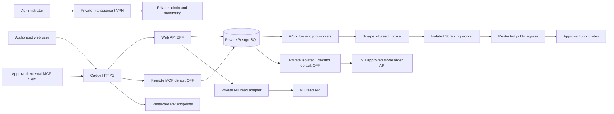

# Auto-Axe 전체 플랫폼 보안 아키텍처

> 2026-11-25 · 설계안. 기존 [MCP 보안 요구사항](../mcp/security.md), [주문 실행 명세](./trading-integration.md) 및 무료 수집 정책을 유지한다. 본 문서는 전체 플랫폼 구현 기준이며 보안 설정 배포·침투시험·운영 승인 완료를 의미하지 않는다. 외부 MCP와 LIVE는 기본 비활성이다.

## 1. 보안 목표 및 위협 모델

개인/소규모 운영의 비용·복잡성을 고려해 기본 차단, 최소 권한, 신뢰 경계 분리, 명시적 승인, 데이터 무결성, 복구 가능성을 우선한다. 사용자가 로그인했거나 내부 네트워크에 있다는 이유만으로 다른 자원/계좌 접근을 허용하지 않는다. 주문 안전성 및 계좌 비밀을 가장 중요한 자산으로 분류한다.

| ID | 위협/보호 대상 | 핵심 통제 |
|---|---|---|
| SEC-01 | 계정 탈취·세션/토큰 도난 | Keycloak OIDC/OAuth, MFA/passkey, 세션 회전/폐기, CSRF |
| SEC-02 | IDOR/BOLA, 권한 상승, MCP 악용 | 서버 RBAC+resource policy, scope, 계좌/모드/버전 검증 |
| SEC-03 | 외부 노출·횡적 이동 | Caddy TLS, nftables/동등 방화벽, private zones, 관리 VPN |
| SEC-04 | SSRF·악성 HTML/JS·DNS rebinding | Scrapling 별도 sandbox, 제한 egress, 검증 broker |
| SEC-05 | 비밀·계좌·데이터 유출 | 역할별 secret, 암호화, 최소 접근, 로그 마스킹 |
| SEC-06 | 주문 탈취·중복·잘못된 계좌/모드 | 독립 Executor, 승인/리스크/멱등·대사, Kill Switch |
| SEC-07 | 데이터 변조·stale·모델 오염 | provenance/품질 게이트, 버전·해시, artifact 검증 |
| SEC-08 | 공급망·CI/CD 악성 코드 | lock/digest, SBOM, Trivy, Gitleaks, 검토·서명 |
| SEC-09 | 서비스 장애·DoS·복구 실패 | rate/size limits, quotas, backup/PITR, alert, fail closed |
| SEC-10 | 감사 우회·사고 대응 지연 | append-only audit, off-host 보존, 사건 대응/재무장 |

공격 표면: 브라우저/REST/SSE, 로컬·외부 MCP, 공개 시장 피드/스크래퍼, 그룹/Workflow JSON import, 뉴스/모델 파일, DB/backup, IdP/관리 API, build/registry, broker API와 주문·통보 연결. 외부 페이지·MCP tool output·모델 출력은 신뢰할 수 없는 데이터로 취급한다.

## 2. 보안 기술 스택

| 영역 | 초기 선택 | 역할 |
|---|---|---|
| Edge | Caddy | HTTPS, 명시적 route·Host 정책, 보안 헤더, 요청 제한 |
| 신원 | Keycloak, PyJWT[crypto] 또는 introspection | OIDC/OAuth 2.1 호환 검증, MFA, scope·token 검증 |
| 네트워크 | Linux nftables 또는 동등 host firewall, Docker network, WireGuard(관리 VPN 후보) | inbound/forward/egress 기본 차단, 관리 경로 분리 |
| 격리 | Docker non-root, seccomp, AppArmor/SELinux, read-only FS, capabilities drop | scraper/worker/executor 보호 |
| 비밀 | 서비스별 Docker secret 파일, SOPS+age(암호화 구성 후보) | 최소 mount·rotation·백업, key 분리 |
| DB/백업 | PostgreSQL role/GRANT, TLS, SCRAM-SHA-256, LUKS 또는 호스트 암호화, 암호화 off-host backup | 전송/저장 보호 및 원장 분리 |
| 공급망 | uv/pnpm lock, Trivy, Syft SBOM, Gitleaks, pip-audit, npm audit, Cosign(서명 후보) | 취약점·secret·provenance 검증 |
| 보안 테스트 | pytest/Hypothesis, OWASP ZAP(staging), MCP Inspector, 합성 SSRF/XSS/권한 테스트 | ASVS 기반 수용 기준 |
| 관측 | Prometheus/Grafana, structlog, OpenTelemetry | 보안 이벤트·위험 상태, 감사 별도 저장 |

WAF/CrowdSec 및 외부 DDoS 방어는 공개 범위·비용·운영 부담을 평가 후 추가한다. Caddy 기본 설치에 WAF/고급 rate limiting이 내장된 것으로 가정하지 않는다. rate limit은 application middleware와 검증된 edge/host 통제로 구현한다. 제품 버전·호환성·라이선스는 설치 및 검증 단계에서 고정한다.

## 3. 네트워크 및 신뢰 경계

| Zone | 허용 경로 | 금지 |
|---|---|---|
| edge | 외부 443 HTTPS, 필요 시 80 인증서 challenge/redirect | 내부 origin 직접 접속, 임의 upstream |
| auth | 제한된 공개 로그인/discovery/token, 내부 API 검증 | 외부 admin console 및 DB |
| app/data | API/MCP/engine/job의 계약별 통신, 제한 DB role | 외부 직접 port publish |
| scrape | broker와 고정 job/result, 제한 egress gateway | DB/IdP/Executor/NH 비밀/관리망/metadata |
| broker-read | NH 조회만, allowlisted upstream | 실주문 호출 및 외부 공개 |
| executor | 승인 모드별 NH endpoint, 제한 trading role, 대사 | 외부 inbound, scraper 및 AI 직접 호출 |
| ops | 관리자 VPN/사설망 및 MFA | 인터넷 직접 Grafana/Prometheus/SSH/Docker API |
| backup | 제한된 암호화 백업 writer/restore principal | 일반 앱 삭제·읽기 및 공개 |

기본 Web UI도 사설망 접근을 우선한다. 외부 UI/원격 MCP 공개는 각각 명시적 승인 및 검증 후 허용하며 MCP off 상태는 proxy와 애플리케이션 양쪽에서 차단한다. SSH 키 기반 인증, 관리자 MFA 및 최소 sudo, 비상 로컬 관리 경로. Docker port publish와 host firewall forwarding/IPv6 규칙을 검증한다. Compose network 이름만으로 격리를 보장하지 않으며 연결되지 않은 zone 간 routing 및 host gateway 접근을 차단한다. 인터넷에서 실제 포트 스캔/접속 테스트, 내부에서는 zone별 허용/거부 matrix 확인. 사설망·VPN은 사용자/서비스 인가의 대체 수단이 아니다.

## 4. 인증·인가 및 웹 보안

### 4.1 신원과 세션

- Keycloak 계정은 초기 관리자 bootstrap 이후 임시 관리자 비밀 제거. 관리자 및 거래 승인자 MFA 필수, 일반 사용자는 MFA/passkey 권장 또는 정책상 강제. 공개 자가가입 기본 off. brute-force 제한·잠금 복구·감사.
- 브라우저 BFF: Authorization Code + PKCE, state/nonce, redirect URI exact allowlist; 서버 세션, HttpOnly/Secure/SameSite cookie, 로그인 후 세션 ID 회전, CSRF token 및 Origin 검증. access/refresh token 서버측 보호, localStorage 금지. logout/계정 폐기·scope 변경 시 접근 회수.
- 원격 MCP: 기존 [MCP 보안](./mcp-security.md) 적용. OAuth discovery/resource/audience, PKCE, issuer/signature/expiration/scope/client 검증, 클라이언트 승인 및 폐기. 세션 ID는 인증이 아니다. 신원 위임 및 서비스 계정 별도.
- 초기 정책 목표(미검증·조정 가능): access token 5~15분, UI idle timeout 30분 및 absolute session 12시간, 민감 설정/승인 시 재인증. IdP 설정 및 Host 호환성 테스트 후 적용.

### 4.2 권한

| 역할 | 허용 | 기본 불허 |
|---|---|---|
| Viewer | 권한 있는 지표 및 읽기 | 계좌·전략 변경·주문 |
| Analyst | 연구/백테스트/그룹 초안, 허용 데이터 | LIVE 승인·실주문 |
| Strategy Editor | Workflow 초안·검증 | 무승인 배포·LIVE |
| Operator | 승인된 모의 실행/중단, 수집 운영 | 임의 위험 한도 변경·비밀 조회 |
| Trading Approver | 허용 계좌/모드/한도 내 승인, 비상 중단 | 직접 DB 변경·일반 MCP 주문 제출 |
| Security Admin | 클라이언트/권한·보안 설정·감사 | 묵시적 거래 승인 |
| Service principals | 해당 작업의 고정 최소 권한 | 사용자 대리 무제한 접근 |

역할 합성도 서버 정책을 우회할 수 없다. 개인 운영에서 한 사람이 여러 역할을 가질 수 있으나 승인 action/재인증/감사 기록은 분리. API/MCP/job은 공통 authorization service로 principal, resource owner, 계좌, 실행 모드, version, scope, permission, 승인 상태를 매 요청 검증. 리소스 ID만으로 접근 허용 금지, 거부 기본값. 관리자의 권한 상향 및 주문 정책 변경은 별도 재인증/감사; 고위험 변경은 독립 승인자 지원 옵션.

### 4.3 입력·브라우저

Pydantic strict schema, Decimal precision/범위/enum, query 기간·페이지·payload 한도, parameterized SQL. 사용자 graph/import는 크기·깊이·노드 수·순환·타입 검사, 임의 eval/shell/SQL/URL/path 금지. UI에서 HTML 직접 삽입 금지, 외부 텍스트 escape, URL scheme allowlist. CSP(default-src self 기반, 필요한 자원만 명시), frame-ancestors, nosniff, Referrer-Policy, HSTS는 HTTPS 검증 후 적용. CORS 필요 origin만, CSRF 별도. 업로드는 허용 포맷/크기/스키마와 경로 traversal 검사, 서버 실행 파일이나 pickle 금지. API rate limit은 principal/client/IP 및 action 기준, Job/WS/SSE 동시성 및 메모리 제한. 오류 응답에서 stacktrace·secret 숨김.

## 5. Scrapling 수집 보안

사용자 지정 [Scrapling](https://github.com/D4Vinci/Scrapling)을 사용한다. HTTP/Selector 우선, JS 렌더링은 필요한 승인 대상에만 분리 실행. upstream 기능 자체가 접근 허가를 의미하지 않는다. CAPTCHA/유료벽/인증·차단 우회, stealth/fingerprint 변조·proxy rotation, 외부 CDP, Scrapling 내장 MCP/CLI 서비스 공개를 금지한다.

- 등록된 source_id와 adapter version, 승인된 조회 parameter만 받는다. registry에 allowlisted scheme/host/port/path, subresource host, permitted methods, permission evidence/expiry, rate limit, data storage/reuse policy 기록. 기본 off, robots 및 이용약관·권한 재검토. 403/CAPTCHA/로그인벽은 중단; 429는 제한된 Retry-After backoff.
- broker는 제한된 내부 service identity로 typed job/result만 교환. worker는 arbitrary URL/path/SQL/commands를 받지 않는다. source 권한 취소/만료 시 job 발급·결과 반영 차단. scraper는 DB 연결정보와 브로커 secret을 보유하지 않는다.
- HTTPS 및 유효한 인증서, DNS/URL 정규화·IDNA 및 정확 host 검사, 자동 redirect 기본 off 또는 매 hop 재검증. 허용 host가 사설/loopback/link-local/metadata/예약 주소로 resolve하면 거부; IPv4/IPv6 및 IPv4-mapped IPv6 포함. DNS rebinding 방지는 연결할 실제 destination 검증 및 강제 egress 정책으로 구현. 응답 검증만으로 SSRF 방어 완료로 간주하지 않는다.
- 브라우저 하위 리소스/iframe/redirect/WS/download를 포함해 외부 트래픽은 전용 gateway만 통과, 고정 승인 도메인과 포트로 제한. 일반 outbound DNS/UDP/QUIC 및 직접 IP 통신 차단; gateway 자체가 private/metadata 접근 불가하도록 network policy 적용. HTTP proxy 환경변수만으로 강제했다고 가정하지 않는다. egress gateway는 TLS를 임의 복호화하지 않고 승인 host·실제 연결 주소를 제한하며 path 정책은 클라이언트에서도 적용한다.
- dedicated non-root container/VM, read-only rootfs, 제한 tmpfs, no privileged/host PID/network/Docker socket/host mounts, cap_drop, seccomp/AppArmor, CPU/RAM/PID/time/response/decompression/redirect 제한. 브라우저 sandbox를 끄는 방식으로 호환성을 해결하지 않는다. sandbox+격리가 입증되지 않으면 JS 기능 off, 필요 시 별도 VM.
- 소스별 독립 ephemeral session, 불필요한 persistent cookie·download·clipboard·파일 접근 금지. 동작은 허용된 공개 UI와 고정 adapter만. 외부 페이지의 텍스트를 명령이나 tool 호출로 처리하지 않는다.
- parser는 CSS/XPath 및 정확한 행/열/단위/원본 시각을 검증. adaptive match는 수동 검토용 후보로만 사용. 값 범위/변경률/원본 revision·freshness 검증; 실패 시 quarantine/UNKNOWN. raw HTML은 권한 있는 경우만 제한 보존, 악성 파일 실행 금지, HTML 그대로 UI 렌더링 금지. 수집 결과는 broker에서 schema·source identity·job nonce·권한/크기 재검증 후 별도 검증 writer가 적재한다.

상세 수집 기술 및 소스는 [data-collection.md](./data-collection.md). 브라우저 모드의 정상 작동/권한/실제 네트워크 경계가 불확실하면 비활성 상태로 유지하며 허용된 수동 fallback을 사용한다.

## 6. 데이터·비밀·DB 보호

| 등급 | 예시 | 통제 |
|---|---|---|
| Public permitted | 이용권 확인 시장 공개 지표 | source/permission/retention, 재배포 권한 확인 |
| Internal | Workflow·모델·시스템 설정·감사 메타데이터 | 인증, 역할별 읽기, 변경 버전, 암호화 백업 |
| Restricted | 계좌·잔고·체결·사용자 식별 정보 | 최소 필요 접근, 마스킹, 로그·연구 데이터 제외 |
| Secret | NH appkey/secret/token, IdP signing/refresh, DB password, backup key | 서비스별 secret mount, 회전, 출력/commit 금지 |

PostgreSQL no public port, TLS 및 SCRAM-SHA-256, schema/GRANT/별도 role, migration role 별도, 애플리케이션 superuser 금지. Row-level security는 계좌/사용자별 추가 방어로 검토하고 connection pool 및 정책 테스트 후 도입. Keycloak DB/role, 모의/운영 환경 분리. DB/backup 파일·artifact volume은 호스트 저장소 암호화 및 off-host 암호화 backup; key는 backup과 분리. 비밀은 Git/이미지/브라우저/Prompt/로그/trace/metrics 금지. Docker secret 파일은 권한 제한 전달 방식이지 자체 암호화 vault가 아님. SOPS+age 사용 시 age private key는 Git 밖·역할별 관리, rotation 및 복구 절차; 운영 규모에 따라 검증된 secret manager 도입. NH API 토큰 캐시/만료·동시 갱신과 모의/운영 분리는 기존 명세 준수.

관측값·피처·모델은 immutable revision/manifest/source provenance 및 cutoff, artifact checksum, 권한 검증. 부정확/지연/수집 권한 철회 데이터는 신호 제한. 외부 모델 파일/pickle 실행 금지. 기록 보관 기간은 사용권·개인정보 최소화·거래 원장 보존 요건에 따라 별도 확정하고 만료 삭제와 backup retention을 일치시킨다.

## 7. 거래 안전 및 MCP

[trading-integration.md](./trading-integration.md)와 [MCP 보안](../mcp/security.md)을 적용한다. API/MCP는 preview/intent/승인 요청만; nhplug-mcp 조회 전용; SDK Executor만 실제 주문 제출. LIVE 기본 off, 모의 계좌/credential/endpoint/DB 환경 분리, 실패 시 운영 fallback 금지. 승인 정책·한도·허용 상품·시각·버전·freshness·risk reservation을 제출 직전 확인. idempotency 및 주문/체결 대사, UNKNOWN 재전송 차단. Kill Switch는 신규 주문 차단 및 대사(자동 청산과 별도). 승인 철회·비상 중단 상태는 reset/재시작으로 해제되지 않는다. 원격 MCP off/인가 실패/권한 정책 장애, 데이터 불명 및 대사 불일치 시 fail closed. 승인된 자동 전략과 임의 AI 요청 구분. AI의 도구 설명·프롬프트·외부 데이터는 권한이 아니다.

## 8. 공급망·운영 보안 및 사고 대응

- Lockfile, pin actions SHA/image digest, SBOM·Trivy/Gitleaks/dependency audit, 보안 업데이트 검토. 검증된 registry 및 artifact 서명(Cosign 후보), 배포 전 signature/provenance 정책 확인. fork/PR에 운영 비밀 제공 금지, CI token 최소 권한, production 환경 승인, LIVE 자동 기동 금지. 브라우저 바이너리도 출처/패치/버전 검증.
- audit: actor/client, action, resource, account_ref(마스킹), mode, policy version, decision/reason, request ID, timestamp 및 redacted diff. auth 실패, 권한 변경, 외부 접속, source 승인/철회, 모델 배포, 전략 승인, 주문/중단/대사, secret rotation 기록. 일반 서비스는 append-only role, 별도 제한 audit reader, off-host tamper-evident 보존 후보. 비밀번호/token/개인정보 원문 저장 금지.
- Prometheus/Grafana private; auth brute-force/403 급증, SSRF 거부, scrape quarantine, stale, UNKNOWN 주문, risk latch, backup age, cert expiry, CI 취약점 경보. 경보는 비밀 없이 운영자에게 전달. API/IdP/DB/worker rate/connection/CPU 제한 및 backup restore/PITR 시험.
- 사고 대응: 탐지 → 관련 endpoint/client/source/계정/Executor 격리 및 신규 주문 차단 → 로그·원장·증빙 보존 → token/credential 회전·폐기 → 취약점 수정 및 restore/대사 → 사용자 승인 후 재무장. 브로커와 실제 주문 상태를 대사하기 전에 무조건 재전송/청산하지 않는다. 정기적으로 권한 검토 및 복구 훈련, 책임자와 연락 경로는 배포 전 지정.

## 9. 수용 테스트 및 출시 게이트

| ID | 검증 및 합격 기준 |
|---|---|
| SEC-01 | 만료/위조/철회 토큰, CSRF, redirect/state/PKCE, MFA, session fixation 차단 |
| SEC-02 | REST/MCP/Job의 타 사용자/계좌/모드 접근 및 read-only 변경 거부, 권한 철회 즉시 적용 |
| SEC-03 | 외부 실제 포트 및 내부 zone matrix, proxy 우회/IPv6/관리 포트 차단 |
| SEC-04 | 합성 악성 HTML/JS, SSRF/redirect/private DNS/subresource/WS/download, oversized response, scraper 침해 가정 하 DB/NH/host secret 접근 불가; 정상 렌더링 및 권한 revoke 검증 |
| SEC-05 | secret scan, 로그/trace/browser/backup 노출 검사, DB role 및 암호화 restore 검증 |
| SEC-06 | stop race/duplicate/timeout/UNKNOWN/partial fill/credential mismatch, MCP 직접 LIVE 주문 거부 |
| SEC-07 | stale·권한 철회·잘못된 DOM/단위/feature cutoff·artifact 변조 시 주문 신호 차단 |
| SEC-08 | SBOM/취약점·pin/서명·CI 권한, 합성 비밀 유출 차단, PR에서 production 접근 불가 |
| SEC-09 | rate limit·과부하·프로세스 중단·DB restore/PITR, 안전한 중단 및 재시작 |
| SEC-10 | audit 누락·변조 시도·알림, 사고 대응과 재무장 모의 훈련 |

초기 release는 OWASP ASVS Level 2를 검수 목표로 삼되 인증 획득을 주장하지 않는다. Critical/High 발견 사항은 외부 공개 또는 LIVE 활성화 전 해결하거나 해당 기능 차단, 예외는 위험 수용 주체·근거·기간 및 재검토 기록. 실제 공격 테스트는 소유/승인된 staging에서만 수행한다. 외부 MCP 공개와 LIVE 주문은 각각 필요한 수용 테스트 통과 및 사용자 명시적 승인이 별도 필요하다. 구체 도메인·호스트·IdP 버전·위험 한도·보존 기간·운영 SLO와 scraper egress 제품 구성은 배포/실측 후 확정한다.

공식 참고: [OWASP ASVS](https://owasp.org/www-project-application-security-verification-standard/) · [OWASP SSRF Prevention](https://cheatsheetseries.owasp.org/cheatsheets/Server_Side_Request_Forgery_Prevention_Cheat_Sheet.html) · [OWASP API Security](https://owasp.org/www-project-api-security/) · [Docker Engine security](https://docs.docker.com/engine/security/) · [Keycloak](https://www.keycloak.org/documentation) · [Caddy](https://caddyserver.com/docs/) · [Scrapling](https://github.com/D4Vinci/Scrapling).
