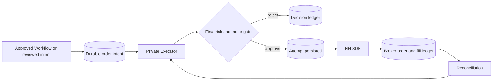

# NH투자증권 연동 및 주문 실행 기술

> 기존 [NHPLUG 연동 명세](../mcp/nhplug-integration.md)에서 확정한 조회/실주문 분리를 따른다. LIVE 활성화는 승인된 구현 및 모의 검증 후 별도 결정이다.

## 1. 기술과 경계

| 계층 | 기술 및 역할 |
|---|---|
| 조회 | 공식 nhplug-mcp Node.js stdio, Python MCP client adapter, operationId allowlist; 계좌·시세·잔고 |
| 주문 | 공식 nhplug-sdk (Python 패키지 nhplug), 독립 Python Executor 이미지/서비스 |
| 브로커 통보 | SDK/공식 REST·WebSocket, 실행 모드별 adapter, 주문·체결 대사 |
| 원장 | PostgreSQL trading schema, intents/attempts/orders/fills/risk/approvals, Decimal |
| 모의 | deterministic simulator + 공식 모의투자 별도 adapter, 계좌·endpoint·credential 분리 |
| 인증 | 비밀 파일/secret store, TTL token cache, TLS CA 검증 (필요 시 truststore) |

nhplug-mcp의 현재 조회 제한을 변경하거나 주문 테스트 스크립트를 우회 호출하지 않는다. upstream commit/package pin 및 actual tool catalog 확인. nhplug-sdk 및 해당 API 지원 범위 확인 후 정확한 요청/응답 필드는 공식 openapi.json에서 결정한다. 해외주식 종목정보파일은 별도 master importer(encoding/record format/hash/거래소/심볼 검증), 상장·폐지·거래 가능 여부 검증; 대형 master 파일 내용 전체를 이미 검증했다고 가정하지 않는다.

## 2. 주문 실행 경계

일반 API/MCP는 조회·preview·intent 및 승인 요청만 가능. Executor의 credential 및 outbound broker 네트워크는 해당 서비스에만 제공. UI/MCP/worker는 직접 SDK 주문 호출 금지. Executor는 제한 role로 approved version·risk state·kill switch·idempotency 및 account mode를 읽고 검증한다.

주문 의도: intent_id, actor/workflow_run/version, activation_id, idempotency_key, account_ref, mode, instrument_id, side, quantity, order_type, price, tif, risk_policy_version, data_as_of, approval_ref, expires_at. 지원되지 않는 상품/정정/취소/주문 유형은 NOT_IMPLEMENTED. 거래소/계좌 통화·tick size·lot size·허용 세션·잔고·현금·미체결·수수료 검증. 금액 및 한도는 사용자 설정/승인 후 확정; 임의 한도나 실주문 자동 승인 없음.

## 3. 상태 전이 및 불명확한 제출

PROPOSED → VALIDATED → APPROVED → SUBMITTING → ACKNOWLEDGED / REJECTED / UNKNOWN → PARTIALLY_FILLED / FILLED / CANCELED 등. 상세 상태는 공식 코드에 따라 매핑하고 raw response/통보 및 timestamp를 권한 범위 내 보존. 취소 요청은 실제 취소와 다르고, 부분 체결 이후 remaining quantity 별도. 승인·제출·접수·체결을 UI에서 구분.

동일 계좌의 주문 제출 gate는 DB lock/원자 상태 전이로 직렬화하고 risk reservation을 관리한다. 외부 호출 전에 attempt를 영속화하고 idempotency key/payload hash를 unique. broker가 client order ID/idempotency를 지원하는지 별도 확인. 응답 유실·timeout·crash 발생 시 UNKNOWN으로 격리하고 주문/체결 조회와 통보 대사 전 자동 재전송 금지. 주문 원장에는 broker order id, mode/account/market, attempt 및 원본 response code 기록. 분산 exactly-once 체결 보장은 하지 않는다.

Kill Switch: 신규 주문 차단, 미체결 처리 별도 정책, 이미 전송 중 주문의 결과 대사, 자동 청산 아님. stop/approval revoke와 submit 경쟁 테스트, 제출 직전 검증. 장애 복구·모드 변경 후 계좌 대사/위험 상태 확인 및 명시적 재무장. stop 또는 risk latch는 영업일 reset으로 해제되지 않는다.

## 4. NHPLUG 연결

저장소 [llms.txt](../nhplug/llms.txt), [llms-full.txt](../nhplug/llms-full.txt)의 환경·토큰·포트 및 공통 규약 준수. 운영 기본값을 그대로 사용하지 말고 mode를 명시; 모의 REST와 운영 REST, WS endpoint 및 계좌 구분을 allowlist로 고정. 환경이 맞지 않으면 fail closed, 모의 실패 후 운영 fallback 금지. token expiry cache 및 동시 갱신 lock, 429는 backoff와 기존 토큰 재사용, 401 및 만료 규칙은 공식 문서와 실제 응답 검증. 토큰/앱키/계좌정보 로그 마스킹. WebSocket 인증 및 통보/해외 시세 포트 구분 검증; TLS verify=False 금지.

## 5. 검수

공식 모의 계좌에서 지원 범위 확인 후 최소 테스트, 응답 유실/부분체결/중복통보/거부/정정취소/재시작/잘못된 환경/한도/중단 fixture와 대사. 모의 미지원 기능은 simulator로 검증하고 실제 지원을 별도 확인한다. 실제 주문은 사용자 별도 LIVE 승인 이전 제출하지 않는다. 브로커 이용 약관·데이터권한·수수료·계정 정책 확인.

[nhplug-sdk](https://github.com/PLUG-OpenAPI/nhplug-sdk) · [nhplug-mcp](https://github.com/PLUG-OpenAPI/nhplug-mcp) · [MCP 보안](../mcp/security.md)
