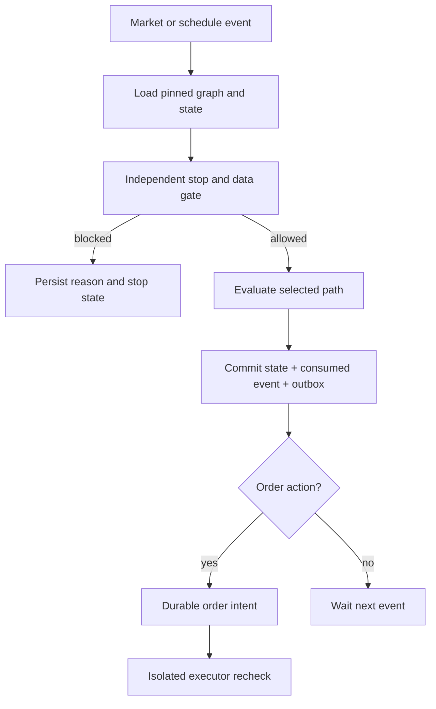

# Workflow 실행 엔진 기술 설계

> [확정 Workflow 기능](../function/trading-workflow.md), [그룹](../function/stock-groups.md), [금요일 전략](../function/friday-close-strategy.md)을 구현하기 위한 기술 명세. n8n·ComfyUI는 UI 레퍼런스이며 매매 실행 엔진으로 사용하지 않는다.

## 1. 기술 선정

Python typed dataclass/Pydantic graph DTO, 자체 event-driven 상태 머신, PostgreSQL 영속 상태·outbox·checkpoint. graph 검증에는 Python graphlib 및 필요 시 NetworkX(순환/의존성/경로 분석)를 사용한다. APScheduler는 기동 보조, exchange-calendars는 달력 계산 후보. Airflow는 배치 DAG 중심, n8n은 범용 자동화, Temporal은 내구 실행 기능이 있으나 현재 복잡한 장중 상태/그래프/리스크 제약의 도메인 의미를 대신하지 못하고 초기 운영 부담이 커 보류. 동일 거래 상태와 주문 원장 위에서 deterministic replay를 먼저 구현한다.

## 2. 실행 계약

### 평가 이벤트 및 즉시 갱신

run 단위 durable evaluation_seq를 트랜잭션에서 할당한다. 입력 이벤트는 committed observation/event ID로 dedupe하고 evaluation_at UTC 및 snapshot_version/input observation IDs를 기록한다. 동일 시점의 이미 수신 가능한 이벤트는 durable ingress/queue 순서, 안정적 event_id로 tie-break하며 DB sequence 할당 순서를 commit 순서로 가정하지 않는다. 소스 event_at과 available_at을 구분하고 available_at <= evaluation_at인 최신 유효 데이터를 사용한다. 늦거나 정정된 이벤트는 새 평가/감사에만 반영한다. 과거 주문·hit·확정된 평가를 소급 재작성하지 않는다.

관련 조건이 최초 충족되거나 새 유효 달성 사건이 발생하면 동일 실행의 활성 복합 조건 및 연결된 후속 조건에 필요한 나머지 데이터의 즉시 갱신을 요청한다. AND/OR/N-of-M, 순차·분기·재사용 조건에 동일 적용한다. 갱신은 공급자별 공식 API/WS·권한·레이트리밋·원본 게시 주기를 준수하며, 실제 새 원본을 강제 생성할 수 없다. 요청 시 최신 WS 이벤트 확인, 허용된 REST 재조회 또는 파생 지표 재계산을 우선한다. 동일 신호의 중복 요청은 single-flight로 병합하며 timeout·실패 시 UNKNOWN/품질 차단을 적용한다. 미선택 경로는 주문 부작용 없이 필요한 데이터만 확인하며 다른 조건의 달성 횟수·순차 활성화 규칙을 우회하지 않는다. 갱신된 데이터가 커밋된 뒤 새로운 단일 평가 시점의 유효 스냅샷으로 복합 조건을 재평가하고, 그 결과 및 독립 위험 게이트를 통과해야 주문 의도를 확정한다. 동일 TRUE 지속·갱신 응답 반복·재시작에 따른 무한 갱신/중복 주문은 금지한다.

RefreshCoordinator는 run_id/activation_id/reset_epoch/trigger_event_id/condition_id 기반 refresh_generation을 기록한다. 관련 series의 refresh를 병렬 요청하고 source/series별 in-flight 병합·rate limit·bounded deadline을 적용한다. 완료/실패/기한 경과 후 fresh committed snapshot을 읽고 stop/승인/품질을 재검증한 뒤 1회 재평가한다. 응답이 새 데이터를 포함하지 않으면 기존 원본 timestamp 유지, 단순 재조회로 TTL 갱신 금지. refresh 중 새로운 유효 이벤트는 다음 generation으로 합치며 현재 generation 자체의 응답으로 무한 refresh 금지. 외부 호출을 DB transaction 내부에 유지하지 않는다. BACKTEST는 네트워크 호출 없이 해당 시점의 기록된 available_at 및 refresh 결과 또는 재현 가능한 역사 이벤트만 사용한다. 정보 부족 시 UNKNOWN. 실거래와 동일 평가 상태 머신을 사용한다.

Graph version: graph_id, version, node_types/schema versions, edges, output ports, dependencies, calendar/reset policy, deployment status. 저장 전 schema/port/type/required input/Fork-Join/순환/참조 검증. dependency의 reverse index, 참조 중 삭제 금지(초안·저장본·배포본·활성 실행), version pin. 동일 조건 재사용은 parent run과 독립 invocation/activation state, 결과 포트 TRUE/FALSE/UNKNOWN만. 참조 순환·깊이 제한, 하위 호출 실패/timeout은 UNKNOWN. 조건용 하위 Workflow에서는 매매 등 side effect 차단.

Node registry: Market/Indicator/Group/Prediction/Condition/Logic/Control/Stateful/Action/Stop/Notification 등 기존 명세 전체. node evaluator는 typed inputs, EvalContext(event_at, available_at, run_id, graph_version, clock, reset_epoch), prior_state → result(new_state, raw_result, effective_result, emitted_actions) 형태로 테스트 가능한 순수 평가를 우선한다. I/O는 adapter/use case로 분리. arbitrary eval/exec 또는 외부 코드 실행 금지.

| 논리 | 정책 |
|---|---|
| AND | FALSE 우선, 모두 TRUE면 TRUE, 나머지 UNKNOWN |
| OR | TRUE 우선, 모두 FALSE면 FALSE, 나머지 UNKNOWN |
| NOT | TRUE/FALSE 반전, UNKNOWN 보존 |
| Sequential | 활성화 조건 및 prior node 상태 확인, 미선택/미평가와 FALSE 구분 |
| IF/Switch/Fork/Join | 명시적 포트·branch selection·join policy, 미선택 경로 side effect 금지 |
| LATCHED | 고유 유효 달성 사건 N회 이후 유효 기한 내 effective TRUE, 재무장·중복 방지 |
| CONTINUOUS | 현재 valid raw TRUE만 TRUE, FALSE/UNKNOWN 즉시 반영 |
| Stop | 별도 우선 감시, 신규 주문 차단, pending 처리 정책 및 알림; 자동 청산과 다름 |

raw/effective condition은 데이터 freshness/권한·위험 게이트와 구분한다. 유효 래치가 있어도 주문 시 stale/권한/위험/중단 gate를 통과해야 한다. 트리거 hit counting은 명세의 달성 사건 및 재무장 규칙 적용(동일 TRUE 샘플 반복을 N회로 세지 않음). 상승 후 하락/하락 후 상승 극값, 가격 기준 시각, cooldown, debounce, 상태 초기화는 node config+state version으로 명시한다.

## 3. 실행 및 복구

order idempotency key는 canonical(mode,account_ref,workflow_id,workflow_version,run_id,reset_epoch,activation_id,node_id,action_ordinal)의 안정적 해시로 생성하고 payload hash는 별도로 저장·비교한다. 동일 키/동일 payload는 기존 intent 반환, 다른 payload는 CONFLICT. activation_id/action_ordinal은 상태 전이와 함께 영속화하여 crash/replay 시 변경하지 않는다. 수동/AI 요청은 actor/account/mode/client request key와 payload hash를 사용한다. 신규 활성화에서만 신규 키를 발급하며 reset은 기존 키·주문 예약·체결 이력을 삭제하지 않는다.

run 단위 single-writer(짧은 transaction advisory/row lock 또는 lease + fencing, partitioned owner). 이벤트 source ordering 및 late/out-of-order policy를 명시하고 committed observation에서만 평가한다. node_state/state_version, consumed_event key, run transition, generated action idempotency key를 원자 커밋. commit 실패는 재평가 가능, 중복 intent 생성 금지. stop과 주문 제출 경쟁은 executor에서 최종 DB gate/직렬화 규칙으로 재검증하되 이미 브로커로 전송 중인 요청을 취소할 수 있다고 보장하지 않는다. crash restart는 DB checkpoint 및 pending event replay, 새 process가 예전 lease를 덮지 못하도록 fencing. UNKNOWN, 데이터 단절, 실행 버전 불일치에서 fail closed.

거래일 reset: calendar_id/version, session timezone, 1/5/20/N 세션, reset_epoch. 첫 유효 세션부터 N번째 정규장 종료 경계; scheduler가 고유 reset key 생성. reset transaction에서 횟수·래치·재무장·진행 상태를 갱신. 늦은 이전 epoch 이벤트는 현 epoch count 오염 금지. 주문·체결·미체결·Kill Switch·리스크·idempotency 보존. 중단된 run이 단순 reset으로 재활성화되지 않음. 복구 시 missed reset을 검증/재생, 세션/달력 변경 정책 기록.

## 4. 모드 및 UI

| mode | 실행 계약 |
|---|---|
| BACKTEST | virtual clock 및 historical available_at, 외부 주문 호출 금지 |
| DRY_RUN | 현재 신호·의도 검증, 주문 제출/체결 없음 |
| PAPER_LOCAL | 자체 simulator, 가상 잔고/체결, 외부 브로커 주문 없음 |
| PAPER_BROKER | 공식 NH 모의 endpoint, 독립 모의 계좌·비밀·원장 |
| LIVE | 별도 명시적 승인된 운영 Executor, 기본 비활성 |

PAPER는 표시용 집계 분류이며 API/DB mode enum으로 저장하지 않는다. 공통 평가기와 graph schema를 사용하되 상태·계좌·artifact를 모드별 분리한다. 모의 미지원은 PAPER_LOCAL에서만 검증하고 자동 fallback은 금지한다.

메인 활성 수는 활성/감시/대기 정의 ID dedupe, 하위 호출/과거 backtest 제외, 모드별 구분. 상세 SSE는 server snapshot, raw/effective, hit_count, required_hits, reset_epoch, expires_at, path, reason, version. UI 연결 상태는 매매 엔진의 실행 여부와 분리.

## 5. 수용 테스트

갱신 generation 중복 및 timeout, source별 single-flight, fresh snapshot 평가·late event·동일 seq replay, 5개 모드 격리, reset 이후 정상 신규 intent와 과거 retry 분리 검증. Coordinator/승인 모델은 [Trading](./trading-integration.md) 참조.

순차·논리·분기·중첩·재사용, 순환/삭제 race, TRUE 반복·중복·UNKNOWN·재무장·만료, 1/5/20/N 휴장 및 조기폐장/DST/재시작, stale gate, 동시 stop/intent, process kill 전후 commit·lease 만료·outbox 중복, 모드 격리. 모든 기존 P0~P2 트리거의 golden fixture 및 동일 입력 replay 결과 비교. 리스크·실주문 검증은 [Trading](./trading-integration.md).
